# Jellynas

A personal media server built on Jellyfin, shared with Friends over the internet. Follow these steps in order, running every command from the repo folder.

## Architecture

### Target

The NAS once every planned service runs (#13, #14, #15, #38, #39, #40). Dark circles are people, hexagons are services outside the NAS, rounded boxes are containers, cylinders are storage.

```mermaid
%%{init: {"theme": "base", "themeVariables": {"fontSize": "15px", "primaryTextColor": "#1f2937", "lineColor": "#78909c", "edgeLabelBackground": "#ffffff", "clusterBkg": "#ffffff", "background": "#ffffff"}}}%%
flowchart LR
    subgraph canvas[" "]
    direction LR
    Friend(("Friend"))
    Admin(("Admin"))
    GitHub{{"GitHub"}}
    ntfy{{"ntfy.sh"}}
    Trackers{{"Trackers and peers"}}
    Soulseek{{"Soulseek"}}
    MangaSources{{"Manga sources"}}

    subgraph exposure["Exposure"]
        direction LR
        DuckDNS("DuckDNS<br/>dynamic DNS")
        Caddy("Caddy<br/>HTTPS proxy")
    end

    subgraph gitops["GitOps"]
        direction TB
        Renovate("Renovate<br/>image updates")
        Deployer("deployer<br/>pulls main")
    end

    subgraph observation["Observation"]
        direction TB
        Homepage("Homepage<br/>dashboard")
        Beszel("Beszel<br/>resources")
        UptimeKuma("Uptime Kuma<br/>uptime")
        Dozzle("Dozzle<br/>logs")
        Indexarr("Indexarr<br/>file catalog")
        Backup("Backup<br/>appdata")
    end

    subgraph watch["Watch and request"]
        direction TB
        Jellyfin("Jellyfin<br/>streaming")
        Seerr("Seerr<br/>Requests")
    end

    subgraph automation["Automation stack"]
        direction LR
        Prowlarr("Prowlarr<br/>indexers")
        Recyclarr("Recyclarr<br/>quality profiles")
        FlareSolverr("FlareSolverr<br/>Cloudflare")
        Radarr("Radarr<br/>movies")
        Sonarr("Sonarr<br/>shows, anime")
        Lidarr("Lidarr<br/>music")
        LazyLibrarian("LazyLibrarian<br/>books")
        Suwayomi("Suwayomi<br/>manga")
        Bazarr("Bazarr<br/>subtitles")
        Tdarr("Tdarr<br/>MKV H265")
    end

    subgraph vpn["Gluetun VPN, kill switch"]
        direction TB
        qBittorrent("qBittorrent<br/>torrents")
        slskd("slskd<br/>Soulseek")
    end

    subgraph ratio["Ratio"]
        direction TB
        autobrr("autobrr<br/>freeleech")
        crossseed("cross-seed")
        qbitmanage("qbit_manage")
        ratiolimit("ratio-limit")
        ratiograb("ratio-grab")
    end

    subgraph data["Data"]
        direction TB
        Torrents[("Torrents")]
        Library[("Library")]
        Backups[("Backups")]
    end
    end

    Friend -->|HTTPS| exposure
    exposure --> watch
    watch -->|Requests| automation
    automation -->|grab| vpn
    ratio -->|"grab, clean, cross-seed"| vpn
    automation -->|search| Trackers
    vpn -->|"tunnel only"| Trackers
    vpn -->|download| data
    automation -->|"import, subtitles, MKV H265"| data
    watch -->|"read-only"| data
    Admin -->|LAN| automation
    Admin --> GitHub
    gitops -->|"update PRs, pulls main"| GitHub
    DuckDNS -.-|"public IP, DNS challenge"| Caddy
    Prowlarr --- FlareSolverr
    Prowlarr -->|indexers| Radarr
    Prowlarr -->|indexers| Sonarr
    Recyclarr -->|profiles| Radarr
    Recyclarr -->|profiles| Sonarr
    Radarr -->|"new files"| Bazarr
    Sonarr -->|"new files"| Bazarr
    Bazarr -->|requeue| Tdarr
    Prowlarr -->|indexers| Lidarr
    Prowlarr -->|indexers| LazyLibrarian
    MangaSources -->|"manga chapters"| automation
    vpn -->|"tunnel only"| Soulseek
    Admin -->|LAN| observation
    observation -.->|"tiles, logs, checks"| automation
    observation -.->|"tiles, logs, checks"| vpn
    observation -.->|"tiles, logs, checks"| ratio
    observation -->|"read-only, nightly backup"| data
    observation -->|alerts| ntfy
    ntfy -.->|push| Admin
    Homepage ~~~ Beszel ~~~ UptimeKuma
    Dozzle ~~~ Indexarr ~~~ Backup
    autobrr ~~~ crossseed ~~~ qbitmanage
    ratiolimit ~~~ ratiograb
    Prowlarr ~~~ Suwayomi

    style canvas fill:#ffffff,stroke:#e5e7eb,stroke-width:1px
    linkStyle default stroke:#78909c,color:#374151
    classDef person fill:#37474f,stroke:#263238,color:#ffffff,stroke-width:2px
    classDef external fill:#ffffff,stroke:#607d8b,color:#1f2937,stroke-width:1.5px
    classDef planned fill:#ffffff,stroke:#9e9e9e,stroke-dasharray:4 4,color:#9e9e9e
    class Friend,Admin person
    class GitHub,ntfy,Trackers,Soulseek,MangaSources external
    classDef exposureNode fill:#ffffff,stroke:#1e88e5,color:#1f2937,stroke-width:1.5px
    class DuckDNS,Caddy exposureNode
    style exposure fill:#e3f2fd,stroke:#1e88e5,stroke-width:2px,color:#1f2937
    classDef gitopsNode fill:#ffffff,stroke:#7e57c2,color:#1f2937,stroke-width:1.5px
    class Renovate,Deployer gitopsNode
    style gitops fill:#ede7f6,stroke:#7e57c2,stroke-width:2px,color:#1f2937
    classDef observationNode fill:#ffffff,stroke:#00acc1,color:#1f2937,stroke-width:1.5px
    class Homepage,Beszel,UptimeKuma,Dozzle,Indexarr,Backup observationNode
    style observation fill:#e0f7fa,stroke:#00acc1,stroke-width:2px,color:#1f2937
    classDef watchNode fill:#ffffff,stroke:#ab47bc,color:#1f2937,stroke-width:1.5px
    class Jellyfin,Seerr watchNode
    style watch fill:#f3e5f5,stroke:#ab47bc,stroke-width:2px,color:#1f2937
    classDef automationNode fill:#ffffff,stroke:#43a047,color:#1f2937,stroke-width:1.5px
    class Prowlarr,Recyclarr,FlareSolverr,Radarr,Sonarr,Lidarr,LazyLibrarian,Suwayomi,Bazarr,Tdarr automationNode
    style automation fill:#e8f5e9,stroke:#43a047,stroke-width:2px,color:#1f2937
    classDef vpnNode fill:#ffffff,stroke:#fb8c00,color:#1f2937,stroke-width:1.5px
    class qBittorrent,slskd vpnNode
    style vpn fill:#fff3e0,stroke:#fb8c00,stroke-width:2px,color:#1f2937
    classDef ratioNode fill:#ffffff,stroke:#ec407a,color:#1f2937,stroke-width:1.5px
    class autobrr,crossseed,qbitmanage,ratiolimit,ratiograb ratioNode
    style ratio fill:#fce4ec,stroke:#ec407a,stroke-width:2px,color:#1f2937
    classDef dataNode fill:#ffffff,stroke:#78909c,color:#1f2937,stroke-width:1.5px
    class Torrents,Library,Backups dataNode
    style data fill:#eceff1,stroke:#78909c,stroke-width:2px,color:#1f2937
```



### Current (main)

Same layout. Dashed grey boxes and links are planned and not running yet.

```mermaid
%%{init: {"theme": "base", "themeVariables": {"fontSize": "15px", "primaryTextColor": "#1f2937", "lineColor": "#78909c", "edgeLabelBackground": "#ffffff", "clusterBkg": "#ffffff", "background": "#ffffff"}}}%%
flowchart LR
    subgraph canvas[" "]
    direction LR
    Friend(("Friend"))
    Admin(("Admin"))
    GitHub{{"GitHub"}}
    ntfy{{"ntfy.sh"}}
    Trackers{{"Trackers and peers"}}
    Soulseek{{"Soulseek"}}
    MangaSources{{"Manga sources"}}

    subgraph exposure["Exposure"]
        direction LR
        DuckDNS("DuckDNS<br/>dynamic DNS")
        Caddy("Caddy<br/>HTTPS proxy")
    end

    subgraph gitops["GitOps"]
        direction TB
        Renovate("Renovate<br/>image updates")
        Deployer("deployer<br/>pulls main")
    end

    subgraph observation["Observation"]
        direction TB
        Homepage("Homepage<br/>dashboard")
        Beszel("Beszel<br/>resources")
        UptimeKuma("Uptime Kuma<br/>uptime")
        Dozzle("Dozzle<br/>logs")
        Indexarr("Indexarr<br/>file catalog")
        Backup("Backup<br/>appdata")
    end

    subgraph watch["Watch and request"]
        direction TB
        Jellyfin("Jellyfin<br/>streaming")
        Seerr("Seerr<br/>Requests")
    end

    subgraph automation["Automation stack"]
        direction LR
        Prowlarr("Prowlarr<br/>indexers")
        Recyclarr("Recyclarr<br/>quality profiles")
        FlareSolverr("FlareSolverr<br/>Cloudflare")
        Radarr("Radarr<br/>movies")
        Sonarr("Sonarr<br/>shows, anime")
        Lidarr("Lidarr<br/>music")
        LazyLibrarian("LazyLibrarian<br/>books")
        Suwayomi("Suwayomi<br/>manga")
        Bazarr("Bazarr<br/>subtitles")
        Tdarr("Tdarr<br/>MKV H265")
    end

    subgraph vpn["Gluetun VPN, kill switch"]
        direction TB
        qBittorrent("qBittorrent<br/>torrents")
        slskd("slskd<br/>Soulseek")
    end

    subgraph ratio["Ratio"]
        direction TB
        autobrr("autobrr<br/>freeleech")
        crossseed("cross-seed")
        qbitmanage("qbit_manage")
        ratiolimit("ratio-limit")
        ratiograb("ratio-grab")
    end

    subgraph data["Data"]
        direction TB
        Torrents[("Torrents")]
        Library[("Library")]
        Backups[("Backups")]
    end
    end

    Friend -->|HTTPS| exposure
    exposure --> watch
    watch -->|Requests| automation
    automation -->|grab| vpn
    ratio -->|"grab, clean, cross-seed"| vpn
    automation -->|search| Trackers
    vpn -->|"tunnel only"| Trackers
    vpn -->|download| data
    automation -->|"import, subtitles, MKV H265"| data
    watch -->|"read-only"| data
    Admin -->|LAN| automation
    Admin --> GitHub
    gitops -->|"update PRs, pulls main"| GitHub
    DuckDNS -.-|"public IP, DNS challenge"| Caddy
    Prowlarr --- FlareSolverr
    Prowlarr -->|indexers| Radarr
    Prowlarr -->|indexers| Sonarr
    Recyclarr -->|profiles| Radarr
    Recyclarr -->|profiles| Sonarr
    Radarr -->|"new files"| Bazarr
    Sonarr -->|"new files"| Bazarr
    Bazarr -->|requeue| Tdarr
    Prowlarr -->|indexers| Lidarr
    Prowlarr -->|indexers| LazyLibrarian
    MangaSources -->|"manga chapters"| automation
    vpn -->|"tunnel only"| Soulseek
    Admin -->|LAN| observation
    observation -.->|"tiles, logs, checks"| automation
    observation -.->|"tiles, logs, checks"| vpn
    observation -.->|"tiles, logs, checks"| ratio
    observation -->|"read-only, nightly backup"| data
    observation -->|alerts| ntfy
    ntfy -.->|push| Admin
    Homepage ~~~ Beszel ~~~ UptimeKuma
    Dozzle ~~~ Indexarr ~~~ Backup
    autobrr ~~~ crossseed ~~~ qbitmanage
    ratiolimit ~~~ ratiograb
    Prowlarr ~~~ Suwayomi

    style canvas fill:#ffffff,stroke:#e5e7eb,stroke-width:1px
    linkStyle default stroke:#78909c,color:#374151
    classDef person fill:#37474f,stroke:#263238,color:#ffffff,stroke-width:2px
    classDef external fill:#ffffff,stroke:#607d8b,color:#1f2937,stroke-width:1.5px
    classDef planned fill:#ffffff,stroke:#9e9e9e,stroke-dasharray:4 4,color:#9e9e9e
    class Friend,Admin person
    class GitHub,Trackers external
    classDef exposureNode fill:#ffffff,stroke:#1e88e5,color:#1f2937,stroke-width:1.5px
    class DuckDNS,Caddy exposureNode
    style exposure fill:#e3f2fd,stroke:#1e88e5,stroke-width:2px,color:#1f2937
    classDef gitopsNode fill:#ffffff,stroke:#7e57c2,color:#1f2937,stroke-width:1.5px
    class Renovate,Deployer gitopsNode
    style gitops fill:#ede7f6,stroke:#7e57c2,stroke-width:2px,color:#1f2937
    classDef observationNode fill:#ffffff,stroke:#00acc1,color:#1f2937,stroke-width:1.5px
    style observation fill:#fafafa,stroke:#9e9e9e,stroke-dasharray:4 4,color:#9e9e9e
    classDef watchNode fill:#ffffff,stroke:#ab47bc,color:#1f2937,stroke-width:1.5px
    class Jellyfin,Seerr watchNode
    style watch fill:#f3e5f5,stroke:#ab47bc,stroke-width:2px,color:#1f2937
    classDef automationNode fill:#ffffff,stroke:#43a047,color:#1f2937,stroke-width:1.5px
    class Prowlarr,Recyclarr,FlareSolverr,Radarr,Sonarr,Bazarr,Tdarr automationNode
    style automation fill:#e8f5e9,stroke:#43a047,stroke-width:2px,color:#1f2937
    classDef vpnNode fill:#ffffff,stroke:#fb8c00,color:#1f2937,stroke-width:1.5px
    class qBittorrent vpnNode
    style vpn fill:#fff3e0,stroke:#fb8c00,stroke-width:2px,color:#1f2937
    classDef ratioNode fill:#ffffff,stroke:#ec407a,color:#1f2937,stroke-width:1.5px
    class autobrr,crossseed,qbitmanage,ratiolimit,ratiograb ratioNode
    style ratio fill:#fce4ec,stroke:#ec407a,stroke-width:2px,color:#1f2937
    classDef dataNode fill:#ffffff,stroke:#78909c,color:#1f2937,stroke-width:1.5px
    class Torrents,Library dataNode
    style data fill:#eceff1,stroke:#78909c,stroke-width:2px,color:#1f2937
    class Backup,Backups,Beszel,Dozzle,Homepage,Indexarr,LazyLibrarian,Lidarr,MangaSources,Soulseek,Suwayomi,UptimeKuma,ntfy,slskd planned
    linkStyle 22,23,24,25,26,27,28,29,30,31,32 stroke:#9e9e9e,stroke-width:1px,stroke-dasharray:4 4,color:#9e9e9e
```



## Prerequisites

- Docker: Docker Desktop on Windows, Docker Engine with the Compose plugin on Linux.
- Git, with Git Bash on Windows to run the verification script.

## Fill in the settings

```sh
cp .env.example .env
```

Open `.env` and fill in every value. Each variable is explained in `.env.example`. Wrap a value in double quotes if it contains a space. `.env` is ignored by git and must never be committed.

## Create the data and appdata roots

Both roots live outside the repo, at the paths set in `DATA_ROOT` and `APPDATA_ROOT`. The data root holds a single tree, so that one folder holds every download and the whole Library:

```text
<DATA_ROOT>
├── torrents
└── media
    ├── movies
    ├── shows
    ├── anime
    ├── music
    ├── books
    └── manga
```

Create it from the repo folder, in bash (Git Bash on Windows):

```bash
set -a && . <(tr -d '\r' < .env) && set +a
mkdir -p "$DATA_ROOT"/torrents "$DATA_ROOT"/media/{movies,shows,anime,music,books,manga} "$APPDATA_ROOT"/seerr "$APPDATA_ROOT"/recyclarr
```

On Linux, make sure the user matching `PUID` and `PGID` owns both roots.

## Start the NAS

```sh
docker compose up -d
```

Each service is one line in the root `compose.yaml`. Comment a line to disable that service, then run the command again.

## Jellyfin

### First-run wizard

1. Open `http://<NAS address>:<JELLYFIN_PORT>` from a browser on the local network.
2. Pick the display language and create the Admin Account with a strong password stored in your password manager.
3. Skip the library step, it is done below.
4. Keep the metadata language and country you prefer.
5. Leave "Allow remote connections to this server" checked, Friends will reach Jellyfin from the internet later.

### Libraries

The media tree is mounted read-only under `/data/media`, so Jellyfin can never delete or change a file. In Dashboard > Libraries, add one library per folder:

| Library | Content type | Folder |
| --- | --- | --- |
| Movies | Movies | `/data/media/movies` |
| Shows | Shows | `/data/media/shows` |
| Anime | Shows | `/data/media/anime` |
| Music | Music | `/data/media/music` |
| Books | Books | `/data/media/books` |
| Manga | Books | `/data/media/manga` |

For each library, leave "Save artwork into media folders" and every "Metadata savers" option unchecked: Jellyfin cannot write into the Library and keeps its metadata in its appdata folder instead.

### Friend Accounts

Each Friend gets their own Account, so their watch history and progress are theirs. In Dashboard > Users, click "+" and:

1. Enter the Friend's name and a password, then give both to the Friend privately.
2. Grant access to all libraries.
3. Leave "Allow this user to manage the server" unchecked.
4. Check "Allow media downloading" so the Friend can download videos, books and manga to their phone.

## Public access

Friends reach Jellyfin from the internet over HTTPS. DuckDNS gives the NAS a free address that follows your home IP, and Caddy is the only service the router lets in. Caddy obtains the certificate on its own and refuses any hostname other than the ones set in `.env`, so the forwarded port can never lead to an admin tool. Caddy proves to Let's Encrypt that it owns the address through DuckDNS with your token, so the certificate needs no open port.

### DuckDNS

1. Sign in on [duckdns.org](https://www.duckdns.org) and add a subdomain. It must point to your home public IP, which DuckDNS fills in for you.
2. Copy the token shown at the top of the page.
3. In `.env`, set `DUCKDNS_SUBDOMAIN` to the subdomain without `.duckdns.org`, `DUCKDNS_TOKEN` to the token, and `JELLYFIN_HOSTNAME` to a name under your subdomain. `jellyfin.${DUCKDNS_SUBDOMAIN}.duckdns.org` reuses the subdomain set just above. DuckDNS resolves every name under your subdomain to the same IP.

The duckdns service then updates the address every five minutes. Your DuckDNS address and token stay in `.env` only.

### Router port forwards

Pick the HTTPS port Friends will use and set it in `CADDY_HTTPS_PORT`, or leave it empty for 443. A high port that no service uses by default, such as a random five-digit number, draws fewer automated scans. Stay below 49152: Windows reserves blocks of ports above it for Hyper-V and Docker, and `netsh interface ipv4 show excludedportrange protocol=tcp` lists them. Friends then add it to the address, for example `https://jellyfin.<subdomain>.duckdns.org:<port>`, which the Jellyfin apps accept.

On your router, forward that single TCP port to the local IP of the NAS, and nothing else. Set both the external and the internal port of the rule to `CADDY_HTTPS_PORT`, never the internal port to 443: Caddy listens on `CADDY_HTTPS_PORT` on the NAS. Every other port, including the Jellyfin port and the admin tools, stays reachable on the local network only. Give the NAS a fixed local IP in the router so the forward keeps working.

### Start Caddy and DuckDNS

```sh
docker compose up -d
```

The first start builds Caddy with its DuckDNS module, which takes a minute or two. After pulling a change to `caddy/Dockerfile`, add `--build` to rebuild it. Caddy then requests the certificate within a few minutes. Follow it with:

```sh
docker compose logs -f caddy
```

The line `certificate obtained successfully` means it worked.

### Jellyfin behind Caddy

In Dashboard > Networking, add `caddy` to "Known proxies" and save. Jellyfin then sees the real address of each Friend instead of the address of Caddy. Jellyfin looks up the address of Caddy when it starts, so restart it now and whenever Caddy is recreated:

```sh
docker compose restart jellyfin
```

## Seerr

Friends make Requests in Seerr, on its own public hostname, and log in with their Jellyfin Account. Seerr has no access to the Library files.

### Hostname

In `.env`, set `SEERR_HOSTNAME` to another name under your subdomain, for example `seerr.${DUCKDNS_SUBDOMAIN}.duckdns.org`. It uses the same HTTPS port, so the router needs no new rule. Recreate Caddy so it picks up the new name and obtains its certificate:

```sh
docker compose up -d
```

### Setup wizard

1. Open `http://<NAS address>:<SEERR_PORT>` from a browser on the local network.
2. Choose Jellyfin as the media server.
3. Enter `jellyfin` as the hostname, `8096` as the port, leave SSL off and the URL base empty.
4. Enter an email address and the username and password of the Jellyfin Admin Account. This Account becomes the Seerr Admin.
5. Sync the libraries and enable Movies, Shows and Anime.
6. Skip the Radarr and Sonarr step, they are added later.

### Settings

1. In Settings > General, set "Application URL" to `https://<SEERR_HOSTNAME>:<CADDY_HTTPS_PORT>`, without the port if it is 443.
2. In Settings > Network, check "Enable Proxy Support" so Seerr sees the real address of each Friend.
3. In Settings > Jellyfin, set "External URL" to `https://<JELLYFIN_HOSTNAME>:<CADDY_HTTPS_PORT>` so links to a movie open the public Jellyfin.
4. In Settings > Users, check "Enable Jellyfin Sign-In" and "Enable New Jellyfin Sign-In", uncheck "Enable Local Sign-In", and leave the default permissions on "Request".

A Friend then opens the Seerr address, picks "Sign in with Jellyfin" and enters their Jellyfin Account, with no second login to create.

## qBittorrent

qBittorrent downloads torrents into the torrents tree, the only folder it sees, mounted under `/data/torrents`. It shares the network of Gluetun, whose firewall only lets traffic out through the VPN. When the VPN is down or not configured yet, qBittorrent has no connectivity at all, so your real IP never leaks.

### VPN

Until you choose a provider, leave every VPN value of `.env` empty. Gluetun then starts with a tunnel that leads nowhere and shows as unhealthy, which is expected.

Once you have a provider:

1. Find your provider on the [Gluetun providers page](https://github.com/qdm12/gluetun-wiki/tree/main/setup/providers) and note the values it asks for.
2. In `.env`, set `VPN_SERVICE_PROVIDER` to the provider name and `VPN_TYPE` to `wireguard` or `openvpn`.
3. For WireGuard, download a WireGuard config file from the provider and copy its `PrivateKey` into `WIREGUARD_PRIVATE_KEY` and its `Address` into `WIREGUARD_ADDRESSES`. For OpenVPN, set `OPENVPN_USER` and `OPENVPN_PASSWORD` to the manual setup credentials of the provider.
4. Optionally set `SERVER_COUNTRIES` to the countries you want to exit from.
5. Recreate Gluetun and qBittorrent:

   ```sh
   docker compose up -d
   ```

The line `Public IP address is` in `docker compose logs gluetun` shows the VPN address, never your home address. Gluetun then turns healthy.

### AirVPN

1. Sign in on the [AirVPN Client Area](https://airvpn.org/client/) and open the [Config Generator](https://airvpn.org/generator/).
2. Pick Linux as the system, WireGuard as the protocol, and the country you want to exit from, then generate and download the config file.
3. In `.env`, set `VPN_SERVICE_PROVIDER` to `airvpn`, `VPN_TYPE` to `wireguard`, and either `SERVER_COUNTRIES` to a country such as `Netherlands` or `SERVER_REGIONS` to `Europe` to let Gluetun pick among every European server. The keys work with any server.
4. From the config file, copy `PrivateKey` into `WIREGUARD_PRIVATE_KEY`, `PresharedKey` into `WIREGUARD_PRESHARED_KEY`, and only the IPv4 part of `Address` into `WIREGUARD_ADDRESSES`, for example `10.128.0.2/32`. Then delete the file, it holds your keys.
5. On the [ports page](https://airvpn.org/ports/), reserve a port, leave its local port empty, and set `VPN_FORWARDED_PORT` to it.
6. Recreate Gluetun and qBittorrent with `docker compose up -d`.

In qBittorrent, Tools > Options > Connection, set "Port used for incoming connections" to `VPN_FORWARDED_PORT` and uncheck "Use UPnP / NAT-PMP port forwarding from my router". Back on the ports page, the test button of the port then shows it as open while a torrent runs.

### Account

1. Read the temporary password qBittorrent printed at its first start:

   ```sh
   docker compose logs qbittorrent
   ```

2. Open `http://<NAS address>:<QBITTORRENT_PORT>` from a browser on the local network and sign in with `admin` and that password.
3. In Tools > Options > WebUI > Authentication, set a new username and a strong password stored in your password manager. Leave both "Bypass authentication" options unchecked.

### Save paths

In Tools > Options > Downloads, set "Default Save Path" to `/data/torrents`, uncheck "Keep incomplete torrents in", and save. Any other path would land inside the container and be lost.

### Downloads and seeding

Each finished torrent keeps seeding from the torrents tree for a while, to give back to other peers. qBittorrent stops it once it reaches its seeding goal, then the tool that sent it removes it. In Tools > Options, set:

| Screen | Setting | Value |
| --- | --- | --- |
| Downloads | Default Torrent Management Mode | Automatic, so each category picks its own save path |
| Downloads | Append .!qB extension to incomplete files | Checked, so no tool imports a file that is still downloading |
| BitTorrent | Privacy | DHT and PeX checked, Local Peer Discovery unchecked since the container has no local peers |
| Connection | Connections Limits | 1000 connections in all and 200 per torrent, upload slots unchecked in all and per torrent, so no swarm waits for a free slot |
| BitTorrent | Torrent Queueing | 3 active downloads, 30 active uploads, 35 active torrents, "Do not count slow torrents in these limits" checked so a dead torrent never holds a place |
| BitTorrent | Seeding Limits | Ratio 2 and total seeding time 20160 minutes (14 days), whichever comes first, then "Stop torrent" |
| Advanced | Network interface | `tun0`, so qBittorrent only ever uses the VPN, on top of the Gluetun kill switch |
| Advanced | Upload slots behavior | Upload rate based, so qBittorrent opens slots while upload bandwidth is left |
| Advanced | Upload choking algorithm | Fastest upload, so the peers that take the most are served first |
| Advanced | Outgoing connections per second | `100`, so a fresh torrent reaches its leechers within seconds |
| Advanced | Send buffer watermark, low watermark, factor | `5120` KiB, `1024` KiB, `150` %, so upload stays steady at high speed |
| Advanced | Socket backlog size | `100` |

Optionally, in Speed, set a global upload limit to about 60% of your internet upload speed, so seeding never slows Jellyfin streams to Friends.

## Radarr

Radarr fulfils movie Requests: it searches the indexers, sends the torrent to qBittorrent, then copies the finished movie into the Library. It sees only the movies folder, under `/data/media/movies`, and the torrents tree, under `/data/torrents`.

### Account

1. Open `http://<NAS address>:<RADARR_PORT>` from a browser on the local network.
2. Radarr asks for an authentication method at the first visit. Pick "Forms (Login Page)", set "Authentication Required" to "Enabled", never "Disabled for Local Addresses", and enter a username and a strong password, distinct from the other tools, stored in your password manager.

### Media management

In Settings > Media Management, click "Show Advanced" at the top, then:

1. Under Root Folders, add `/data/media/movies`.
2. Check "Rename Movies".
3. Under Importing, uncheck "Use Hardlinks instead of Copy". Each import is a copy, so the torrent keeps seeding from the torrents tree while Tdarr normalises the Library file.
4. Under File Management, set "Recycling Bin" to `/data/media/movies/.recycle` and "Recycling Bin Cleanup" to `30` days. A deleted movie stays there for 30 days and can be moved back. Jellyfin and Radarr skip hidden folders, so it never shows up as a movie.

Create the recycle bin folder first, from the repo folder in bash:

```bash
set -a && . <(tr -d '\r' < .env) && set +a
mkdir -p "$DATA_ROOT"/media/movies/.recycle
```

### Download client

1. In qBittorrent, right-click "Categories" in the left panel, pick "Add category", and enter `radarr` as the category and `/data/torrents/movies` as the save path.
2. In Radarr, Settings > Download Clients, click "+" and pick qBittorrent.
3. Enter `gluetun` as the host, since qBittorrent shares its network, `8080` as the port, and the qBittorrent Account.
4. Set "Category" to `radarr`.
5. Check "Remove Completed": once qBittorrent stops a torrent at its seeding goal, Radarr removes it and its files from the torrents tree, and the movie stays in the Library.
6. Click "Test", then "Save".

Copy the API key from Settings > General > Security, Prowlarr and Seerr need it below.

## Prowlarr

Prowlarr holds the indexers once and pushes them to Radarr, and later to the other tools. FlareSolverr opens indexers protected by Cloudflare for it. Neither sees any media file.

### Account

Open `http://<NAS address>:<PROWLARR_PORT>` and set the authentication the same way as Radarr, with its own username and password.

### FlareSolverr

In Settings > Indexers, click "+" and pick FlareSolverr. Enter `flaresolverr` as the tag and `http://flaresolverr:8191/` as the host, then save. FlareSolverr has no web UI and is reachable by the other containers only.

### Indexers

In Indexers, click "Add Indexer", pick a tracker and fill in what it asks for, an Account for a private one. For an indexer behind Cloudflare, add the `flaresolverr` tag so its requests go through FlareSolverr. Click "Test", then "Save".

### Radarr sync

1. In Prowlarr, not Radarr, open Settings > Apps, click "+" and pick Radarr.
2. Leave "Sync Level" on "Full Sync".
3. Set "Prowlarr Server" to `http://prowlarr:9696` and "Radarr Server" to `http://radarr:7878`.
4. Paste the Radarr API key, click "Test", then "Save".

Every indexer then shows up in Radarr, Settings > Indexers, and follows any change made in Prowlarr.

### Seeding goals of private trackers

A private tracker bans an Account that removes a torrent before its minimum seeding time or ratio, a hit and run. For each private indexer, in Indexers, edit it, click "Show Advanced", and set "Seed Ratio" and "Seed Time" in minutes to the minimums of its rules page. Prowlarr syncs them to Radarr and Sonarr, which hand them to qBittorrent with each torrent, so "Remove Completed" never removes a private torrent before the tracker allows it. An indexer left empty uses the global seeding limits of qBittorrent.

## Movie Requests

In Seerr, Settings > Services, click "Add Radarr Server":

1. Check "Default Server" and enter `Radarr` as the name.
2. Enter `radarr` as the hostname, `7878` as the port, leave SSL off, and paste the Radarr API key.
3. Click "Test", then pick a quality profile, `/data/media/movies` as the root folder, and "Released" as the minimum availability.
4. Leave "Enable Automatic Search" checked and save.

An approved movie Request is then searched by Radarr, downloaded by qBittorrent into `/data/torrents/movies`, and copied into the movies folder, where Jellyfin picks it up.

## Sonarr

Sonarr fulfils show Requests and fetches new episodes on its own: it searches the indexers, sends the torrent to qBittorrent, then copies each finished episode into the Library. It sees only the shows and anime folders, under `/data/media/shows` and `/data/media/anime`, and the torrents tree, under `/data/torrents`.

### Account

Open `http://<NAS address>:<SONARR_PORT>` and set the authentication the same way as Radarr, with its own username and password.

### Media management

In Settings > Media Management, click "Show Advanced" at the top, then:

1. Under Root Folders, add `/data/media/shows` and `/data/media/anime`.
2. Check "Rename Episodes".
3. Under Importing, uncheck "Use Hardlinks instead of Copy". Each import is a copy, so the torrent keeps seeding from the torrents tree while Tdarr normalises the Library file.
4. Under File Management, set "Recycling Bin" to `/data/media/shows/.recycle` and "Recycling Bin Cleanup" to `30` days. Deleted episodes of both shows and anime stay there for 30 days and can be moved back.

Create the recycle bin folder first, from the repo folder in bash:

```bash
set -a && . <(tr -d '\r' < .env) && set +a
mkdir -p "$DATA_ROOT"/media/shows/.recycle
```

### Download client

1. In qBittorrent, add a category `tv-sonarr` with `/data/torrents/shows` as the save path.
2. In Sonarr, Settings > Download Clients, click "+" and pick qBittorrent.
3. Enter `gluetun` as the host, `8080` as the port, and the qBittorrent Account.
4. Set "Category" to `tv-sonarr`.
5. Check "Remove Completed": once qBittorrent stops a torrent at its seeding goal, Sonarr removes it and its files from the torrents tree, and the episodes stay in the Library.
6. Click "Test", then "Save".

Copy the API key from Settings > General > Security, Prowlarr and Seerr need it below.

### Sonarr sync

In Prowlarr, Settings > Apps, click "+" and pick Sonarr. Set "Prowlarr Server" to `http://prowlarr:9696` and "Sonarr Server" to `http://sonarr:8989`, paste the Sonarr API key, click "Test", then "Save". Every indexer with TV categories then shows up in Sonarr, Settings > Indexers. An indexer without TV categories, such as Internet Archive, is never synced to Sonarr.

## Show Requests

In Seerr, Settings > Services, click "Add Sonarr Server":

1. Check "Default Server" and enter `Sonarr` as the name.
2. Enter `sonarr` as the hostname, `8989` as the port, leave SSL off, and paste the Sonarr API key.
3. Click "Test". The quality profiles only load once the test succeeds. Pick one and `/data/media/shows` as the root folder.
4. Set "Anime Series Type" to "Anime", pick the same quality profile for anime and `/data/media/anime` as the anime root folder.
5. Check "Season Folders" to match Sonarr, leave "Enable Automatic Search" checked, and save.

An approved show Request is then searched by Sonarr, downloaded by qBittorrent into `/data/torrents/shows`, and copied into the shows folder, or the anime folder for an anime, where Jellyfin picks it up. New episodes of a monitored show follow on their own.

## Recyclarr

Recyclarr creates the quality profiles of Radarr and Sonarr, so that most downloads already match the Library format and Tdarr rarely has to re-encode. It sees no media file and only talks to the Radarr and Sonarr APIs. Its config is `recyclarr/recyclarr.yml`, with a few custom formats of our own in `recyclarr/custom-formats`, and it syncs again every day at midnight.

Each tool gets two profiles, built from the French profiles of the [TRaSH Guides](https://trash-guides.info/Radarr/radarr-setup-quality-profiles-french-en/):

- **MULTi 1080p**, for movies and shows: French and original audio required, H265 preferred, 1080p first.
- **Anime 1080p**, for anime: a `MULTi` with French subtitles first, then a VOSTFR, then any other `MULTi`.

[ADR 0002](docs/adr/0002-recyclarr-prefers-french-h265-1080p.md) lists every rule and why. Change a rule in the config, never in Radarr or Sonarr, since each sync overwrites the profiles.

### API keys

In `.env`, set `RADARR_API_KEY` and `SONARR_API_KEY` to the keys copied from Settings > General > Security in each tool, then start Recyclarr:

```sh
docker compose up -d
```

Sync right away instead of waiting for midnight:

```sh
docker compose exec recyclarr recyclarr sync
```

Each tool ends with a `Completed` line and no error. Lines about `conflicting scores` are expected: they show the config overriding a TRaSH score. Run the same command after changing anything under `recyclarr/`.

### Assign the profiles

Recyclarr creates the profiles but never assigns them.

1. In Sonarr, Series, click "Select Series", select every show, pick `MULTi 1080p` under "Quality Profile" at the bottom, and save. Then select every anime, those with the "Anime" series type, and pick `Anime 1080p`.
2. In Radarr, Movies, select every movie and pick `MULTi 1080p`. Then select each Japanese animated movie and pick `Anime 1080p`. Radarr cannot tell an anime movie apart, so do this after each anime movie Request too.
3. In Settings > Profiles of each tool, delete the profiles that came with it, so a new movie or show can only get a Recyclarr one.
4. In Seerr, Settings > Services, edit Radarr and pick `MULTi 1080p` as the quality profile. Edit Sonarr, pick `MULTi 1080p` as the quality profile and `Anime 1080p` as the anime quality profile.

### Check a release

Interactive Search, in a movie or an episode, shows the score of each release and why any is refused. To score a release name without searching, use the parse endpoint of Radarr. The name must match a movie already in Radarr, here Your Name, otherwise no profile applies and the score stays at 0:

```bash
set -a && . <(tr -d '\r' < .env) && set +a
curl -s -G -H "X-Api-Key: $RADARR_API_KEY" --data-urlencode "title=Your.Name.2016.MULTi.1080p.WEB.x265-GROUP" "http://localhost:${RADARR_PORT:-7878}/api/v3/parse"
```

The answer holds `customFormats` and `customFormatScore`. A score below -5000 means refused. Sonarr answers the same on its own port with the name of an episode of a show it has.

## Bazarr

Bazarr gives every movie and show French and English subtitles. It learns about each file from Radarr and Sonarr, then saves the subtitles next to it in the Library, where Tdarr embeds them into the video and deletes the subtitle files. It sees only the movies, shows and anime folders, under the same paths as Radarr and Sonarr, so no path mapping is needed.

### Account

1. Open `http://<NAS address>:<BAZARR_PORT>` from a browser on the local network.
2. In Settings > General > Security, set "Authentication" to "Form", enter a username and a strong password, distinct from the other tools, stored in your password manager, and save.

### Languages

Subtitles are for watching in the original audio. Movies and shows get French and English subtitles, anime get French and Japanese ones, and a French original work gets none. [ADR 0003](docs/adr/0003-bazarr-subtitle-languages.md) records why.

Sonarr and Radarr tag each work so that Bazarr knows which case applies. In Settings > Tags of Sonarr, click "+" under Auto Tagging twice, check "Remove Tags Automatically" each time, and create:

| Name | Tag | Condition |
| --- | --- | --- |
| Anime | `anime` | Series Type is Anime |
| French original | `french-original` | Original Language is French |

Do the same in Radarr, with the condition "Quality Profile is `Anime 1080p`" for the Anime rule, since Radarr cannot tell an anime movie apart. Each work gets its tags at its next refresh, or right away with "Update All" in Series and in Movies.

Then in Bazarr, Settings > Languages:

1. Add French, English and Japanese to "Languages Filter".
2. Under "Languages Profile", click "Add New Profile", name it `French and English`, add French and English, and save the profile.
3. Add a second profile named `French and Japanese` with French and Japanese, and enter `anime` as its tag.
4. Check "Series" and "Movies" under "Tag-Based Automatic Language Profile Selection", and enter `french-original` under "Remove Profile Tags".
5. Under "Default Language Profiles For Newly Added Shows", check "Series" and "Movies" and pick `French and English` for both, then save.

A subtitle track already inside the file counts as found, so a `MULTi` release with French subtitles needs no download.

### Providers

In Settings > Providers, click "+" for each provider, fill in what it asks for, and save:

| Provider | Account | Covers |
| --- | --- | --- |
| OpenSubtitles.com | Free Account on [opensubtitles.com](https://www.opensubtitles.com), with a daily download limit | Movies and shows, the widest French catalogue |
| Podnapisi | None | Movies and shows |
| Gestdown | None | Shows, from the Addic7ed catalogue |
| Jimaku.cc | Free Account on [jimaku.cc](https://jimaku.cc), then an API key from its account page | Anime, the Japanese subtitles |

Jimaku.cc needs the AniDB integration first: register an API client on [anidb.net](https://anidb.net/software/add), with the HTTP API, not UDP, then in Settings > Providers, Metadata tab, click "+" under "Metadata Providers" and add AniDB with that client name and version.

### Sonarr and Radarr

1. In Settings > Sonarr, check "Enabled", enter `sonarr` as the address and `8989` as the port, paste the Sonarr API key, click "Test", then "Save".
2. In Settings > Radarr, check "Enabled", enter `radarr` as the address and `7878` as the port, paste the Radarr API key, click "Test", then "Save".

Bazarr then lists every show and movie, picks the profile of each from its tags at every sync, and searches subtitles for each new file.

### Subtitles embedded by Tdarr

The Library holds no subtitle file: Tdarr embeds each one into its video, so a Friend who downloads a video gets its subtitles. When Bazarr finds a subtitle after Tdarr has processed the video, it puts the video back in the Tdarr queue with `bazarr/tdarr_requeue.py`, which reads `TDARR_API_KEY` from `.env`. In Settings > Subtitles:

1. Under "Embedded Subtitles", leave "Use Embedded Subtitles" checked, so an embedded track counts as found and is never downloaded again.
2. Under "Upgrading Subtitles", uncheck "Upgrade Previously Downloaded Subtitles". An upgrade would add a second track of the same language to the video.
3. Under "Post-Processing", check "Custom Post-Processing", leave the score thresholds unchecked, and enter this command:

   ```sh
   python3 /scripts/tdarr_requeue.py "{{episode}}"
   ```

4. Save.

Bazarr writes the outcome of each command in System > Logs.

## Tdarr

Tdarr normalises every video of the Library to MKV H265 within 1920x1080, as [ADR 0001](docs/adr/0001-tdarr-normalises-to-mkv-h265.md) sets out. It sees only the movies, shows and anime folders, under the same paths as Radarr and Sonarr, and never the torrents tree, so a torrent still seeding is never touched. Its work files go to `<APPDATA_ROOT>/tdarr/cache`.

The flow, `tdarr/flow.json`, decides from the tracks of each file, as [ADR 0004](docs/adr/0004-tdarr-picks-tracks-from-the-file.md) records:

- It keeps French audio and the original audio, the language of the first audio track that is not French.
- It keeps French and English subtitles, or French and Japanese ones when the original audio is Japanese, forced subtitles included, inside the MKV.
- A file already in H265 within 1920x1080 keeps its video as is, only its extra tracks are removed. Any other video is encoded to H265 and scaled down to fit within 1920x1080, keeping its aspect ratio, never scaled up.
- It embeds the subtitle files that Bazarr saved next to the video, such as `.fr.srt` or `.ja.forced.ass`, under the same language rules, and deletes them once the new file is in place.
- The new MKV replaces the original file. Tdarr then asks Radarr for movies, or Sonarr for shows and anime, to rescan the folder, with the API keys of `.env`, so they and Bazarr know the new file right away.

### Disk space while seeding

Each import is a copy, so a downloaded file sits twice on the disk: once in the torrents tree, where it seeds, and once in the Library, where Tdarr rewrites it. The torrents copy goes away once qBittorrent stops the torrent at its seeding goal and Radarr or Sonarr remove it with "Remove Completed". Keep enough free space for every torrent still seeding.

### Account

1. In `.env`, set `TDARR_API_KEY` before the first start of Tdarr, to `tapi_` followed by random letters and digits:

   ```bash
   echo "tapi_$(openssl rand -hex 16)"
   ```

2. Start Tdarr with `docker compose up -d`. It creates the `admin` Account with that key as its password, and its internal node connects with the same key.
3. Open `http://<NAS address>:<TDARR_PORT>` from a browser on the local network and sign in with `admin` and the key.
4. In Tools > Account, click "Change Password" and set a strong password, distinct from the other tools, stored in your password manager. The key keeps working for the node.

### Flow

1. In Flows, click "Import JSON Flow Template", paste the content of `tdarr/flow.json`, and create the flow.
2. After pulling a change to `tdarr/flow.json`, import it again and pick "Update Existing Flow".

### Libraries

In Libraries, click "Library +" once per folder:

| Library | Source |
| --- | --- |
| Movies | `/data/media/movies` |
| Shows | `/data/media/shows` |
| Anime | `/data/media/anime` |

For each library:

1. In Source, enter the folder, check "Folder Watch", and leave "Hold Files After Scanning" checked so a file still being copied by Radarr or Sonarr waits before it is processed.
2. In Transcode Cache, enter `/temp`.
3. In Transcode, pick "Flows" and the `Jellynas normalise to MKV H265 1080p` flow.
4. Leave the output folder empty, so each file is replaced in place.

### Node

On the home page, the internal node starts with one transcode and one health check CPU worker. Raise the transcode workers if the machine has cores to spare, each one encodes a file at a time.

## Private tracker ratio

The Admin keeps a good ratio on private trackers with torrents grabbed only to seed, without touching the Library. [ADR 0005](docs/adr/0005-ratio-torrents-stay-in-the-torrents-tree.md) records the layout:

- ratio-grab sends the fresh releases with the hungriest swarms of each private indexer to qBittorrent in the `ratio` category, saved in `/data/torrents/ratio`. autobrr does the same from the IRC announces of a tracker, for freeleech filters. Radarr and Sonarr only import their own category, so a ratio torrent never reaches the Library.
- cross-seed finds the torrents of the torrents tree on other trackers and seeds them too, from hardlinks in `/data/torrents/cross-seed`, without downloading them again.
- qbit_manage tags every torrent by tracker, and removes ratio and cross-seed torrents once they stop uploading. Radarr and Sonarr still remove their own torrents.
- ratio-limit keeps the ratio folder under `RATIO_MAX_SIZE_GB`.

None of them sees the media tree. autobrr, ratio-grab and ratio-limit see no folder at all, cross-seed and qbit_manage see only the torrents tree.

### Risks

- A private tracker bans an Account for a hit and run, a torrent removed before its minimum seeding time. Set the seeding goals of each tracker in Prowlarr, in qbit_manage and in `RATIO_MIN_SEEDING_DAYS` before grabbing anything.
- Ratio faking tools, which report uploads that never happened, get Accounts banned and are detected by every private tracker. Never use one.
- Read the rules page of each tracker before enabling autobrr or cross-seed on it. Some forbid automated grabbing from IRC, or cross-seeding, or limit how many torrents you may download at once.

### Folders

```bash
set -a && . <(tr -d '\r' < .env) && set +a
mkdir -p "$DATA_ROOT"/torrents/{ratio,cross-seed} "$APPDATA_ROOT"/{autobrr,cross-seed,qbit_manage}
```

The `cross-seed` folder holds hardlinks to the data of other torrents, so the torrents tree must stay on a single disk.

### Ratio category

In qBittorrent, add a category `ratio` with `/data/torrents/ratio` as the save path. No other tool uses it.

In `.env`, set `QBITTORRENT_USER` and `QBITTORRENT_PASSWORD` to the qBittorrent Account. cross-seed, qbit_manage and ratio-limit use it.

### autobrr

autobrr joins the IRC announce channel of each tracker and grabs a release the moment it is announced, when the swarm is hungry and a seeder uploads the most.

1. Open `http://<NAS address>:<AUTOBRR_PORT>` and create the Account at the first visit, with its own username and a strong password stored in your password manager.
2. In Settings > Clients, click "Add new", pick qBittorrent, enter `http://gluetun:8080` as the host and the qBittorrent Account. Under "Rules", check "Enabled" and set "Max active downloads" to `2`, so autobrr never fills the queue of Radarr and Sonarr. Save.
3. In Settings > Indexers, click "Add new", pick the tracker, and fill in its passkey or API key and your IRC nick. autobrr adds its IRC network in Settings > IRC with the channel and the invite command of the tracker. Wait for the network to show as connected, some trackers need an IRC password or a NickServ registration first.
4. In Filters, click "Add new" once per tracker, name it after the tracker, and pick the indexer. Set:

   | Tab | Setting | Value |
   | --- | --- | --- |
   | General | Size | Min `1 GB`, max `30 GB`, so one grab never takes most of the ratio folder |
   | General | Max downloads | `5` per day |
   | Advanced | Freeleech | Checked, so a grab never costs ratio |
   | Actions | Action | qBittorrent, the client above, with `ratio` as the category |

5. Save, and leave the filter enabled. A matching announce then shows up in qBittorrent in the `ratio` category within seconds, and in the Releases page of autobrr.

Uncheck Freeleech only on a tracker that rewards seeding time more than ratio, after reading its rules.

autobrr reaches IRC and the tracker from the home IP. Only qBittorrent goes through the VPN, as for Radarr and Sonarr.

### cross-seed

cross-seed searches the private indexers of Prowlarr for torrents that hold the same data as one already in qBittorrent, and adds them seeding from a hardlink, without downloading anything. Its config is `cross-seed/config.js`, which reads every value from `.env`.

1. In `.env`, set `CROSS_SEED_API_KEY` to a new key, `PROWLARR_API_KEY` to the key of Prowlarr from Settings > General > Security, and `CROSS_SEED_INDEXER_IDS` to the ids of the private indexers to search. Prowlarr shows the id of an indexer in its Torznab URL, `http://prowlarr:9696/<id>/api`, in Indexers when you edit it.

   ```bash
   openssl rand -hex 24
   ```

2. Recreate cross-seed with `docker compose up -d`. Its logs end with `Server is running on port 2468` once it reaches qBittorrent and Prowlarr.

   ```sh
   docker compose logs cross-seed
   ```

cross-seed searches each new torrent of qBittorrent, searches it again once a day for two weeks, and adds each match in the `cross-seed-link` category. Leave public indexers out, a public torrent brings no ratio.

### qbit_manage

qbit_manage runs every 10 minutes, so a new ratio torrent gets its own limits before the global seeding limit of qBittorrent can stop it. Its config lives in its appdata folder, since it holds the names of your trackers, which stay out of the repo. `qbit_manage/config.yml` is the starting point.

1. Copy it, replacing the file qbit_manage creates at its first start:

   ```bash
   set -a && . <(tr -d '\r' < .env) && set +a
   cp qbit_manage/config.yml "$APPDATA_ROOT"/qbit_manage/config.yml
   docker compose restart qbit_manage
   ```

2. Open `http://<NAS address>:<QBIT_MANAGE_PORT>`. In the Security section, set the authentication method to "Basic Authentication", enter a username and a strong password, distinct from the other tools, leave "Bypass authentication for local" unchecked, and save.
3. In Tracker Configuration, add one entry per tracker, with a keyword of its announce URL and its name as the tag. A torrent from a tracker not listed gets the `other` tag.
4. In Share Limits, the `ratio` and `cross-seed` groups never stop a torrent at a ratio or a seeding time, since a torrent that uploads well should keep seeding. They remove a torrent with its files once it has uploaded nothing for 10 days, which comes after the minimum seeding time of any tracker that asks for 10 days or less. For a tracker that asks for more, raise "Max Last Active" in its group above its minimum. ratio-limit frees space when the ratio folder is full. For a tracker with other rules, add a group with a priority number below 10, such as 5, since the smallest number wins, with its tag under "Include All Tags" and `ratio` and `cross-seed-link` under "Categories".
5. Save, then run the commands from the toolbar to see the result right away.

qbit_manage never touches the share limits of the `radarr` and `tv-sonarr` categories, so Radarr and Sonarr keep removing their own torrents.

### ratio-limit

ratio-limit, `ratio-limit/ratio_limit.py`, checks the ratio folder every 5 minutes. Once its torrents add up to more than `RATIO_MAX_SIZE_GB`, it removes those that upload the least for their seeding time, with their files, until the folder is back under the limit. It never removes a torrent still downloading, nor one that seeded less than `RATIO_MIN_SEEDING_DAYS`.

In `.env`, set `RATIO_MAX_SIZE_GB` to the space you give to ratio torrents, and `RATIO_MIN_SEEDING_DAYS` to the longest minimum seeding time of your trackers, then recreate it with `docker compose up -d`. Its logs name each torrent it removes:

```sh
docker compose logs ratio-limit
```

### ratio-grab

ratio-grab, `ratio-limit/ratio_grab.py`, reads the newest movies and shows of each Prowlarr indexer in `RATIO_GRAB_INDEXER_IDS` every 15 minutes, and sends the hungriest swarms to qBittorrent in the `ratio` category. It works without freeleech, since it judges the demand of a release once leechers are waiting, which autobrr cannot do on a release it sees the second it is announced. A release is grabbed when:

- it is at most 1 hour old, between 1 and 5 GB, and not already in qBittorrent, so it finishes while the swarm still has leechers,
- it has at least one seeder, at least 10 leechers, and at least 5 leechers per seeder,
- fewer than 2 ratio torrents are downloading, fewer than 3 were grabbed in the last 24 hours, and the ratio folder has room for it under `RATIO_MAX_SIZE_GB`.
- the ratio torrents have not downloaded more than `RATIO_GRAB_MAX_DEFICIT_GB` beyond what they uploaded. Over it, ratio-grab pauses until their upload pays the difference back, and says so in its logs. It keeps what each ratio torrent downloaded and uploaded in `${APPDATA_ROOT}/ratio-grab/ratio-grab.json`, so a torrent removed by ratio-limit or qbit_manage still counts. To start over, for example once the ratio on the tracker has a buffer, stop ratio-grab, delete that file and start it again.

Each download counts against your ratio until it uploads more than it took, so keep these limits until the Account has a buffer. In `.env`, set `RATIO_GRAB_INDEXER_IDS` to the id of each private indexer to watch, then recreate it with `docker compose up -d`. Its logs name each grab with its swarm:

```sh
docker compose logs ratio-grab
```

ratio-grab reads `RATIO_GRAB_MAX_AGE_HOURS`, `RATIO_GRAB_MIN_SIZE_GB`, `RATIO_GRAB_MAX_SIZE_GB`, `RATIO_GRAB_MIN_LEECHERS`, `RATIO_GRAB_MIN_LEECHERS_PER_SEEDER`, `RATIO_GRAB_PER_DAY` and `RATIO_GRAB_MAX_DOWNLOADING` to change the limits above, once added to its `environment` in `ratio-limit/compose.yaml`.

## Automatic deployment

The NAS follows the `main` branch of GitHub: a change merged into `main` reaches the NAS within minutes, and nothing else changes it. The NAS runs from its own clone of the repo, kept on `main` and never edited: the deployer refuses to deploy while a tracked file differs from git. Edit the repo in another folder and go through a pull request. `.env` stays in the NAS clone only, outside git.

The settings made in the web UIs of the services live in the appdata root, not in git, so the deploy never touches them. Back up the appdata root to keep them.

### Deployer

The deployer is a container, outside the NAS project, that runs `scripts/deploy.sh` every 5 minutes. Start it once from the NAS clone, in Git Bash on Windows:

```sh
docker compose -f deployer/compose.yaml up -d --build
```

Each run fast-forwards `main` to GitHub, then runs `docker compose up -d --build --remove-orphans`, which recreates the services whose compose file or image changed and removes the services commented out in `compose.yaml`. A service also restarts when another file of its folder changes, such as a script or a config file it mounts, since Docker would keep the old one. The deployer remembers the last deployed commit in `.git/jellynas-deployed` and does nothing until a new one is merged. A failed deploy is retried at the next run. When a change touches `deployer/Dockerfile` or `deployer/compose.yaml`, the deployer recreates itself.

The deployer reaches Docker through its socket, which gives it full control of the machine, like any tool that runs Compose. Under Docker Desktop, it sees the clone through the path of the Docker Desktop VM, so its first deploy recreates every service that mounts a file of the repo.

Its logs name each deploy, and the reason of each failed run, repeated every 5 minutes until it is fixed:

```sh
docker logs jellynas-deployer
```

To deploy without waiting, restart it, it deploys as soon as it starts. Running `scripts/deploy.sh` or `docker compose up` from Windows instead would recreate every service that mounts a file of the repo, twice, since Windows and the VM name the clone differently.

```sh
docker restart jellynas-deployer
```

### Renovate

[Renovate](https://github.com/apps/renovate) keeps the images and the GitHub Actions up to date. Install the app on the repo only, then merge the onboarding pull request it opens if it still opens one. Its settings are in `renovate.json`:

- It opens its pull requests as soon as a release is published, and merges an update only once its release is 3 days old.
- It merges a minor or patch update by itself once the CI passes, and the NAS deploys it.
- A major update, and any update of Gluetun or qBittorrent, waits for the Admin to read its release notes and merge it.
- The Dependency Dashboard issue lists every pending update.

## Verify the NAS

Run the verification script from the repo folder, in Git Bash on Windows:

```sh
./scripts/verify.sh
```

It checks the NAS from the outside and prints one line per promise. To prove the kill switch, it cuts the VPN for a few seconds and then restarts Gluetun and qBittorrent. A failing line names the service that broke it, and the script exits with an error if any check fails.

The script ends with the public addresses to test yourself. Open each one on a phone on 4G with wifi off: it must load over HTTPS without a certificate warning.

## Contributing

Before committing to this repo, enable the secret hook with [pre-commit](https://pre-commit.com):

```sh
pre-commit install
```

gitleaks then scans every commit and refuses it if it finds a secret.
