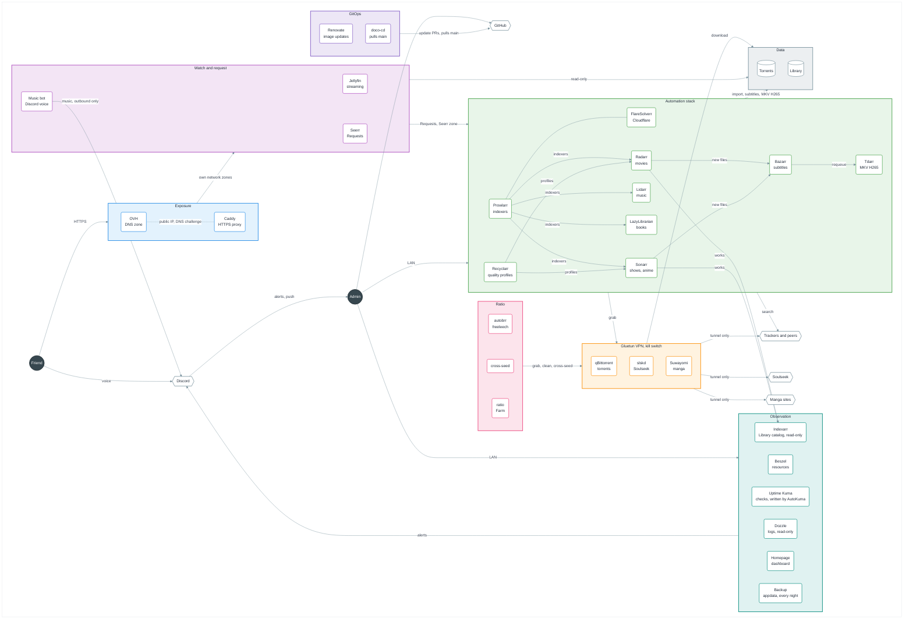

# Jellynas

## CI

`.github/workflows/ci.yml` runs on every pull request to `main`, on every push to `main`, and by hand. Its jobs run in parallel and every tool version is pinned, so Renovate keeps them up to date:

| Job      | Checks                                                                  |
| -------- | ----------------------------------------------------------------------- |
| Secrets  | gitleaks scans the whole git history for a committed secret             |
| Compose  | `compose.yaml` and the doco-cd compose file parse with `.env.example`   |
| Images   | hadolint lints every Dockerfile, then every image with a `build` builds |
| YAML     | yamllint passes in strict mode                                          |
| JSON     | every tracked `.json` file parses                                       |
| Python   | the `unittest` tests pass                                               |
| Lint     | shellcheck passes on the shell scripts and ruff on the Python           |
| Renovate | `renovate.json` is a valid Renovate config                              |
| Markdown | markdownlint passes on every `.md` file                                 |
| Actions  | actionlint checks the workflows, then zizmor audits their security      |

=== A REWORK ===

A personal media server built on Jellyfin, shared with Friends over the internet.

Every tool here is maintained open source software, picked by the Admin, and the picks may change over time. None of them is an obligation: the repo is a base that runs as is and that you can adapt. Some picks, such as OVH, AirVPN, C411, Nyaa and the French quality profiles, only come from the Admin being French. Each section names equivalent tools and says in a few words why a pick was made, so you can tell when another fits you better.

Follow the sections in order. Each one starts with the sections it requires. Every command runs on TrueNAS, as root, from the Clone, as [TrueNAS](#truenas) sets out.

1. [Architecture](#architecture)
2. [Prerequisites](#prerequisites)
3. [TrueNAS](#truenas)
4. [Settings](#settings)
5. [Domain](#domain)
6. [Deploy](#deploy)
7. [Jellyfin](#jellyfin)
8. [Seerr](#seerr)
9. [qBittorrent](#qbittorrent)
10. [Prowlarr](#prowlarr)
11. [Radarr](#radarr)
12. [Sonarr](#sonarr)
13. [slskd](#slskd)
14. [Lidarr](#lidarr)
15. [Requests](#requests)
16. [Recyclarr](#recyclarr)
17. [Tdarr](#tdarr)
18. [Bazarr](#bazarr)
19. [Indexarr](#indexarr)
20. [Music bot](#music-bot)
21. [Discord messages](#discord-messages)
22. [Private tracker ratio](#private-tracker-ratio)
23. [Observation](#observation)
24. [Beszel](#beszel)
25. [Uptime Kuma](#uptime-kuma)
26. [Dozzle](#dozzle)
27. [Homepage](#homepage)
28. [Backup](#backup)
29. [Verify the NAS](#verify-the-nas)
30. [Contributing](#contributing)

## Architecture

Dark circles are people, hexagons are services outside the NAS, rounded boxes are containers, cylinders are storage.



## Prerequisites

- **Required**: [TrueNAS SCALE](https://www.truenas.com/download-truenas-community-edition/) installed, on a machine or a virtual machine, with a pool. Its Docker runs the NAS directly, the data sits on ZFS with snapshots and replication to move the pool to another machine, and the services stay in git rather than in the Custom Apps of TrueNAS. Any Linux host with Docker Compose works too, with its own paths and ids in `.env`.
- **Recommended**: a VPN with port forwarding, here AirVPN. ProtonVPN, Mullvad or any provider Gluetun supports work too. Without a VPN, a seedbox such as Ultra.cc, Seedhost or Whatbox can download in place of the NAS, or the NAS downloads with the home IP, at your own risk.
- **Optional**: a domain, here at OVH. Cloudflare, Gandi, Porkbun or any registrar with an API that [caddy-dns](https://github.com/caddy-dns) supports work too. Without a domain, a free dynamic DNS subdomain from DuckDNS, deSEC or dynv6 does the same job, or the NAS stays on the local network only.
- **Optional**: an account on a private tracker, here C411. Any private tracker works, minus the Zen, which only C411 pays.

Each optional part is a set of services in `compose.yaml`. To leave one out, comment its lines in a pull request, and doco-cd removes them once merged:

- Without a private tracker, comment `autobrr`, `cross-seed`, `ratio` and `farm-report`.
- Without a VPN, comment `gluetun`, `slskd` and `suwayomi`, remove `network_mode` and `depends_on` from `services/qbittorrent/compose.yaml`, and replace `gluetun:8080` with `qbittorrent:8080` in `services/caddy/Caddyfile`, `services/cross-seed/config.js`, `services/ratio/ratio.py` and `services/homepage/services.yaml`. Soulseek shows the IP of each user to the others, so slskd never runs without the VPN, and Suwayomi never fetches a manga site from the home IP.
- Without a domain, comment `caddy` and publish the port of each web UI in its own `compose.yaml`, reachable over plain HTTP on the local network only.

Remove the tiles of the services left out from `services/homepage/services.yaml` too.

`./scripts/verify.sh` only checks the services that `compose.yaml` still includes.

## TrueNAS

Requires [Prerequisites](#prerequisites).

Every command of this README runs on TrueNAS, in System > Shell or over SSH, as root and from the Clone:

```sh
sudo -i
cd /mnt/tank/jellynas
```

### Datasets

Open the TrueNAS web UI. The commands of this README name the pool `tank`.

1. In Datasets, add four datasets to the pool with the "Apps" preset, so the `apps` user, 568, owns them: `data`, `appdata`, `backup` and `jellynas`. Never add a child dataset under `data`: `torrents` and `media` are plain folders, so that the hardlinks of cross-seed stay on one file system.
2. In Apps, click "Configure", pick the pool, and save. TrueNAS starts its Docker.

Once [Domain](#domain) is done, TrueNAS also answers at `https://truenas.lan.<DOMAIN>:<CADDY_HTTPS_PORT>`.

### Clone

In System > Shell, clone the repo into its dataset. Git refuses a clone that root does not own until it is marked as safe:

```sh
sudo -i
git clone https://github.com/Amaroke/Jellynas.git /mnt/tank/jellynas
git config --global --add safe.directory /mnt/tank/jellynas
```

## Settings

Requires [TrueNAS](#truenas).

```sh
cp .env.example .env
```

Open `.env` and fill in every value of the modules you keep. Each variable is explained in `.env.example`. Wrap a value in double quotes if it contains a space. `.env` is ignored by git and must never be committed.

Both roots live outside the repo, at the paths set in `DATA_ROOT` and `APPDATA_ROOT`, and so do the archives of the appdata, at `BACKUP_ROOT`. The data root holds a single tree, so that one folder holds every download and the whole Library:

```text
<DATA_ROOT>
├── torrents
│   ├── farm
│   ├── cross-seed
│   └── soulseek
└── media
    ├── movies
    ├── shows
    ├── anime
    ├── music
    ├── books
    └── manga
```

Create both roots, the folder of the archives, the recycle bins of Radarr and Sonarr, and the appdata folders of the services that run as `PUID` from their first start:

```bash
. <(grep -E '^(DATA_ROOT|APPDATA_ROOT|BACKUP_ROOT|PUID|PGID)=' .env)
mkdir -p "$BACKUP_ROOT" "$DATA_ROOT"/torrents/{farm,cross-seed} "$DATA_ROOT"/torrents/soulseek/{downloads,incomplete} "$DATA_ROOT"/media/{movies,shows,anime,music,books,manga} "$DATA_ROOT"/media/{movies,shows}/.recycle "$APPDATA_ROOT"/{seerr,recyclarr,autobrr,cross-seed,ratio,farm-report,slskd,suwayomi}
chown -R "$PUID:$PGID" "$DATA_ROOT" "$APPDATA_ROOT"
```

## Domain

Requires [Settings](#settings).

Caddy is the only service the NAS publishes, on `CADDY_HTTPS_PORT`. Friends reach `jellyfin.<DOMAIN>` and `seerr.<DOMAIN>` from the internet. The Admin reaches every tool at `<tool>.lan.<DOMAIN>`, from the local network only: Caddy refuses a lan name to any address outside `LAN_SUBNET`, and refuses any name it does not know. Through the API of the DNS provider, Caddy obtains a wildcard certificate for `*.<DOMAIN>` and one for `*.lan.<DOMAIN>`, so no port opens for the certificates and the certificate logs never list the tools, and it keeps `jellyfin` and `seerr` on the public IP of the home. Wildcards keep the tools out of the certificate logs, a single port keeps what the NAS publishes small, and public certificates avoid installing a local root certificate on every device.

Caddy also listens on `CADDY_HTTPS_PORT` inside its container and sends HSTS on every name, so a browser never tries plain HTTP. Inside the NAS, Caddy answers `jellyfin.<DOMAIN>` and `seerr.<DOMAIN>` itself, so a service reaches Jellyfin or Seerr at the same address a Friend uses, without going through the router. [Network zones](#network-zones) says why.

### Network zones

Jellyfin and Seerr face the internet, so a flaw in either must not land next to the rest of the NAS. The services sit in three Docker networks:

| Zone            | Services                                               |
| --------------- | ------------------------------------------------------ |
| `jellyfin-zone` | Caddy, Jellyfin                                        |
| `seerr-zone`    | Caddy, Seerr, Radarr, Sonarr                           |
| `internal-zone` | every other service, Caddy, Radarr and Sonarr included |

qBittorrent, slskd and Suwayomi share the network of Gluetun, in the internal zone, and the Beszel agent the network of the Host. A service of the internal zone that needs Jellyfin or Seerr, such as Homepage, Uptime Kuma or the Music bot, reaches it through Caddy at its public name, so the zones only open towards Jellyfin and Seerr, never from them. `python3 -m unittest` checks the members of each zone. Jellyfin and Seerr face the internet, so a flaw in one of them should not land next to Radarr, qBittorrent or Dozzle.

Traefik or nginx can replace Caddy. The steps below use OVH. With another DNS provider, swap the `caddy-dns/ovh` module in `services/caddy/Dockerfile` for its own, and its settings in the `acme_dns` and `dynamic_dns` blocks of `services/caddy/Caddyfile` and in `.env`.

### DNS zone

In the [OVH Control Panel](https://www.ovh.com/manager/), open Web Cloud > Domain names > `<DOMAIN>` > DNS zone, click "Add an entry", pick `A`, enter `*.lan` as the subdomain and the fixed local IP of the NAS as the target. Leave every other entry as it is, such as the ones of the OVH email. Caddy creates the `jellyfin` and `seerr` entries itself at its first start.

### API keys

1. Open [eu.api.ovh.com/createToken](https://eu.api.ovh.com/createToken/) and sign in with the OVH account that holds the domain.
2. Enter `Jellynas Caddy` as the name and description, and pick "Unlimited" as the validity.
3. Add these rights, with `<DOMAIN>` written out, so the keys can only change the records of the zone:

   | Method | Path                             |
   | ------ | -------------------------------- |
   | GET    | `/domain/zone/<DOMAIN>/record`   |
   | POST   | `/domain/zone/<DOMAIN>/record`   |
   | GET    | `/domain/zone/<DOMAIN>/record/*` |
   | PUT    | `/domain/zone/<DOMAIN>/record/*` |
   | DELETE | `/domain/zone/<DOMAIN>/record/*` |
   | GET    | `/domain/zone/<DOMAIN>/soa`      |
   | POST   | `/domain/zone/<DOMAIN>/refresh`  |

4. Create the keys, then copy the application key, the application secret and the consumer key into `OVH_APPLICATION_KEY`, `OVH_APPLICATION_SECRET` and `OVH_CONSUMER_KEY` in `.env`.
5. In `.env`, set `DOMAIN` to the domain and `LAN_SUBNET` to the local network, for example `192.168.1.0/24` when the router is `192.168.1.254`.

### Router port forward

Pick the HTTPS port and set it in `CADDY_HTTPS_PORT`, or leave it empty for 443. A high port that no service uses by default, such as a random five-digit number, draws fewer automated scans. Friends then add it to the address, for example `https://jellyfin.<DOMAIN>:<port>`, which the Jellyfin apps accept.

On your router, forward that single TCP port to the local IP of the NAS, and nothing else. Set both the external and the internal port of the rule to `CADDY_HTTPS_PORT`, never the internal port to 443: Caddy listens on `CADDY_HTTPS_PORT` on the NAS.

### Addresses

Once [Deploy](#deploy) is done, each tool answers at its own address, with `:<CADDY_HTTPS_PORT>` after the name unless it is 443:

| Service     | Address                             | Reached from  |
| ----------- | ----------------------------------- | ------------- |
| Jellyfin    | `https://jellyfin.<DOMAIN>`         | Anywhere      |
| Seerr       | `https://seerr.<DOMAIN>`            | Anywhere      |
| TrueNAS     | `https://truenas.lan.<DOMAIN>`      | Local network |
| Jellyfin    | `https://jellyfin.lan.<DOMAIN>`     | Local network |
| Seerr       | `https://seerr.lan.<DOMAIN>`        | Local network |
| qBittorrent | `https://qbittorrent.lan.<DOMAIN>`  | Local network |
| Prowlarr    | `https://prowlarr.lan.<DOMAIN>`     | Local network |
| Radarr      | `https://radarr.lan.<DOMAIN>`       | Local network |
| Sonarr      | `https://sonarr.lan.<DOMAIN>`       | Local network |
| Lidarr      | `https://lidarr.lan.<DOMAIN>`       | Local network |
| slskd       | `https://slskd.lan.<DOMAIN>`        | Local network |
| Bazarr      | `https://bazarr.lan.<DOMAIN>`       | Local network |
| Tdarr       | `https://tdarr.lan.<DOMAIN>`        | Local network |
| Indexarr    | `https://indexarr.lan.<DOMAIN>`     | Local network |
| autobrr     | `https://autobrr.lan.<DOMAIN>`      | Local network |
| ratio       | `https://ratio.lan.<DOMAIN>/graphs` | Local network |
| Beszel      | `https://beszel.lan.<DOMAIN>`       | Local network |
| Uptime Kuma | `https://uptime-kuma.lan.<DOMAIN>`  | Local network |
| Dozzle      | `https://dozzle.lan.<DOMAIN>`       | Local network |
| Homepage    | `https://homepage.lan.<DOMAIN>`     | Local network |

cross-seed has an API only, which the other containers reach at `http://cross-seed:2468`. The first certificates take a few minutes, follow them with:

```sh
docker compose logs -f caddy
```

The line `certificate obtained successfully` shows up once for `*.<DOMAIN>` and once for `*.lan.<DOMAIN>`.

## Deploy

Requires [Settings](#settings) and [Domain](#domain).

The NAS follows the `main` branch of GitHub: a change merged into `main` reaches the NAS within minutes, and nothing else changes it. The Clone holds `.env`, outside git, and starts doco-cd, but the NAS never runs from it. Edit the repo in another folder and go through a pull request. Pull the Clone before running a script of the repo:

```sh
git pull --ff-only
```

Never start the NAS with `docker compose up` from the Clone: it would recreate the services from the Clone, and doco-cd would recreate them again at its next poll. `docker compose logs`, `exec`, `stop`, `start` and `restart` are safe.

The settings made in the web UIs of the services live in the appdata root, not in git, so the deploy never touches them. Back up the appdata root to keep them.

### doco-cd

[doco-cd](https://doco.cd) is a container, outside the NAS project, that polls `main` every 3 minutes and deploys `compose.yaml` with `.env`, as set in `.doco-cd.yml`. Komodo or Portainer can do the same with a web UI and a database the NAS does not need. doco-cd pulls, so nothing opens on the router, and no workflow of a public pull request can run on the NAS. Start doco-cd once from the Clone, its first poll starts the whole NAS:

```sh
docker compose -f services/doco-cd/compose.yaml up -d
```

Each deploy runs from a copy of the merged revision, kept in the data volume of doco-cd. It recreates the services whose compose definition or image changed, and those that mount a file of the repo that changed, such as `services/ratio/ratio.py`. It rebuilds Caddy from its Dockerfile, and removes the services commented out in `compose.yaml`. A failed deploy is retried at the next poll.

doco-cd reaches Docker through its socket, which gives it full control of the machine, like any tool that runs Compose. Its logs name each deploy, and the reason of each failed one:

```sh
docker logs doco-cd
```

A change of `.env` is no new revision. To apply it, or to deploy without waiting, restart doco-cd, it polls as soon as it starts:

```sh
docker restart doco-cd
```

Renovate opens the updates of doco-cd itself and never merges them. Once one is merged, pull the Clone and recreate doco-cd:

```sh
git pull --ff-only
docker compose -f services/doco-cd/compose.yaml up -d
```

### Renovate

[Renovate](https://github.com/apps/renovate) keeps the images, the GitHub Actions and the CI tools up to date, where Dependabot could not compare most linuxserver tags. Install the app on the repo only, then merge the onboarding pull request it opens if it still opens one. Its settings are in `renovate.json`:

- It opens its pull requests as soon as a release is published, and merges an update only once its release is 3 days old.
- It merges a minor or patch update by itself once the CI passes, and the NAS deploys it.
- A major update, and any update of Gluetun, qBittorrent or doco-cd, waits for the Admin to read its release notes and merge it.
- The Dependency Dashboard issue lists every pending update.

## Jellyfin

Requires [Deploy](#deploy).

Jellyfin streams the Library to the Admin and the Friends. Emby or Plex can replace it, but neither is fully open source.

### First-run wizard

1. Open `https://jellyfin.lan.<DOMAIN>:<CADDY_HTTPS_PORT>` from a browser on the local network.
2. Pick the display language and create the Admin Account with a strong password stored in your password manager.
3. Skip the library step, [Libraries](#libraries) does it.
4. Keep the metadata language and country you prefer.
5. Leave "Allow remote connections to this server" checked, Friends will reach Jellyfin from the internet through [Domain](#domain).

### Libraries

The media tree is mounted read-only under `/data/media`, so Jellyfin can never delete or change a file. In Dashboard > Libraries, add one library per folder:

| Library | Content type | Folder               |
| ------- | ------------ | -------------------- |
| Movies  | Movies       | `/data/media/movies` |
| Shows   | Shows        | `/data/media/shows`  |
| Anime   | Shows        | `/data/media/anime`  |
| Music   | Music        | `/data/media/music`  |
| Books   | Books        | `/data/media/books`  |
| Manga   | Books        | `/data/media/manga`  |

For each library, leave "Save artwork into media folders" and every "Metadata savers" option unchecked: Jellyfin cannot write into the Library and keeps its metadata in its appdata folder instead.

### Friend Accounts

Each Friend gets their own Account, so their watch history and progress are theirs. In Dashboard > Users, click "+" and:

1. Enter the Friend's name and a password, then give both to the Friend privately.
2. Grant access to all libraries.
3. Leave "Allow this user to manage the server" unchecked.
4. Check "Allow media downloading" so the Friend can download videos, books and manga to their phone.

### Login lockout

In Dashboard > Users, keep "Maximum number of failed login attempts before user is locked out" at its default on every Account, never `-1`, so no Account can be brute forced from the internet.

### Jellyfin behind Caddy

In Dashboard > Networking, add `caddy` to "Known proxies" and save. Jellyfin then sees the real address of each Friend instead of the address of Caddy. Jellyfin looks up the address of Caddy when it starts, so restart it now and whenever Caddy is recreated:

```sh
docker compose restart jellyfin
```

## Seerr

Requires [Jellyfin](#jellyfin).

Friends make Requests in Seerr, on its own public name, and log in with their Jellyfin Account. Seerr has no access to the Library files. Ombi can replace it.

### Setup wizard

1. Open `https://seerr.lan.<DOMAIN>:<CADDY_HTTPS_PORT>` from a browser on the local network.
2. Choose Jellyfin as the media server.
3. Enter `jellyfin.<DOMAIN>` as the hostname, `CADDY_HTTPS_PORT` as the port, turn SSL on and leave the URL base empty. Seerr sits in another network zone than Jellyfin and reaches it through Caddy, as [Network zones](#network-zones) sets out.
4. Enter an email address and the username and password of the Jellyfin Admin Account. This Account becomes the Seerr Admin.
5. Sync the libraries and enable Movies, Shows and Anime.
6. Skip the Radarr and Sonarr step, [Requests](#requests) adds them.

### Settings

1. In Settings > General, set "Application URL" to `https://seerr.<DOMAIN>:<CADDY_HTTPS_PORT>`, without the port if it is 443.
2. In Settings > Network, check "Enable Proxy Support" so Seerr sees the real address of each Friend.
3. In Settings > Jellyfin, set "External URL" to `https://jellyfin.<DOMAIN>:<CADDY_HTTPS_PORT>` so links to a movie open the public Jellyfin.
4. In Settings > Users, check "Enable Jellyfin Sign-In" and "Enable New Jellyfin Sign-In", uncheck "Enable Local Sign-In", and leave the default permissions on "Request".

A Friend then opens the Seerr address, picks "Sign in with Jellyfin" and enters their Jellyfin Account, with no second login to create.

## qBittorrent

Requires [Deploy](#deploy).

qBittorrent downloads torrents into the torrents tree, the only folder it sees, mounted under `/data/torrents`. Transmission or Deluge can replace it, though cross-seed and ratio speak to qBittorrent. It shares the network of Gluetun, whose firewall only lets traffic out through the VPN. When the VPN is down or not configured yet, qBittorrent has no connectivity at all, so your real IP never leaks.

### VPN

Until you choose a provider, leave every VPN value of `.env` empty. Gluetun then starts with a tunnel that leads nowhere and shows as unhealthy, which is expected.

Once you have a provider:

1. Find your provider on the [Gluetun providers page](https://github.com/qdm12/gluetun-wiki/tree/main/setup/providers) and note the values it asks for.
2. In `.env`, set `VPN_SERVICE_PROVIDER` to the provider name and `VPN_TYPE` to `wireguard` or `openvpn`.
3. For WireGuard, download a WireGuard config file from the provider and copy its `PrivateKey` into `WIREGUARD_PRIVATE_KEY` and its `Address` into `WIREGUARD_ADDRESSES`. For OpenVPN, set `OPENVPN_USER` and `OPENVPN_PASSWORD` to the manual setup credentials of the provider.
4. Optionally set `SERVER_COUNTRIES` to the countries you want to exit from.
5. Recreate Gluetun and qBittorrent:

   ```sh
   docker restart doco-cd
   ```

The line `Public IP address is` in `docker compose logs gluetun` shows the VPN address, never your home address. Gluetun then turns healthy.

### Example: AirVPN

1. Sign in on the [AirVPN Client Area](https://airvpn.org/client/) and open the [Config Generator](https://airvpn.org/generator/).
2. Pick Linux as the system, WireGuard as the protocol, and the country you want to exit from, then generate and download the config file.
3. In `.env`, set `VPN_SERVICE_PROVIDER` to `airvpn`, `VPN_TYPE` to `wireguard`, and either `SERVER_COUNTRIES` to a country such as `Netherlands` or `SERVER_REGIONS` to `Europe` to let Gluetun pick among every European server. The keys work with any server.
4. From the config file, copy `PrivateKey` into `WIREGUARD_PRIVATE_KEY`, `PresharedKey` into `WIREGUARD_PRESHARED_KEY`, and only the IPv4 part of `Address` into `WIREGUARD_ADDRESSES`, for example `10.128.0.2/32`. Then delete the file, it holds your keys.
5. On the [ports page](https://airvpn.org/ports/), reserve a port, leave its local port empty, and set `VPN_FORWARDED_PORT` to it. [slskd](#slskd) reserves a second one later.
6. Recreate Gluetun and qBittorrent with `docker restart doco-cd`.

In qBittorrent, Tools > Options > Connection, set "Port used for incoming connections" to the first port of `VPN_FORWARDED_PORT` and uncheck "Use UPnP / NAT-PMP port forwarding from my router". Back on the ports page, the test button of the port then shows it as open while a torrent runs.

### Login

1. Read the temporary password qBittorrent printed at its first start:

   ```sh
   docker compose logs qbittorrent
   ```

2. qBittorrent refuses its web UI behind Caddy until it trusts it as a reverse proxy, so turn on its reverse proxy support for the Docker networks, `172.16.0.0/12` on TrueNAS, while it is stopped:

   ```sh
   . <(grep '^APPDATA_ROOT=' .env)
   docker compose stop qbittorrent
   sed -i '/^\[Preferences\]/a WebUI\\ReverseProxySupportEnabled=true\nWebUI\\TrustedReverseProxiesList=172.16.0.0/12' "$APPDATA_ROOT"/qbittorrent/qBittorrent/qBittorrent.conf
   docker compose start qbittorrent
   ```

   Caddy sends qBittorrent its own address as the host and the lan name in `X-Forwarded-Host`, which qBittorrent then checks against the origin of each request, so its CSRF protection stays on.

3. Open `https://qbittorrent.lan.<DOMAIN>:<CADDY_HTTPS_PORT>` from a browser on the local network and sign in with `admin` and that password.
4. In Tools > Options > WebUI > Authentication, set a new username and a strong password stored in your password manager. Leave both "Bypass authentication" options unchecked.

### Save paths

In Tools > Options > Downloads, set "Default Save Path" to `/data/torrents`, uncheck "Keep incomplete torrents in", and save. Any other path would land inside the container and be lost.

### Downloads and seeding

Each finished torrent keeps seeding from the torrents tree for a while, to give back to other peers. A private torrent stops at its seeding goal, then the tool that sent it removes it, unless ratio moved it into the Farm. ratio removes a public torrent after two weeks. Each import is a copy, so a downloaded file sits twice on the disk until then: keep enough free space for every torrent still seeding. In Tools > Options, set:

| Screen     | Setting                                      | Value                                                                                                                                                                                               |
| ---------- | -------------------------------------------- | --------------------------------------------------------------------------------------------------------------------------------------------------------------------------------------------------- |
| Downloads  | Default Torrent Management Mode              | Automatic, so each category picks its own save path                                                                                                                                                 |
| Downloads  | Append .!qB extension to incomplete files    | Checked, so no tool imports a file that is still downloading                                                                                                                                        |
| BitTorrent | Privacy                                      | DHT and PeX checked, Local Peer Discovery unchecked since the container has no local peers                                                                                                          |
| Connection | Connections Limits                           | 1000 connections in all and 200 per torrent, upload slots unchecked in all and per torrent, so no swarm waits for a free slot                                                                       |
| BitTorrent | Torrent Queueing                             | Unchecked. A queued torrent never announces, so it uploads nothing and C411 pays it no Zen. ratio unchecks it itself. Each tool already limits its own downloads, ratio to 2 at a time for the Farm |
| BitTorrent | Seeding Limits                               | All unchecked. ratio unchecks them itself, since it removes the public torrents and keeps the Farm seeding                                                                                          |
| Advanced   | Network interface                            | `tun0`, so qBittorrent only ever uses the VPN, on top of the Gluetun kill switch                                                                                                                    |
| Advanced   | Upload slots behavior                        | Upload rate based, so qBittorrent opens slots while upload bandwidth is left                                                                                                                        |
| Advanced   | Upload choking algorithm                     | Fastest upload, so the peers that take the most are served first                                                                                                                                    |
| Advanced   | Outgoing connections per second              | `100`, so a fresh torrent reaches its leechers within seconds                                                                                                                                       |
| Advanced   | Send buffer watermark, low watermark, factor | `5120` KiB, `1024` KiB, `150` %, so upload stays steady at high speed                                                                                                                               |
| Advanced   | Socket backlog size                          | `100`                                                                                                                                                                                               |

Optionally, in Speed, set a global upload limit to about 60% of your internet upload speed, so seeding never slows Jellyfin streams to Friends.

## Prowlarr

Requires [qBittorrent](#qbittorrent).

Prowlarr holds the indexers once and pushes them to Radarr, Sonarr, Lidarr and the other tools. FlareSolverr opens indexers protected by Cloudflare for it. Neither sees any media file. Jackett can replace Prowlarr, without the push.

### Login

1. Open `https://prowlarr.lan.<DOMAIN>:<CADDY_HTTPS_PORT>` from a browser on the local network.
2. Prowlarr asks for an authentication method at the first visit. Pick "Forms (Login Page)", set "Authentication Required" to "Enabled", never "Disabled for Local Addresses", and enter a username and a strong password, distinct from the other tools, stored in your password manager.

Copy the API key from Settings > General > Security into `PROWLARR_API_KEY` in `.env`.

### FlareSolverr

In Settings > Indexers, click "+" and pick FlareSolverr. Enter `flaresolverr` as the tag and `http://flaresolverr:8191/` as the host, then save. FlareSolverr has no web UI and is reachable by the other containers only.

### Indexers

In Indexers, click "Add Indexer", pick a tracker and fill in what it asks for, an account for a private one. For an indexer behind Cloudflare, add the `flaresolverr` tag so its requests go through FlareSolverr. Click "Test", then "Save".

### Seeding goals of private trackers

A private tracker bans an account for a hit and run. For each private indexer, in Indexers, edit it, click "Show Advanced", and set "Seed Ratio" and "Seed Time" in minutes to the minimums of its rules page. Prowlarr syncs them to Radarr, Sonarr and Lidarr, which hand them to qBittorrent with each torrent, so "Remove Completed" never removes a private torrent before the tracker allows it. Leave no private indexer empty: with the global seeding limits of qBittorrent off, its torrent would seed forever unless ratio moves it into the Farm.

## Radarr

Requires [Prowlarr](#prowlarr).

Radarr fulfils movie Requests: it searches the indexers, sends the torrent to qBittorrent, then copies the finished movie into the Library. No other maintained open source tool covers movies as well. It sees only the movies folder, under `/data/media/movies`, and the torrents tree, under `/data/torrents`.

### Login

Open `https://radarr.lan.<DOMAIN>:<CADDY_HTTPS_PORT>` and set the authentication the same way as Prowlarr, with its own username and password. Copy the API key from Settings > General > Security into `RADARR_API_KEY` in `.env`.

### Media management

In Settings > Media Management, click "Show Advanced" at the top, then:

1. Under Root Folders, add `/data/media/movies`.
2. Check "Rename Movies".
3. Under Importing, uncheck "Use Hardlinks instead of Copy". Each import is a copy, so the torrent keeps seeding from the torrents tree while Tdarr normalises the Library file.
4. Under File Management, set "Recycling Bin" to `/data/media/movies/.recycle` and "Recycling Bin Cleanup" to `30` days. A deleted movie stays there for 30 days and can be moved back. Jellyfin and Radarr skip hidden folders, so it never shows up as a movie.

### Download client

1. In qBittorrent, right-click "Categories" in the left panel, pick "Add category", and enter `movies` as the category and `/data/torrents/movies` as the save path. ratio creates it by itself once it runs.
2. In Radarr, Settings > Download Clients, click "+" and pick qBittorrent.
3. Enter `gluetun` as the host, since qBittorrent shares its network, `8080` as the port, and the qBittorrent login.
4. Set "Category" to `movies`.
5. Check "Remove Completed": once qBittorrent stops a torrent at its seeding goal, Radarr removes it and its files from the torrents tree, and the movie stays in the Library.
6. Click "Test", then "Save".

### Indexers from Prowlarr

1. In Prowlarr, not Radarr, open Settings > Apps, click "+" and pick Radarr.
2. Leave "Sync Level" on "Full Sync".
3. Set "Prowlarr Server" to `http://prowlarr:9696` and "Radarr Server" to `http://radarr:7878`.
4. Paste the Radarr API key, click "Test", then "Save".

Every indexer then shows up in Radarr, Settings > Indexers, and follows any change made in Prowlarr.

## Sonarr

Requires [Prowlarr](#prowlarr).

Sonarr fulfils show Requests and fetches new episodes on its own: it searches the indexers, sends the torrent to qBittorrent, then copies each finished episode into the Library. It sees only the shows and anime folders, under `/data/media/shows` and `/data/media/anime`, and the torrents tree, under `/data/torrents`. Medusa or SickChill can replace it.

### Login

Open `https://sonarr.lan.<DOMAIN>:<CADDY_HTTPS_PORT>` and set the authentication the same way as Prowlarr, with its own username and password. Copy the API key from Settings > General > Security into `SONARR_API_KEY` in `.env`.

### Media management

In Settings > Media Management, click "Show Advanced" at the top, then:

1. Under Root Folders, add `/data/media/shows` and `/data/media/anime`.
2. Check "Rename Episodes".
3. Under Importing, uncheck "Use Hardlinks instead of Copy", for the same reason as Radarr.
4. Under File Management, set "Recycling Bin" to `/data/media/shows/.recycle` and "Recycling Bin Cleanup" to `30` days. Deleted episodes of both shows and anime stay there for 30 days and can be moved back.

### Download client

1. In qBittorrent, add a category `shows` with `/data/torrents/shows` as the save path.
2. In Sonarr, Settings > Download Clients, click "+" and pick qBittorrent.
3. Enter `gluetun` as the host, `8080` as the port, and the qBittorrent login.
4. Set "Category" to `shows`.
5. Check "Remove Completed": once qBittorrent stops a torrent at its seeding goal, Sonarr removes it and its files from the torrents tree, and the episodes stay in the Library.
6. Click "Test", then "Save".

### Indexers from Prowlarr

In Prowlarr, Settings > Apps, click "+" and pick Sonarr. Set "Prowlarr Server" to `http://prowlarr:9696` and "Sonarr Server" to `http://sonarr:8989`, paste the Sonarr API key, click "Test", then "Save". Every indexer with TV categories then shows up in Sonarr, Settings > Indexers. An indexer without TV categories, such as Internet Archive, is never synced to Sonarr.

## slskd

Requires [qBittorrent](#qbittorrent).

slskd is a Soulseek client. Soulseek is a network of music lovers who share their own folders, where rare albums missing from every tracker often turn up. slskd shares the network of Gluetun, like qBittorrent: when the VPN is down, it has no connectivity at all. It downloads into the `soulseek` folder of the torrents tree, under `/data/torrents/soulseek`, and shares the music folder of the Library, mounted read-only under `/data/media/music`, so nobody can change the Library through it. Nicotine+ can replace it, without the API that Lidarr needs.

### Soulseek account

Soulseek has no sign-up page: slskd creates the account at its first connection, if the username is free. In `.env`, set `SOULSEEK_USERNAME` to a username that does not identify you and `SOULSEEK_PASSWORD` to a strong password stored in your password manager. Other Soulseek users see the username and the IP of the VPN, never the home IP.

### Login

In `.env`, set `SLSKD_USERNAME` and `SLSKD_PASSWORD` to the login of its web UI, distinct from the other tools, and `SLSKD_API_KEY` to a new key, which Lidarr and Homepage use:

```bash
openssl rand -hex 24
```

Restart doco-cd to apply `.env`:

```sh
docker restart doco-cd
```

Open `https://slskd.lan.<DOMAIN>:<CADDY_HTTPS_PORT>` and sign in. The status at the top turns to connected once slskd reaches Soulseek.

### Forwarded port

Other Soulseek users connect to slskd on its listening port. Without a forwarded port, slskd still downloads, but fewer users can reach it and some transfers fail.

1. Reserve a second port at the VPN provider, on the [ports page](https://airvpn.org/ports/) with AirVPN, and leave its local port empty.
2. In `.env`, add it to `VPN_FORWARDED_PORT` after the qBittorrent one, for example `VPN_FORWARDED_PORT=41234,52345`, and set `SLSKD_LISTEN_PORT` to it, here `52345`. Gluetun opens every port of `VPN_FORWARDED_PORT` in its firewall.
3. Restart doco-cd to apply `.env`.

`./scripts/verify.sh` checks that `SLSKD_LISTEN_PORT` is one of the ports of `VPN_FORWARDED_PORT` after the qBittorrent one, and fails slskd until it is.

### Sharing

Many Soulseek users refuse to send files to a user who shares nothing. slskd shares the whole music folder, which it scans at each start. Once Lidarr imported new albums, open Shares in slskd and click "Rescan" so that other users see them.

## Lidarr

Requires [Prowlarr](#prowlarr) and [slskd](#slskd).

Lidarr follows artists: every album of a followed artist arrives in the Library on its own, from the indexers through qBittorrent, or from Soulseek through slskd when no indexer has it. Its image supports plugins, and it uses the [Tubifarry](https://github.com/TypNull/Tubifarry) plugin, which adds slskd as an indexer and as a download client. It sees only the music folder, under `/data/media/music`, and the torrents tree, under `/data/torrents`. No other maintained open source tool follows artists as well.

### Login

Open `https://lidarr.lan.<DOMAIN>:<CADDY_HTTPS_PORT>` and set the authentication the same way as Prowlarr, with its own username and password. Copy the API key from Settings > General > Security into `LIDARR_API_KEY` in `.env`.

### Tubifarry

In System > Plugins, paste `https://github.com/TypNull/Tubifarry` into "GitHub URL", click "Install", and let Lidarr restart. Tubifarry then shows up in the list of installed plugins.

### Media management

In Settings > Media Management, click "Show Advanced" at the top, then:

1. Under Root Folders, add `/data/media/music`, with the default quality and metadata profiles.
2. Check "Rename Tracks".
3. Under Importing, uncheck "Use Hardlinks instead of Copy". Each import is a copy, so the torrent keeps seeding from the torrents tree.

### Quality profile

In Settings > Profiles, edit the quality profile of the root folder, check "Upgrades Allowed" and set "Upgrade Until" to the format you want, for example `FLAC`. Lidarr then replaces an album with a better release until it reaches that format, and stops there, like movies and shows.

### Download clients

For qBittorrent:

1. In qBittorrent, add a category `music` with `/data/torrents/music` as the save path.
2. In Lidarr, Settings > Download Clients, click "+" and pick qBittorrent.
3. Enter `gluetun` as the host, `8080` as the port, and the qBittorrent login.
4. Set "Category" to `music`.
5. Check "Remove Completed": once qBittorrent stops a torrent at its seeding goal, Lidarr removes it and its files from the torrents tree, and the album stays in the Library.
6. Click "Test", then "Save".

For slskd:

1. In Settings > Download Clients, click "+" and pick Slskd.
2. Enter `http://gluetun:5030` as the URL, since slskd shares the network of Gluetun, and paste `SLSKD_API_KEY`.
3. Check "Remove Completed", click "Test", then "Save". Tubifarry reads the download folder from slskd, `/data/torrents/soulseek/downloads`, which Lidarr sees at the same path.

### Indexers

1. In Prowlarr, Settings > Apps, click "+" and pick Lidarr. Set "Prowlarr Server" to `http://prowlarr:9696` and "Lidarr Server" to `http://lidarr:8686`, paste the Lidarr API key, click "Test", then "Save". Every indexer with audio categories then shows up in Lidarr, Settings > Indexers.
2. In Lidarr, Settings > Indexers, click "+" and pick Slskd. Enter `http://gluetun:5030` as the URL, paste `SLSKD_API_KEY`, check "Include Only Audio Files", click "Test", then "Save".

### Follow an artist

In Library > Add New, search an artist, pick `/data/media/music` as the root folder and the albums to monitor, and check "Start search for missing albums". Lidarr searches the indexers and Soulseek, sends each album to qBittorrent or slskd, then copies it into the music folder, where the Music library of Jellyfin picks it up.

## LazyLibrarian

Requires [Prowlarr](#prowlarr).

LazyLibrarian follows authors and books: a wanted book arrives in the Library on its own, from the indexers through qBittorrent. It sees only the books folder, under `/data/media/books`, and the torrents tree, under `/data/torrents`. Readarr is retired, and no other maintained open source tool finds and files books this way.

### Login

Open `https://lazylibrarian.lan.<DOMAIN>:<CADDY_HTTPS_PORT>`. In Config > Interface:

1. Under WebServer Options, set "User" and "Pass" to a username and a strong password, distinct from the other tools.
2. Leave "Enable user accounts" unchecked and set the authentication type to "Basic (Browser Popup)".
3. Under API, check "Enable API" and generate the "API Full Access key", which Prowlarr uses.
4. Click "Save changes" and restart LazyLibrarian from its menu.

`./scripts/verify.sh` checks that the web UI then asks for the login.

### Folders

In Config > Processing, set "eBook Library Folder" to `/data/media/books` and check "Keep original files". Each import is then a copy, so the torrent keeps seeding from the torrents tree. Click "Save changes".

### Download client

1. In qBittorrent, add a category `books` with `/data/torrents/books` as the save path.
2. In LazyLibrarian, Config > Downloaders, under Torrents, check qBitTorrent.
3. Enter `gluetun` as "qBitTorrent Host", `8080` as "qBitTorrent Port", and the qBittorrent login.
4. Set "qBitTorrent Label/Category" to `books` and "Download directory" to `/data/torrents/books`, which LazyLibrarian sees at the same path.
5. Check "Keep seeding after processing" and "Do not delete if still seeding", so LazyLibrarian never removes a torrent before qBittorrent stops it at its seeding goal.
6. Click "Test qBitTorrent", then "Save changes".

### Indexers

In Prowlarr, Settings > Apps, click "+" and pick LazyLibrarian. Set "Prowlarr Server" to `http://prowlarr:9696` and "LazyLibrarian Server" to `http://lazylibrarian:5299`, paste the API Full Access key, click "Test", then "Save". Every indexer with book categories then shows up in LazyLibrarian, Config > Providers.

### Want a book

In Authors, search a book or an author, add it and mark the book as Wanted. LazyLibrarian searches the indexers, sends the book to qBittorrent, then copies it into the books folder, where the Books library of Jellyfin picks it up. A Friend reads it in the Jellyfin app or downloads it to their phone.

## Suwayomi

Requires [qBittorrent](#qbittorrent).

Suwayomi follows manga: it runs the Mihon extensions, which read manga sites, and downloads each new chapter of a manga in the library as a CBZ file into the manga folder of the Library, where Jellyfin reads it. It shares the network of Gluetun, like qBittorrent: manga sites see the IP of the VPN, and when the VPN is down, it has no connectivity at all. It sees only the manga folder, mounted as its downloads folder, and its appdata folder. Kaizoku is archived and points to Suwayomi, and LazyLibrarian handles manga poorly. Suwayomi passes the Cloudflare challenge of a site with its own built-in browser. A site that refuses the IPs of the VPN stays out of reach.

### Login

In `.env`, set `SUWAYOMI_USERNAME` and `SUWAYOMI_PASSWORD` to the login of its web UI, letters and digits only and distinct from the other tools, then restart doco-cd to apply `.env`:

```sh
docker restart doco-cd
```

Suwayomi asks for this login at every visit, and Homepage uses it to read its figures. `./scripts/verify.sh` checks that the web UI asks for it.

### Extensions

Open `https://suwayomi.lan.<DOMAIN>:<CADDY_HTTPS_PORT>` and sign in. In Settings > Browse, add the URL of a Mihon extension repository, then in Browse > Extensions, install the extension of each manga site you read.

### Settings

1. In Settings > Downloads, turn on the automatic download of new chapters, so each new chapter of a manga in the library is downloaded on its own. CBZ is already set from compose.
2. In Settings > Library, set the automatic update interval, for example 12 hours, so Suwayomi checks the sites for new chapters.

### Want a manga

In Browse, pick a source, search a manga and add it to the library. Open it, select the chapters to keep and click "Download". Suwayomi files them under `mangas/<source>/<manga>` in the manga folder, where the Manga library of Jellyfin picks them up. New chapters follow on their own.

## Requests

Requires [Seerr](#seerr), [Radarr](#radarr) and [Sonarr](#sonarr).

In Seerr, Settings > Services, click "Add Radarr Server":

1. Check "Default Server" and enter `Radarr` as the name.
2. Enter `radarr` as the hostname, `7878` as the port, leave SSL off, and paste the Radarr API key.
3. Click "Test", then pick a quality profile, `/data/media/movies` as the root folder, and "Released" as the minimum availability.
4. Leave "Enable Automatic Search" checked and save.

Then click "Add Sonarr Server":

1. Check "Default Server" and enter `Sonarr` as the name.
2. Enter `sonarr` as the hostname, `8989` as the port, leave SSL off, and paste the Sonarr API key.
3. Click "Test". The quality profiles only load once the test succeeds. Pick one and `/data/media/shows` as the root folder.
4. Set "Anime Series Type" to "Anime", pick the same quality profile for anime and `/data/media/anime` as the anime root folder.
5. Check "Season Folders" to match Sonarr, leave "Enable Automatic Search" checked, and save.

An approved Request is then searched by Radarr or Sonarr, downloaded by qBittorrent into the torrents tree, and copied into the movies, shows or anime folder, where Jellyfin picks it up. New episodes of a monitored show follow on their own.

## Recyclarr

Requires [Requests](#requests).

Recyclarr creates the quality profiles of Radarr and Sonarr, so that most downloads already match the Library format and Tdarr rarely has to re-encode. It sees no media file and only talks to the Radarr and Sonarr APIs. Profilarr can replace it, or the profiles of the [TRaSH Guides](https://trash-guides.info/) copied by hand. Its config is `services/recyclarr/recyclarr.yml`, with a few custom formats of our own in `services/recyclarr/custom-formats`, and it syncs again every day at midnight.

Each tool gets two profiles, built from the French profiles of the [TRaSH Guides](https://trash-guides.info/Radarr/radarr-setup-quality-profiles-french-en/):

- **MULTi 1080p**, for movies and shows: French and original audio required, H265 preferred, 1080p first.
- **Anime 1080p**, for anime: a `MULTi` with French subtitles first, then a VOSTFR, then any other `MULTi`.

The profiles favour releases already in the Library format, so Tdarr rarely re-encodes, and refuse what Tdarr cannot fix: a missing French audio track. Quality always ranks before score, and H265 outweighs the release group, since it saves a lossy Tdarr pass. Change a rule in the config, never in Radarr or Sonarr, since each sync overwrites the profiles.

### API keys

With `RADARR_API_KEY` and `SONARR_API_KEY` set in `.env`, start Recyclarr:

```sh
docker restart doco-cd
```

Sync right away instead of waiting for midnight:

```sh
docker compose exec recyclarr recyclarr sync
```

Each tool ends with a `Completed` line and no error. Lines about `conflicting scores` are expected: they show the config overriding a TRaSH score. Run the same command after changing anything under `services/recyclarr/`.

### Assign the profiles

Recyclarr creates the profiles but never assigns them.

1. In Sonarr, Series, click "Select Series", select every show, pick `MULTi 1080p` under "Quality Profile" at the bottom, and save. Then select every anime, those with the "Anime" series type, and pick `Anime 1080p`.
2. In Radarr, Movies, select every movie and pick `MULTi 1080p`. Then select each Japanese animated movie and pick `Anime 1080p`. Radarr cannot tell an anime movie apart, so do this after each anime movie Request too.
3. In Settings > Profiles of each tool, delete the profiles that came with it, so a new movie or show can only get a Recyclarr one.
4. In Seerr, Settings > Services, edit Radarr and pick `MULTi 1080p` as the quality profile. Edit Sonarr, pick `MULTi 1080p` as the quality profile and `Anime 1080p` as the anime quality profile.

### Check a release

Interactive Search, in a movie or an episode, shows the score of each release and why any is refused. To score a release name without searching, use the parse endpoint of Radarr. The name must match a movie already in Radarr, here Your Name, otherwise no profile applies and the score stays at 0:

```bash
. <(grep -E '^(RADARR_API_KEY|DOMAIN|CADDY_HTTPS_PORT)=' .env)
curl -s -G -H "X-Api-Key: $RADARR_API_KEY" --data-urlencode "title=Your.Name.2016.MULTi.1080p.WEB.x265-GROUP" "https://radarr.lan.${DOMAIN}:${CADDY_HTTPS_PORT:-443}/api/v3/parse"
```

The answer holds `customFormats` and `customFormatScore`. A score below -5000 means refused. Sonarr answers the same on its own name with the name of an episode of a show it has.

## Tdarr

Requires [Radarr](#radarr) and [Sonarr](#sonarr).

Tdarr normalises every video of the Library to MKV H265 within 1920x1080, one compact format that most devices play directly, offline on a phone included. MP4 holds subtitles and several audio tracks poorly, and H264 makes much larger files. Unmanic or FileFlows can replace it. It sees only the movies, shows and anime folders, under the same paths as Radarr and Sonarr, and never the torrents tree, so a torrent still seeding is never touched. Its work files go to `<APPDATA_ROOT>/tdarr/cache`.

The flow, `services/tdarr/flow.json`, picks the tracks of each file, embeds the subtitle files of Bazarr, replaces the original as MKV and asks Radarr or Sonarr to rescan its folder, following the rules of [Languages](#languages).

### Login

1. In `.env`, set `TDARR_API_KEY` before the first start of Tdarr, to `tapi_` followed by random letters and digits:

   ```bash
   echo "tapi_$(openssl rand -hex 16)"
   ```

2. Start Tdarr with `docker restart doco-cd`. It creates the `admin` login with that key as its password, and its internal node connects with the same key.
3. Open `https://tdarr.lan.<DOMAIN>:<CADDY_HTTPS_PORT>` from a browser on the local network and sign in with `admin` and the key.
4. In Tools > Account, click "Change Password" and set a strong password, distinct from the other tools, stored in your password manager. The key keeps working for the node.

### Flow

Tdarr keeps its flows in its own database, so the repo holds the flow as an export.

1. In Flows, click "Import JSON Flow Template", paste the content of `services/tdarr/flow.json`, and create the flow.
2. After pulling a change to `services/tdarr/flow.json`, import it again and pick "Update Existing Flow".

### Libraries

In Libraries, click "Library +" once per folder:

| Library | Source               |
| ------- | -------------------- |
| Movies  | `/data/media/movies` |
| Shows   | `/data/media/shows`  |
| Anime   | `/data/media/anime`  |

For each library:

1. In Source, enter the folder, check "Folder Watch", and leave "Hold Files After Scanning" checked so a file still being copied by Radarr or Sonarr waits before it is processed.
2. In Transcode Cache, enter `/temp`.
3. In Transcode, pick "Flows" and the `Jellynas normalise to MKV H265 1080p` flow.
4. Leave the output folder empty, so each file is replaced in place.

### Node

On the home page, the internal node starts with one transcode and one health check CPU worker. Raise the transcode workers if the machine has cores to spare, each one encodes a file at a time.

## Bazarr

Requires [Recyclarr](#recyclarr) and [Tdarr](#tdarr).

Bazarr finds the subtitles for watching in the original audio. It learns about each file from Radarr and Sonarr, then saves the subtitles next to it in the Library, where Tdarr embeds them into the video and deletes the subtitle files. It sees only the movies, shows and anime folders, under the same paths as Radarr and Sonarr, so no path mapping is needed. Jellyfin can also fetch subtitles on demand with its OpenSubtitles plugin, without embedding them.

### Login

1. Open `https://bazarr.lan.<DOMAIN>:<CADDY_HTTPS_PORT>` from a browser on the local network.
2. In Settings > General > Security, set "Authentication" to "Form", enter a username and a strong password, distinct from the other tools, stored in your password manager, and save.

### Languages

Every work in a foreign language, anime included, gets French and English subtitles, and a French original work gets none. Subtitles only serve to watch in the original audio. They are embedded in the video rather than left beside it, and only Tdarr writes the file, so Bazarr and Tdarr never rewrite the same video.

Sonarr and Radarr tag each French original work so that Bazarr leaves it out. In Settings > Tags of Sonarr, click "+" under Auto Tagging, name the rule `French original`, check "Remove Tags Automatically", enter `french-original` as the tag, add the condition "Original Language is French", and save. Do the same in Radarr. Each work gets its tag at its next refresh, or right away with "Update All" in Series and in Movies.

Then in Bazarr, Settings > Languages:

1. Add French and English to "Languages Filter".
2. Under "Languages Profile", click "Add New Profile", name it `French and English`, add French and English, and save the profile.
3. Check "Series" and "Movies" under "Tag-Based Automatic Language Profile Selection", and enter `french-original` under "Remove Profile Tags".
4. Under "Default Language Profiles For Newly Added Shows", check "Series" and "Movies" and pick `French and English` for both, then save.

A subtitle track already inside the file counts as found, so a `MULTi` release with French subtitles needs no download.

### Providers

In Settings > Providers, click "+" for each provider, fill in what it asks for, and save:

| Provider          | Sign-up                                                                                         | Covers                                        |
| ----------------- | ----------------------------------------------------------------------------------------------- | --------------------------------------------- |
| OpenSubtitles.com | Free account on [opensubtitles.com](https://www.opensubtitles.com), with a daily download limit | Movies and shows, the widest French catalogue |
| Podnapisi         | None                                                                                            | Movies and shows                              |
| Gestdown          | None                                                                                            | Shows, from the Addic7ed catalogue            |

### Sonarr and Radarr

1. In Settings > Sonarr, check "Enabled", enter `sonarr` as the address and `8989` as the port, paste the Sonarr API key, click "Test", then "Save".
2. In Settings > Radarr, check "Enabled", enter `radarr` as the address and `7878` as the port, paste the Radarr API key, click "Test", then "Save".

Bazarr then lists every show and movie, picks the profile of each from its tags at every sync, and searches subtitles for each new file.

### Anime on an older NAS

A NAS set up before anime got French and English subtitles still gives them French and Japanese ones. To switch it:

1. In Settings > Tags of Sonarr and of Radarr, delete the `Anime` rule under Auto Tagging. Then in Series of Sonarr, click "Select Series", select every anime, click "Set Tags" at the bottom, pick `anime`, choose "Remove", and apply. Do the same in Movies of Radarr. Back in Settings > Tags, delete the `anime` tag, now unused.
2. In Bazarr, Settings > Languages, delete the `French and Japanese` profile, remove Japanese from "Languages Filter", and save. No work carries the `anime` tag any more, so no sync gives it back that profile.
3. In Series, click "Mass Edit", select every anime, pick `French and English` as the profile, and save. Do the same in Movies for every anime movie.
4. In Settings > Providers, delete Jimaku.cc. In the Metadata tab, delete AniDB, and save.
5. Import `services/tdarr/flow.json` again in Tdarr, as [Tdarr](#tdarr) describes.

### Subtitles embedded by Tdarr

The Library holds no subtitle file: Tdarr embeds each one into its video, so a Friend who downloads a video gets its subtitles. When Bazarr finds a subtitle after Tdarr has processed the video, it puts the video back in the Tdarr queue with `services/bazarr/tdarr_requeue.py`, which reads `TDARR_API_KEY` from `.env`. In Settings > Subtitles:

1. Under "Embedded Subtitles", leave "Use Embedded Subtitles" checked, so an embedded track counts as found and is never downloaded again.
2. Under "Upgrading Subtitles", uncheck "Upgrade Previously Downloaded Subtitles". An upgrade would add a second track of the same language to the video.
3. Under "Post-Processing", check "Custom Post-Processing", leave the score thresholds unchecked, and enter this command:

   ```sh
   python3 /scripts/tdarr_requeue.py "{{episode}}"
   ```

4. Save.

Bazarr writes the outcome of each command in System > Logs.

## Indexarr

Requires [Radarr](#radarr) and [Sonarr](#sonarr).

Indexarr is a catalog of the Library files for the Admin: every movie, show and anime with the resolution, the codec, the audio and subtitle tracks of its files, the statistics of the Library and the count of files with a problem. It sees only the movies, shows and anime folders, mounted read-only under the same paths as Radarr and Sonarr, so it can never change a file and no path mapping is needed. `./scripts/verify.sh` checks that it mounts nothing else and cannot write to them. MediaInfo or a Jellyfin plugin shows the same tracks, one file at a time.

### Login

The admin account of Indexarr comes from `.env`. In `.env`:

1. Set `INDEXARR_USERNAME` and `INDEXARR_PASSWORD` to a username and a strong password, distinct from the other tools, stored in your password manager.
2. Set `INDEXARR_SESSION_SECRET` to a new secret, so a restart does not sign you out:

   ```bash
   openssl rand -hex 32
   ```

3. Restart doco-cd to apply `.env`:

   ```sh
   docker restart doco-cd
   ```

Open `https://indexarr.lan.<DOMAIN>:<CADDY_HTTPS_PORT>` from a browser on the local network and sign in. The login always comes from `.env`, so change the password there, not in the web UI. `./scripts/verify.sh` checks that the web UI asks for the login.

### TMDB and TVDB keys

Radarr and Sonarr give Indexarr the title, the year and the poster of each work. The TMDB and TVDB keys add what they miss, such as the episode count of each season, which tells a show with missing episodes apart. Both are free and optional:

1. On [themoviedb.org](https://www.themoviedb.org/settings/api), create an account, request a developer key, and copy the "API Key" into `TMDB_API_KEY`, not the read access token.
2. On [thetvdb.com](https://thetvdb.com/api-information), create an account, create a key for personal use, and copy it into `TVDB_API_KEY`.
3. Restart doco-cd to apply `.env`.

### Folders to scan

The folders are set in `services/indexarr/compose.yaml`, not in the web UI: `/data/media/movies` for movies, `/data/media/shows` and `/data/media/anime` for series. With `RADARR_API_KEY` and `SONARR_API_KEY` set, Indexarr takes the list of works and files from Radarr and Sonarr, then reads the tracks of each file from these folders. It refreshes the catalog every 24 hours. To refresh it at once, after a large import, click "Scan" in its web UI. The first scan reads every file of the Library and takes a while.

## Music bot

Requires [Jellyfin](#jellyfin) and [Lidarr](#lidarr).

The music bot plays the music of the Library in a voice channel of the Discord server of the Admin. Only a DJ commands it, a member who holds the `MusicDJ` role. It searches Jellyfin, then reads the files from the music folder, mounted read-only under the same path as Jellyfin, so it can never change a file. It connects out to Discord only, so it has no public name and no lan name. `./scripts/verify.sh` checks that it mounts nothing else and cannot write to it. It reports no play to Jellyfin.

### Discord application

1. On [the Discord developer portal](https://discord.com/developers/applications), click "New Application" and name it.
2. In Bot, upload the profile picture under Icon, click "Reset Token" and copy the token into `DISCORD_TOKEN`.
3. In OAuth2 > URL Generator, tick the scopes `bot` and `applications.commands`, then the permissions View Channels, Send Messages, Embed Links, Change Nickname, Connect and Speak. Open the generated URL and add the bot to your server.
4. In Discord, User Settings > Advanced, turn on Developer Mode. Right click the server, click "Copy Server ID" and paste it into `DISCORD_GUILD_ID`.
5. In Server Settings > Roles, create the `MusicDJ` role and give it to each DJ.

### Jellyfin key

In Jellyfin, Dashboard > Advanced > API Keys, click "+", name it `Music bot`, and copy it into `MUSIC_BOT_JELLYFIN_API_KEY`. Restart doco-cd to apply `.env`:

```sh
docker restart doco-cd
```

### Commands

A DJ joins a voice channel, then:

| Command           | Effect                                                                                                                                                                                                          |
| ----------------- | --------------------------------------------------------------------------------------------------------------------------------------------------------------------------------------------------------------- |
| `/play`           | Starts the Shuffle, the endless random play of the whole music of the Library, every track once before any repeats                                                                                              |
| `/play <search>`  | Lists up to 25 artists, albums, playlists and tracks that match, for the DJ alone. The pick goes to the Queue, which plays before the Shuffle. An album or a playlist plays in order, an artist in random order |
| `/pause`          | Pauses or resumes                                                                                                                                                                                               |
| `/skip`           | Skips the track playing                                                                                                                                                                                         |
| `/stop`           | Empties the Queue, ends the Shuffle and leaves the voice channel                                                                                                                                                |
| `/queue`          | Shows the track playing and the Queue                                                                                                                                                                           |
| `/volume <0-100>` | Sets the volume                                                                                                                                                                                                 |

Each track posts a message with its cover and Pause, Skip and Stop buttons, and shows as the status of the music bot, Listening to the track. Each time it leaves a voice channel, it takes back the nickname `MusicBot by Amaroke`. Every command but `/queue` needs the DJ in the voice channel of the music bot, and a `/play` from another voice channel waits until it stops there. It leaves a voice channel after one minute alone or five minutes without playing.

## Discord messages

The links, news and admin channels of the Discord server of the Friends hold messages written in `discord-posts/`, one Markdown file per message, so they live in git like the rest of the NAS. `${DOMAIN}` and `${CADDY_HTTPS_PORT}` in a file are filled in from `.env`. `scripts/discord_post.py` publishes a file through the webhook of its channel: the first time it posts the message, the next times it edits the same message in place, and it posts again if the message was deleted. It keeps the id of each message in `${APPDATA_ROOT}/discord-posts/state.json`. Each file becomes an embed, its first level one heading the title and the rest the description. Discord takes 4096 characters per description, which `python3 -m unittest` checks, along with `discord-posts/admin.md` listing every lan name of Caddy.

1. In Discord, in the settings of the links channel, Integrations > Webhooks, click "New Webhook", name it `Jellynas`, and copy its URL, `https://discord.com/api/webhooks/<id>/<token>`. Do the same for the news and admin channels.
2. In `.env`, set `DISCORD_LINKS_WEBHOOK_ID` and `DISCORD_LINKS_WEBHOOK_TOKEN`, then the same pairs for `NEWS` and `ADMIN`, to both parts of each URL.
3. Pull the Clone and publish the messages of links, news and admin:

   ```sh
   python3 scripts/discord_post.py links discord-posts/links.md
   python3 scripts/discord_post.py admin discord-posts/admin.md
   python3 scripts/discord_post.py news discord-posts/welcome.md
   ```

Run the same command after changing `discord-posts/links.md` to update the message. For a piece of news, add a new file, such as `discord-posts/2026-11-new-folder.md`, and publish it with `news` as the channel. Any channel works the same way once `.env` holds `DISCORD_<CHANNEL>_WEBHOOK_ID` and `DISCORD_<CHANNEL>_WEBHOOK_TOKEN`.

## Private tracker ratio

Requires [qBittorrent](#qbittorrent), [Prowlarr](#prowlarr), [Radarr](#radarr) and [Sonarr](#sonarr).

The Admin keeps a good ratio on C411, a French private tracker, with torrents grabbed only to seed, without touching the Library. The same tools work with any private tracker, except the Zen, which only C411 pays. Paid grabs of fresh releases lost the race against seedboxes, so the Farm works first for Zen, paid every night per torrent seeded, and takes upload as a bonus:

- ratio, `services/ratio/ratio.py`, runs the Farm. It grabs freeleech releases, Twins and, over the Ratio floor of the account, small Rare releases of the Volume hunt for the Farm, downloads each from its Twin on a public tracker when one exists, and cleans both.
- cross-seed finds the torrents of qBittorrent on C411 and seeds them there too, from hardlinks in `/data/torrents/cross-seed`, without downloading them again. qBittorrent tells it about every finished torrent.
- autobrr stays available for a tracker that announces on IRC. C411 does not.

Radarr and Sonarr only import their own category, so a torrent of the Farm never reaches the Library. None of these tools sees the media tree. autobrr and ratio see no folder at all, cross-seed sees only the torrents tree.

### Risks

- A private tracker bans an account for a hit and run. Set the seeding goals of each tracker in Prowlarr and in `RATIO_MIN_SEEDING_DAYS` before grabbing anything.
- Ratio faking tools, which report uploads that never happened, get accounts banned and are detected by every private tracker. Never use one.
- Read the rules page of each tracker before enabling autobrr, cross-seed or Twins on it. Some forbid automated grabbing, or cross-seeding from a public tracker, or limit how many torrents you may download at once.

### Login

In `.env`, set `QBITTORRENT_USER` and `QBITTORRENT_PASSWORD` to the qBittorrent login. cross-seed and ratio use it. ratio creates the `movies`, `shows`, `music`, `books` and `farm` categories in qBittorrent by itself, and turns off its global share limits and its torrent queueing, so every torrent of the Farm seeds.

### Public tracker for Twins

A download on a public tracker costs nothing on C411, so Radarr and Sonarr prefer it, and ratio looks there for Twins. Nyaa, a public anime tracker, is the one used here, since French anime groups post there and on C411 alike.

1. In Prowlarr, Indexers, click "Add Indexer", pick Nyaa.si, set "Indexer Priority" to `10`, click "Test", then "Save".
2. Edit the C411 indexer, click "Show Advanced", and set "Indexer Priority" to `25`. At equal quality and score, Radarr and Sonarr then take Nyaa. A better release on C411 still wins, as the profiles of [Recyclarr](#recyclarr) rank them.
3. Note the id of Nyaa, the number in its Torznab URL `http://prowlarr:9696/<id>/api`, for `RATIO_TWIN_INDEXER_IDS`.

Prowlarr syncs Nyaa to Radarr and Sonarr like any indexer. It returns almost only anime, so it costs nothing to search it for the other works.

### autobrr

autobrr joins the IRC announce channel of each tracker and grabs a release the moment it is announced. C411 announces on no channel autobrr knows, so it grabs nothing until another tracker joins.

1. Open `https://autobrr.lan.<DOMAIN>:<CADDY_HTTPS_PORT>` and create the login at the first visit, with its own username and a strong password stored in your password manager.
2. In Settings > Clients, click "Add new", pick qBittorrent, enter `http://gluetun:8080` as the host and the qBittorrent login. Under "Rules", check "Enabled" and set "Max active downloads" to `2`, so autobrr never fills the queue of Radarr and Sonarr. Save.
3. In Settings > Indexers, click "Add new", pick the tracker, and fill in its passkey or API key and your IRC nick. autobrr adds its IRC network in Settings > IRC with the channel and the invite command of the tracker. Wait for the network to show as connected, some trackers need an IRC password or a NickServ registration first.
4. In Filters, click "Add new" once per tracker, name it after the tracker, and pick the indexer. Set:

   | Tab      | Setting       | Value                                                             |
   | -------- | ------------- | ----------------------------------------------------------------- |
   | General  | Size          | Min `1 GB`, max `30 GB`, so one grab never takes most of the Farm |
   | General  | Max downloads | `5` per day                                                       |
   | Advanced | Freeleech     | Checked, so a grab never costs ratio                              |
   | Actions  | Action        | qBittorrent, the client above, with `farm` as the category        |

5. Save, and leave the filter enabled. A matching announce then shows up in qBittorrent in the `farm` category within seconds, and in the Releases page of autobrr.

autobrr reaches IRC and the tracker from the home IP. Only qBittorrent goes through the VPN, as for Radarr and Sonarr.

### cross-seed

cross-seed searches the private indexers of Prowlarr for torrents that hold the same data as one already in qBittorrent, and adds them seeding from a hardlink, without downloading anything. Its config is `services/cross-seed/config.js`, which reads every value from `.env`.

1. In `.env`, set `CROSS_SEED_API_KEY` to a new key, and `CROSS_SEED_INDEXER_IDS` to the ids of the private indexers to search, C411 only. Prowlarr shows the id of an indexer in its Torznab URL, `http://prowlarr:9696/<id>/api`, in Indexers when you edit it.

   ```bash
   openssl rand -hex 24
   ```

2. Recreate cross-seed with `docker restart doco-cd`. Its logs end with `Server is running on port 2468` once it reaches qBittorrent and Prowlarr.

   ```sh
   docker compose logs cross-seed
   ```

ratio sets "Run external program on torrent finished" in qBittorrent, Tools > Options > Downloads, to a `curl` that sends the hash of each finished torrent to cross-seed, single episodes included. cross-seed then searches C411 at once, while its swarm is still hungry, and adds each match in the `farm` category. It also searches each new torrent again once a day for two weeks. Leave public indexers out of `CROSS_SEED_INDEXER_IDS`, a public torrent brings no ratio.

To check the hook, open View > Log in qBittorrent once a torrent finishes: it shows the `curl` command it ran. cross-seed then names the torrent in its logs.

### ratio

ratio, `services/ratio/ratio.py`, runs every 10 minutes. It reads qBittorrent, Prowlarr and the profile API of C411, then:

1. **Holds the Ratio floor.** It reads the Account ratio of C411 once per run with `C411_PROFILE_API_KEY`, its uploaded total over its downloaded total, credit included. Under `RATIO_FLOOR`, 1.2 by default, or when the profile cannot be read, ratio spends no download on C411 and moves the C411 indexer of Prowlarr onto a sync profile named Paused, which it creates with RSS, automatic and interactive search off. Prowlarr pushes it to Radarr, Sonarr and Lidarr, whose sync level must stay Full Sync, so they stop downloading from C411, while ratio and cross-seed still read it. Every torrent keeps seeding, since seeding never goes through Prowlarr. LazyLibrarian ignores sync profiles and still sees C411. Once the Account ratio is back over the floor, ratio puts C411 back on the other profile. A paid grab never takes the Account ratio under the floor.
2. **Counts.** It keeps the Ledger in `${APPDATA_ROOT}/ratio/state.json`, which gives the Deficit or the Surplus of the C411 account. A torrent belongs to C411 when its announce URL holds `RATIO_TRACKER`.
3. **Drops Twins.** Once cross-seed seeds the C411 copy of a Twin, it removes the Nyaa copy. The hardlink of cross-seed keeps the data. cross-seed searches C411 by the Nyaa title, so it misses a Twin that C411 lists under another title, such as Sgt Frog for Sergent Keroro. One hour after the grab, when the C411 copy is still missing, ratio adds the C411 torrent itself, stopped, in the folder of the Nyaa copy, gives its files the Nyaa names and checks it. Once the check is complete, ratio starts the C411 copy and removes the Nyaa copy without its files, which the C411 copy now seeds. When adding the C411 copy fails, ratio waits one hour before the next try, then twice longer. It gives up after the third failure, or at once when C411 refuses the torrent file, and the Nyaa copy then seeds alone until it leaves as a public torrent. Prowlarr counts each failed download as a failure of the C411 indexer and disables it for longer and longer, so ratio tries these copies only after its search of the run.
4. **Files every torrent.** qBittorrent holds five categories: `movies`, `shows`, `music` and `books` for Radarr, Sonarr, Lidarr and LazyLibrarian, and `farm` for the Farm. ratio moves the torrents of the old `ratio`, `zen` and `cross-seed-link` categories into `farm`, and those of `radarr`, `tv-sonarr`, `lidarr` and `lazylibrarian` into the new name of their category once they finished 6 hours ago. It removes each old category once it is empty, so switch the category of Radarr, Sonarr, Lidarr and LazyLibrarian first. A moved torrent keeps its files where they are, since a Twin and its C411 copy may share them. A torrent moved into `farm` loses its own share limits and seeds again if it was stopped. ratio tags every public torrent `public`, and every C411 torrent with its Source: `paid`, `free`, `library` or `volume-hunt`. The retired `twin`, `freeleech`, `cross-seed` and `zen-hunt` tags become `free` and `volume-hunt`. A torrent is public when its working tracker is not C411, qBittorrent does not mark it private and the Ledger does not know it, so a C411 torrent whose tracker is down never counts as public.
5. **Adopts Library torrents.** A C411 torrent of `movies`, `shows`, `music` or `books` that finished at least 6 hours ago, so it is imported, moves into the Farm when it fits in its budget. Radarr, Sonarr and Lidarr only watch their own category, so they no longer remove it, and it keeps paying Zen without any new download. Its file then takes its space twice, once in the Library and once in the torrents tree.
6. **Cleans the public torrents and the Farm.** A public torrent of one of the five categories leaves after 14 days of seeding, whatever its ratio, or once a C411 torrent seeds the same files, at least 6 hours after it finished. Nothing leaves the Farm while it holds less than `RATIO_MAX_SIZE_GB`, 100 by default. Over it, the C411 torrents that pay the least Zen for their size leave first, never before `RATIO_MIN_SEEDING_DAYS`. ratio estimates the Zen of a torrent per night as C411 does, a note of 1 plus 0.10 from 7 days of seeding, 0.25 from 30, 0.35 from 90 and 0.50 from 180, plus 0.25 when it is Rare, times a weight of 0.25 GB plus its size over 4.25 GB, which rises slower beyond 4 GB.
7. **Grabs Twins.** It reads the newest movies and shows of each indexer in `RATIO_GRAB_INDEXER_IDS`, while fewer than 2 torrents of the Farm are downloading. For each episode at most 24 hours old with at least one leecher, it searches `RATIO_TWIN_INDEXER_IDS` for its episode and language, for example `S03E06 VOSTFR`, and keeps a result of the same release group whose size is within 5 %, since Nyaa rounds its sizes. It then downloads both torrent files and compares the length of every file. When they match, the release is a Twin: ratio downloads it from Nyaa into the Farm, for free, outside any quota or pause, and cross-seed seeds its C411 copy. Up to 10 episodes are checked per run, and each one again 2 hours later at most.
8. **Grabs freeleech.** For the Farm, a freeleech release of C411 among the newest, whose `downloadvolumefactor` is 0, up to 5 GB with at least one seeder, the most leechers first. It is free, never counts in the Deficit, and stays allowed under the floor. ratio no longer pays C411 for fresh releases to farm upload: a home connection behind a VPN loses that race against seedboxes.
9. **Runs the Volume hunt.** Each run, it reads one category of C411 through Prowlarr and grabs into the Farm its Rare releases of at most 1 GB with at least one seeder, the cheapest first: freeleech before paid, then the smallest. It turns through the five categories the Quests of C411 count, Films & Vidéos, Ebook, Audio, Emulation and Imprimante 3D, until each holds 25 C411 torrents, and fills one up to 25 at most while another is short. Once all five hold 25, it reads only the anime of Films & Vidéos. A Library torrent counts in the category of what it holds, a Twin in Films & Vidéos, and any other C411 torrent in the category of its largest files, read once from qBittorrent: video, ebook, audio, game ROM or 3D model. Paid download stays under `RATIO_VOLUME_DAILY_GB` over the last 24 hours, 2 by default, and within the download left before the floor, so under the floor only freeleech is hunted. An anime Twin from Nyaa has no size cap, a paid anime grab stays Rare and at most 1 GB.

Prowlarr answers 429 when an indexer is queried too often. ratio leaves at least 2 seconds between two requests to Prowlarr, fetches each torrent file once per run, and leaves Prowlarr alone for as long as a 429 asks, an hour when it does not say. Prowlarr also answers 429 while it keeps an indexer disabled after failures, which ratio names in its logs. Once the cause is gone, a test of the indexer in Prowlarr, Indexers, clears the failures and enables it again. Holding or releasing C411 at the floor still goes through meanwhile.

C411 counts each seeder twice in the peers it gives Prowlarr, 87 seeders and no leecher show up as 174 peers, so ratio takes the leechers of C411 as the peers minus twice the seeders. A torrent is Rare when C411 counts at most 24 seeders for it under 1 GB, 50 up to 100 GB, and 199 beyond, the thresholds of the Swarm Keeper class. Each Zen is worth 1 GB of upload in the shop of C411, so the Farm also builds the ratio.

In `.env`, set the `RATIO_*` values, then recreate it with `docker restart doco-cd`. Its logs name each grab, move and removal:

```sh
docker compose logs ratio
```

Once a day, the logs also hold one line per Source: paid grab, Twin, freeleech, cross-seed of the Library, Library download, Zen hunt, Volume hunt, or unknown for the torrents removed before ratio kept Sources. Each line gives the torrents, the GB downloaded and uploaded and their ratio, the same over the last 7 days, and the days seeded in the Farm. The state file holds the same figures under `report`:

```sh
docker compose logs ratio | grep Source
```

After each run, ratio also serves a summary at `http://ratio:8000/summary`, on the Compose network only, for [Homepage](#homepage): the Account with its ratio, the floor, the download left before the floor, whether downloads are paused, its Zen and its upload of the last 7 days, the Ledger with its ratio and its Surplus, and one line per Source. It holds no key and changes nothing.

ratio also keeps one entry per day in `daily` of its state file, the last 30 days, so a restart or a deploy keeps them: the Account ratio, the download left before the floor, the uploaded total with the credit bought with Zen and the real upload, the downloaded total with the download of the last 24 hours, the Zen balance, the Zen paid that night, which is the growth of the total Zen earned since the entry of the day before, and the Seed count. On its first run it fills the days it already read from the profile, about a week.

ratio draws a board at `https://ratio.lan.<DOMAIN>/graphs`, in inline SVG and HTML that loads no script, in English or with `?lang=fr` in French. `?part=1` shows the big figures of the account, among them the theoretical GB, the upload over a ratio of 1 plus the Zen balance, 1 GB per Zen and 1024 GB per full 1000 Zen, and three curves on a fixed axis of 30 days: the Account ratio with the floor, the Zen paid each night with the balance, and the uploaded and downloaded totals. `?part=2` shows every step of the five challenges of the Seed and Specialization paths of the Swarm Keeper class, with its reward, the reached steps faded and the next one with its progress, then the disk of the Farm split by Source, and a table of what each Source earned since the Ledger began, most uploaded first: its torrents, download, upload and ratio, then its download, upload and ratio of the last 7 days and its days in the Farm, with a total. `?part=disk` shows only the disk of the Farm, and `pad=<height>` adds a margin around any part and sets its height in pixels. The Volume category steps of 250 and 500 seeds count Films & Vidéos, the specialization category of the Admin. Homepage embeds both parts, in French, in two iframes of 384 pixels, the largest fixed height its styles hold, and `services/homepage/custom.css` hides the title of both cards and the frame Homepage draws around an iframe. Homepage gives the iframe a light color scheme, so the board declares none and stays transparent, while the page opened alone has its own dark background. Caddy only routes `/graphs` on that lan name, `/summary` stays on the Compose network.

To start the Deficit over, for example once the ratio on the tracker has a buffer, stop ratio, delete its state file and start it again. Every other limit above is fixed in `settings_from_env` of `services/ratio/ratio.py`.

### Farm report

farm-report, `services/farm-report/report.py`, posts the board of ratio to a channel of the Discord server dedicated to the NAS, the one of the [Discord alerts](#discord-alerts), every hour. Its message holds two pictures, the first part of the board, the trends, and the Farm disk, without the challenges, in violet, or in rose when the downloads of C411 are paused under the Ratio floor.

Each day at midnight, it posts a new message, then edits that one every hour until the next midnight. The message of the day before keeps its last state, so the channel holds one message per day. The id of the message of the day sits in `${APPDATA_ROOT}/farm-report/state.json`. A message deleted in Discord is posted again at the next hour. When ratio does not answer, farm-report changes nothing and tries again at the next hour.

The pictures come from a headless Chromium that opens `http://ratio:8000/graphs?lang=fr&part=1&pad=424` at 1200 by 424 pixels, the height of the iframes of Homepage plus a margin, and `part=disk&pad=228` at 640 by 228 pixels, on the dark background of Homepage, and exits once both are taken. `pad` adds a margin of 20 pixels around the board and sets its height in pixels. Chromium paints a viewport shorter than its window, so farm-report first reads the height it hides, opens a window taller by that much, and crops the picture back to its height. It needs about 200 MB of memory for a few seconds each hour, and its container is capped at 512 MB.

1. In Discord, in the server of the NAS, create a text channel for the Farm.
2. In Server Settings > Integrations > Webhooks, click "New Webhook", pick that channel and copy its URL, `https://discord.com/api/webhooks/<id>/<token>`.
3. In `.env`, set `DISCORD_FARM_WEBHOOK_ID` and `DISCORD_FARM_WEBHOOK_TOKEN` to both parts of the URL, then restart doco-cd to apply `.env`.
4. Its logs name each post and edit:

   ```sh
   docker compose logs farm-report
   ```

## Observation

Requires [Deploy](#deploy).

Three tools tell the Admin that something goes wrong before a Friend does. [Beszel](#beszel) watches the resources of the Host and of each container, and alerts on the disk and the temperature. [Uptime Kuma](#uptime-kuma) checks that each service answers, and alerts when one is down, with checks AutoKuma writes from the labels of each service. [Dozzle](#dozzle) shows the logs of every container. All three are reached from the local network only, behind their own login.

None of them can start, stop or change a container: git stays the only way to change the NAS. Dozzle, Uptime Kuma, AutoKuma and the Beszel agent reach Docker through the socket proxy, a [read-only proxy](https://docs.linuxserver.io/images/docker-socket-proxy/) that lets through the list of the containers, their logs, stats and events, and the version and info of Docker, and refuses every write. A read-only mount of the socket would not do: the Docker API stays writable through it. The proxy listens in the internal zone, and on the loopback of the Host for the Beszel agent. Only the proxy, backup and doco-cd mount the socket, which `python3 -m unittest` checks, and `./scripts/verify.sh` checks that the proxy refuses a write.

### Discord alerts

Backup, Beszel and Uptime Kuma send their alerts to a channel of a Discord server dedicated to the NAS, which pushes them to the phone of the Admin. Nobody else is on the server, so nobody else reads the alerts, and only the webhook can post them. [ntfy](https://ntfy.sh), self-hosted or not, Gotify or Telegram can replace Discord, since backup, Beszel and Uptime Kuma all speak to them through Shoutrrr URLs or their own notifiers.

1. In Discord, create a server for the NAS, with yourself alone on it.
2. In Server Settings > Integrations > Webhooks, click "New Webhook", pick the channel of the alerts and copy its URL, `https://discord.com/api/webhooks/<id>/<token>`.
3. In `.env`, set `DISCORD_ALERTS_WEBHOOK_ID` and `DISCORD_ALERTS_WEBHOOK_TOKEN` to both parts of the URL, then restart doco-cd to apply `.env`.
4. Send a test alert, which the channel shows within seconds:

   ```bash
   . <(grep -E '^DISCORD_ALERTS_WEBHOOK_(ID|TOKEN)=' .env)
   curl -H 'Content-Type: application/json' -d '{"content": "Test alert from the NAS"}' "https://discord.com/api/webhooks/$DISCORD_ALERTS_WEBHOOK_ID/$DISCORD_ALERTS_WEBHOOK_TOKEN"
   ```

## Beszel

Requires [Observation](#observation).

Beszel shows the processor, the memory, the disks, the network and the temperatures of the Host and of every container, over time. Its agent runs in the network of the Host to see its interfaces, and opens no port: the hub reaches it through a socket that both containers share. The agent reads Docker through the socket proxy, on the loopback of the Host. Container details are off in Beszel, since they show the environment of each container, secrets included. Dozzle shows the logs instead. Netdata, or Prometheus with Grafana, can replace it, with far more to set up.

### Login and key

1. In `.env`, set `BESZEL_EMAIL` and `BESZEL_PASSWORD`. Beszel creates this login at its first start only. If it already started without them, it restarts in a loop with `users: cannot be blank` in its logs: stop it, delete `data.db` and `auxiliary.db` from its appdata folder, and start it again.
2. Beszel creates its key at its first start. Print its public key. The pipe gets past the permissions of the dataset, which `ssh-keygen` finds too open on the file itself:

   ```bash
   . <(grep '^APPDATA_ROOT=' .env)
   cat "$APPDATA_ROOT"/beszel/id_ed25519 | ssh-keygen -y -f /dev/stdin
   ```

3. In `.env`, set `BESZEL_AGENT_KEY` to the line it prints, between double quotes since it holds a space, then restart doco-cd to apply `.env`.
4. Open `https://beszel.lan.<DOMAIN>:<CADDY_HTTPS_PORT>` and sign in. The system `NAS`, set in `services/beszel/compose.yaml`, turns up within a minute, with a `Data` disk for the data root.

### Alerts

In `.env`, set `BESZEL_DISK_ALERT_PERCENT` and `BESZEL_TEMPERATURE_ALERT_CELSIUS`, or leave them empty for their defaults. Apply them, and the Discord webhook, to every system of Beszel:

```bash
set -a
. <(grep -E '^(BESZEL_EMAIL|BESZEL_PASSWORD|BESZEL_DISK_ALERT_PERCENT|BESZEL_TEMPERATURE_ALERT_CELSIUS|DISCORD_ALERTS_WEBHOOK_ID|DISCORD_ALERTS_WEBHOOK_TOKEN)=' .env)
set +a
python3 scripts/beszel_alerts.py "http://$(docker inspect -f '{{range .NetworkSettings.Networks}}{{.IPAddress}}{{end}}' beszel):8090"
```

An alert fires once a value stays over its threshold for 10 minutes. Run the same command after changing one of these values. The disk alert watches the data disk and the disk of Docker, and fires for the fuller of both. A virtual machine shows no temperature sensor to the agent, so the temperature alert only works with TrueNAS on its own machine.

## Uptime Kuma

Requires [Observation](#observation).

Uptime Kuma checks every minute that each service answers, and sends an alert when one stops and when it comes back. AutoKuma writes its checks: each service carries its own in the `kuma.*` labels of its `compose.yaml`, and AutoKuma creates and updates the monitors of Uptime Kuma to match the running containers. It never deletes one, so a container that stops stays down in Uptime Kuma and on its status page: delete the monitor of a service commented out in `compose.yaml` by hand. AutoKuma also creates the Discord notification and the Docker host `NAS`, which reads Docker through the socket proxy, from the labels of its own service. Gatus can replace both with checks kept in a file.

### Account

1. Open `https://uptime-kuma.lan.<DOMAIN>:<CADDY_HTTPS_PORT>`. Pick SQLite as the database, then create the admin account with a strong password, distinct from the other tools. Leave two-factor authentication off: AutoKuma signs in with the password alone.
2. In `.env`, set `UPTIME_KUMA_USERNAME` and `UPTIME_KUMA_PASSWORD` to this account, then restart doco-cd to apply `.env`.
3. Within a minute, Uptime Kuma lists one monitor per service, a notification `discord` in Settings > Notifications and a Docker host `NAS` in Settings > Docker Hosts. If AutoKuma made none, read its logs:

   ```bash
   docker compose logs autokuma
   ```

A monitor, notification or Docker host made by hand before AutoKuma stays as it was, beside the one AutoKuma makes: delete the old one in the web UI. A change made in the web UI to a monitor of AutoKuma is undone at its next sync, so change its labels instead.

### Checks

An HTTP monitor reaches its service by its name in the Docker network, with no login. Jellyfin and Seerr sit in other network zones, so their monitors reach them at their public names, through Caddy. A service without a route to check gets a Docker Container monitor, which only tells whether its container runs. The labels of a service read:

```yaml
labels:
  kuma.radarr.http.name: Radarr
  kuma.radarr.http.url: http://radarr:7878/ping
```

The defaults of every monitor, its interval of 60 seconds, the Discord notification and the Docker host `NAS`, sit in `AUTOKUMA__DEFAULT_SETTINGS` in `services/uptime-kuma/compose.yaml`. `python3 -m unittest` checks that every service has a monitor.

The monitors of Jellyfin and Seerr also alert before the certificate expires. Inside the NAS their public names lead straight to Caddy, so they check Caddy, its certificate and the service, but neither the port forward of the router nor the DNS record: only a check from outside the home, such as a free monitor of UptimeRobot, covers those.

## Dozzle

Requires [Observation](#observation).

Dozzle shows the logs of every container on the Host, the NAS and doco-cd included. Its container actions and its shell stay off. Portainer can replace it, though it can also change containers.

### Login

Dozzle reads its login from `users.yml` in its appdata folder, and refuses to start without it. Create it with a username and a strong password, distinct from the other tools, then restart Dozzle:

```bash
. <(grep '^APPDATA_ROOT=' .env)
mkdir -p "$APPDATA_ROOT"/dozzle
read -rp 'Username: ' user
read -rsp 'Password: ' password
echo
printf '%s\n' "$password" | docker compose run --rm --no-deps -T dozzle generate "$user" > "$APPDATA_ROOT"/dozzle/users.yml
unset password
docker compose restart dozzle
```

Open `https://dozzle.lan.<DOMAIN>:<CADDY_HTTPS_PORT>` and sign in.

## Homepage

Requires [Bazarr](#bazarr), [Suwayomi](#suwayomi), [Private tracker ratio](#private-tracker-ratio), [Beszel](#beszel) and [Uptime Kuma](#uptime-kuma).

Homepage is the start page of the Admin: one tile per service, grouped as in [Architecture](#architecture), with a link to its lan name and its live figures, such as the Requests waiting in Seerr, the queues of Radarr, Sonarr and Lidarr, the manga of Suwayomi, the torrents of qBittorrent, the public IP and the country of the VPN, and the free space of the data disk, plus the board of ratio in two iframes. Homarr or Dashy can replace it.

Its config is `services/homepage/settings.yaml`, `services/homepage/services.yaml` and `services/homepage/widgets.yaml`. They hold no key and no personal value: Homepage reads each one from `.env`, through the `HOMEPAGE_VAR_` variables of `services/homepage/compose.yaml`. Homepage pastes each value into the YAML before reading it, so a value it reads must hold no single quote, or the whole page stays empty. This is why it reads qBittorrent with an API key rather than its password. Homepage calls the APIs itself, so no key ever reaches the browser. It sees no file of the data root, only the empty folder `<DATA_ROOT>/.homepage`, which gives it the free space of the data disk. `./scripts/verify.sh` checks that it mounts neither the media tree nor the torrents tree.

### Login

Homepage asks for a password only, set in `.env`. In `.env`, set `HOMEPAGE_PASSWORD` to a strong password, distinct from the other tools, and `HOMEPAGE_AUTH_SECRET` to a new secret:

```bash
openssl rand -hex 32
```

### API keys

Most keys are already in `.env` from the sections of their service. Add the others, then restart doco-cd to apply `.env`:

| Service     | Variable                                 | Where to find it                                                  |
| ----------- | ---------------------------------------- | ----------------------------------------------------------------- |
| Jellyfin    | `JELLYFIN_API_KEY`                       | Dashboard > Advanced > API Keys, click "+" and name it `Homepage` |
| Seerr       | `SEERR_API_KEY`                          | Settings > General, "API Key"                                     |
| qBittorrent | `QBITTORRENT_API_KEY`                    | Tools > Options > WebUI > Authentication, generate the API key    |
| Gluetun     | `GLUETUN_API_KEY`                        | Generated, as below                                               |
| Prowlarr    | `PROWLARR_API_KEY`                       | Set in [Prowlarr](#prowlarr)                                      |
| Radarr      | `RADARR_API_KEY`                         | Set in [Radarr](#radarr)                                          |
| Sonarr      | `SONARR_API_KEY`                         | Set in [Sonarr](#sonarr)                                          |
| Lidarr      | `LIDARR_API_KEY`                         | Set in [Lidarr](#lidarr)                                          |
| slskd       | `SLSKD_API_KEY`                          | Set in [slskd](#slskd)                                            |
| Suwayomi    | `SUWAYOMI_USERNAME`, `SUWAYOMI_PASSWORD` | Set in [Suwayomi](#suwayomi)                                      |
| Bazarr      | `BAZARR_API_KEY`                         | Settings > General > Security, "API Key"                          |
| Tdarr       | `TDARR_API_KEY`                          | Set in [Tdarr](#tdarr)                                            |
| autobrr     | `AUTOBRR_API_KEY`                        | Settings > API Keys, click "Add new" and name it `Homepage`       |
| Beszel      | `BESZEL_EMAIL`, `BESZEL_PASSWORD`        | Set in [Beszel](#beszel)                                          |

```sh
docker restart doco-cd
```

### Gluetun

The control server of Gluetun refuses every request until it is given a key. Set `GLUETUN_API_KEY` to a new key:

```bash
openssl rand -hex 24
```

At each start, Gluetun allows that key on one route only, `GET /v1/publicip/ip`, which gives the public IP and the country of the VPN. The key cannot stop the VPN nor read its settings.

### Uptime Kuma

The Uptime Kuma tile counts the services up and down from a status page. In Uptime Kuma, Status Pages, click "New Status Page", enter `NAS` as the name and `nas` as the slug, add every monitor, and save. A monitor AutoKuma adds later, for a new service, goes on the status page by hand too. The status page is reachable on the lan name of Uptime Kuma without a login, so any device of the local network can read it.

### Open

Open `https://homepage.lan.<DOMAIN>:<CADDY_HTTPS_PORT>` and sign in with `HOMEPAGE_PASSWORD`. The playback controls of Jellyfin stay off, so Homepage only reads the services. A tile whose service is down, or whose key is wrong, shows an error in place of its figures. The Ratio group shows the Account of the summary of ratio in one tile: its ratio, the download left before the floor, its Zen and its upload of the last 7 days. The board shows the Farm and the Quests. The tiles of Recyclarr, Caddy, LazyLibrarian and Indexarr show no figures, since Homepage has no widget for them.

## Backup

Requires [Observation](#observation).

The settings made in the web UIs of the services live in the appdata root, outside git. The backup service, [docker-volume-backup](https://offen.github.io/docker-volume-backup/), archives the whole appdata root every night at 4:00 into `BACKUP_ROOT`, a dataset of its own, and deletes the archives older than 30 days. A failed backup sends an alert to the [Discord alerts](#discord-alerts) channel. The caches of Jellyfin and Tdarr, the logs of Tdarr and the images Jellyfin keeps in `data/metadata` stay out of the archive: Jellyfin fetches the images again at its next library scan, and keeping them would take gigabytes per archive. No copy leaves the NAS for now, so a lost pool takes the archives with it. restic or Borg can add a copy elsewhere, and the snapshots and replication of TrueNAS can replace the service.

A service whose database could be copied mid-write is stopped during the backup, and started again once the archive is written. It carries the label `docker-volume-backup.stop-during-backup: "true"` in its `compose.yaml`. Uptime Kuma carries it too, so the services stopped for the night send no alert. A service slower to start than Uptime Kuma, such as Jellyfin, can still send one as it comes back. `python3 -m unittest` checks that every service with an appdata folder either carries the label or is listed in `tests/test_backup.py` as one that keeps running.

The backup service mounts the appdata root read-only, and the Docker socket, without the proxy, to stop and start the services. `./scripts/verify.sh` checks that it cannot write to the appdata and that `BACKUP_ROOT` is on another dataset than the data and appdata roots.

### First archive

Run a backup now, then check that its archive is there:

```bash
. <(grep '^BACKUP_ROOT=' .env)
docker exec backup backup
ls -lh "$BACKUP_ROOT"
```

### Restore a service

Each archive holds the appdata root under `backup/appdata`. Pick an archive, stop the service, set its folder aside, extract it from the archive, and start the service again. With Radarr:

```bash
. <(grep -E '^(APPDATA_ROOT|BACKUP_ROOT)=' .env)
ls "$BACKUP_ROOT"
archive="$BACKUP_ROOT"/appdata-2026-11-07T04-00-00.tar.gz
docker compose stop radarr
mv "$APPDATA_ROOT"/radarr "$APPDATA_ROOT"/radarr.old
tar -xzf "$archive" -C "$APPDATA_ROOT" --strip-components=2 backup/appdata/radarr
docker compose start radarr
```

Once the service works again, delete `radarr.old`. Restore the services that talk to each other, such as Radarr and Prowlarr, from the same archive.

## Verify the NAS

Requires [Domain](#domain) and [qBittorrent](#qbittorrent).

Run the verification script from the Clone:

```sh
./scripts/verify.sh
```

It checks the NAS from the outside and prints one line per promise, for the services `compose.yaml` includes. To prove the kill switch, it cuts the VPN for a few seconds and then restarts Gluetun, qBittorrent, slskd and Suwayomi. A failing line names the service that broke it, and the script exits with an error if any check fails.

The script ends with the public addresses to test yourself. Open each one on a phone on 4G with wifi off: it must load over HTTPS without a certificate warning.

## Contributing

Before committing to this repo, enable the secret hook with [pre-commit](https://pre-commit.com):

```sh
pre-commit install
```

gitleaks then scans every commit and refuses it if it finds a secret.
