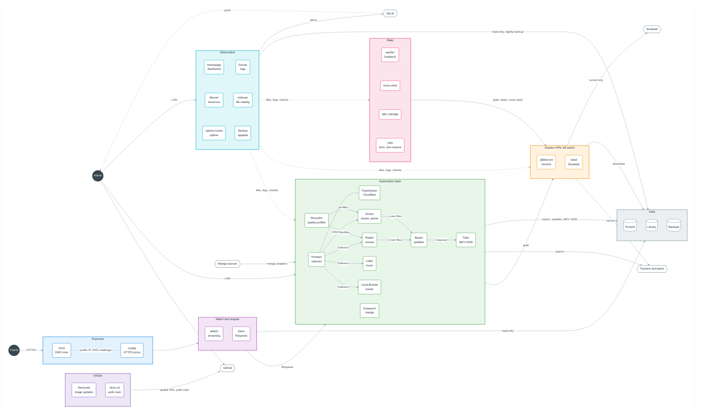
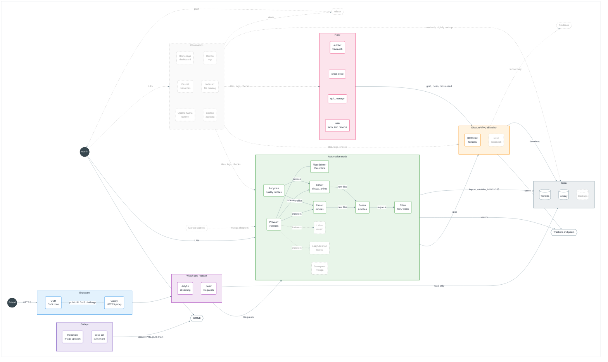

# Jellynas

A personal media server built on Jellyfin, shared with Friends over the internet.

Follow the sections in order. Each one starts with the sections it requires, which must be done first. Every command runs on the Host, as root, from the clone, as [Host](#host) sets out.

1. [Host](#host)
2. [Fill in the settings](#fill-in-the-settings)
3. [Create the data and appdata roots](#create-the-data-and-appdata-roots)
4. [Domain](#domain)
5. [Start the NAS](#start-the-nas)
6. [Jellyfin](#jellyfin)
7. [Seerr](#seerr)
8. [qBittorrent](#qbittorrent)
9. [Radarr](#radarr)
10. [Prowlarr](#prowlarr)
11. [Movie Requests](#movie-requests)
12. [Sonarr](#sonarr)
13. [Show Requests](#show-requests)
14. [Recyclarr](#recyclarr)
15. [Tdarr](#tdarr)
16. [Bazarr](#bazarr)
17. [Private tracker ratio](#private-tracker-ratio)
18. [Verify the NAS](#verify-the-nas)

## Architecture

### Target

The NAS once every planned service runs (#13, #14, #15, #38, #39, #40). Dark circles are people, hexagons are services outside the NAS, rounded boxes are containers, cylinders are storage.



### Current (main)

Same layout. Dashed grey boxes and links are planned and not running yet.



## Host

The NAS runs on TrueNAS SCALE, in a Hyper-V virtual machine on the PC until the UGREEN NAS replaces it. [ADR 0007](docs/adr/0007-the-nas-runs-on-the-docker-of-truenas-scale.md) records why. Every command of this README runs on TrueNAS, in System > Shell or over SSH, as root and from the clone:

```sh
sudo -i
cd /mnt/tank/jellynas
```

### Virtual machine

Download the TrueNAS SCALE ISO from [truenas.com](https://www.truenas.com/download-truenas-community-edition/). In PowerShell run as administrator, create an external switch on the Ethernet adapter, which cuts the network of the PC for a few seconds, then the virtual machine with its boot and pool disks:

```powershell
New-VMSwitch -Name External -NetAdapterName Ethernet -AllowManagementOS $true
New-VM -Name truenas -Generation 2 -MemoryStartupBytes 8GB -SwitchName External -NewVHDPath C:\Hyper-V\truenas\boot.vhdx -NewVHDSizeBytes 32GB
Set-VM -Name truenas -ProcessorCount 3 -StaticMemory -CheckpointType Disabled -AutomaticStartAction Start -AutomaticStopAction ShutDown
Set-VMFirmware -VMName truenas -EnableSecureBoot Off
New-VHD -Path C:\Hyper-V\truenas\pool.vhdx -SizeBytes 200GB -Dynamic
Add-VMHardDiskDrive -VMName truenas -Path C:\Hyper-V\truenas\pool.vhdx
Add-VMDvdDrive -VMName truenas -Path <path of the ISO>
Set-VMFirmware -VMName truenas -FirstBootDevice (Get-VMDvdDrive -VMName truenas)
Start-VM -Name truenas
```

Checkpoints stay disabled, the snapshots of ZFS replace them. The virtual machine starts and stops with the PC.

Open it in Hyper-V Manager and install TrueNAS on the 32 GB disk, with `truenas_admin` as the administrative user. Leave the installer on its final menu, and pin the MAC address of the virtual machine, so that the router always gives it the same address:

```powershell
$mac = (Get-VMNetworkAdapter -VMName truenas).MacAddress
Stop-VM -Name truenas -TurnOff -Force
Set-VMNetworkAdapter -VMName truenas -StaticMacAddress $mac
Get-VMDvdDrive -VMName truenas | Remove-VMDvdDrive
Set-VMFirmware -VMName truenas -FirstBootDevice (Get-VMHardDiskDrive -VMName truenas -ControllerLocation 0)
Start-VM -Name truenas
```

In the router, give that MAC address a fixed local IP. It is the address of the NAS.

### Pool and datasets

Open `http://<NAS address>` and sign in with `truenas_admin`. Once [Domain](#domain) is done, TrueNAS also answers at `https://truenas.lan.<DOMAIN>:<CADDY_HTTPS_PORT>`.

1. In Storage, create a pool named `tank` on the 200 GB disk, as a stripe. The redundancy comes with the UGREEN.
2. In Datasets, add three datasets to `tank` with the "Apps" preset, so the `apps` user, 568, owns them: `data`, `appdata` and `jellynas`. Never add a child dataset under `data`: `torrents` and `media` are plain folders, so that the hardlinks of cross-seed stay on one file system.
3. In Apps, click "Configure", pick `tank` as the pool, and save. TrueNAS starts its Docker.

### Clone

In System > Shell, clone the repo into its dataset. Git refuses a clone that root does not own until it is marked as safe:

```sh
sudo -i
git clone https://github.com/Amaroke/Jellynas.git /mnt/tank/jellynas
git config --global --add safe.directory /mnt/tank/jellynas
```

## Fill in the settings

Requires [Host](#host).

```sh
cp .env.example .env
```

Open `.env` and fill in every value. Each variable is explained in `.env.example`. Wrap a value in double quotes if it contains a space. `.env` is ignored by git and must never be committed.

## Create the data and appdata roots

Requires [Host](#host) and [Fill in the settings](#fill-in-the-settings).

Both roots live outside the repo, at the paths set in `DATA_ROOT` and `APPDATA_ROOT`. The data root holds a single tree, so that one folder holds every download and the whole Library:

```text
<DATA_ROOT>
├── torrents
└── media
    ├── movies
    ├── shows
    ├── anime
    ├── music
    ├── books
    └── manga
```

Create it from the clone:

```bash
set -a && . ./.env && set +a
mkdir -p "$DATA_ROOT"/torrents "$DATA_ROOT"/media/{movies,shows,anime,music,books,manga} "$APPDATA_ROOT"/seerr "$APPDATA_ROOT"/recyclarr
chown -R "$PUID:$PGID" "$DATA_ROOT" "$APPDATA_ROOT"
```

The services run as `PUID` and `PGID`, so the last command gives them the folders that root just created.

## Domain

Requires [Host](#host) and [Fill in the settings](#fill-in-the-settings).

Caddy is the only service the NAS publishes, on `CADDY_HTTPS_PORT`. Friends reach `jellyfin.<DOMAIN>` and `seerr.<DOMAIN>` from the internet. The Admin reaches every tool at `<tool>.lan.<DOMAIN>`, from the local network only: Caddy refuses a lan name to any address outside `LAN_SUBNET`, and refuses any name it does not know. Through the OVH API, Caddy obtains a wildcard certificate for `*.<DOMAIN>` and one for `*.lan.<DOMAIN>`, so no port opens for the certificates and the certificate logs never list the tools, and it keeps `jellyfin` and `seerr` on the public IP of the home. [ADR 0008](docs/adr/0008-the-nas-answers-on-its-own-domain.md) records why.

### DNS zone

In the [OVH Control Panel](https://www.ovh.com/manager/), open Web Cloud > Domain names > `<DOMAIN>` > DNS zone, click "Add an entry", pick `A`, enter `*.lan` as the subdomain and the fixed local IP of the NAS as the target. Leave every other entry as it is, such as the ones of the OVH email. Caddy creates the `jellyfin` and `seerr` entries itself at its first start.

### API keys

1. Open [eu.api.ovh.com/createToken](https://eu.api.ovh.com/createToken/) and sign in with the OVH Account that holds the domain.
2. Enter `Jellynas Caddy` as the name and description, and pick "Unlimited" as the validity.
3. Add these rights, with `<DOMAIN>` written out, so the keys can only change the records of the zone:

   | Method | Path |
   | --- | --- |
   | GET | `/domain/zone/<DOMAIN>/record` |
   | POST | `/domain/zone/<DOMAIN>/record` |
   | GET | `/domain/zone/<DOMAIN>/record/*` |
   | PUT | `/domain/zone/<DOMAIN>/record/*` |
   | DELETE | `/domain/zone/<DOMAIN>/record/*` |
   | GET | `/domain/zone/<DOMAIN>/soa` |
   | POST | `/domain/zone/<DOMAIN>/refresh` |

4. Create the keys, then copy the application key, the application secret and the consumer key into `OVH_APPLICATION_KEY`, `OVH_APPLICATION_SECRET` and `OVH_CONSUMER_KEY` in `.env`.
5. In `.env`, set `DOMAIN` to the domain and `LAN_SUBNET` to the local network, for example `192.168.1.0/24` when the router is `192.168.1.254`.

### Router port forward

Pick the HTTPS port and set it in `CADDY_HTTPS_PORT`, or leave it empty for 443. A high port that no service uses by default, such as a random five-digit number, draws fewer automated scans. Friends then add it to the address, for example `https://jellyfin.<DOMAIN>:<port>`, which the Jellyfin apps accept.

On your router, forward that single TCP port to the local IP of the NAS, and nothing else. Set both the external and the internal port of the rule to `CADDY_HTTPS_PORT`, never the internal port to 443: Caddy listens on `CADDY_HTTPS_PORT` on the NAS.

### Addresses

Once [Start the NAS](#start-the-nas) is done, each tool answers at its own address, with `:<CADDY_HTTPS_PORT>` after the name unless it is 443:

| Service | Address | Reached from |
| --- | --- | --- |
| Jellyfin | `https://jellyfin.<DOMAIN>` | Anywhere |
| Seerr | `https://seerr.<DOMAIN>` | Anywhere |
| TrueNAS | `https://truenas.lan.<DOMAIN>` | Local network |
| Jellyfin | `https://jellyfin.lan.<DOMAIN>` | Local network |
| Seerr | `https://seerr.lan.<DOMAIN>` | Local network |
| qBittorrent | `https://qbittorrent.lan.<DOMAIN>` | Local network |
| Prowlarr | `https://prowlarr.lan.<DOMAIN>` | Local network |
| Radarr | `https://radarr.lan.<DOMAIN>` | Local network |
| Sonarr | `https://sonarr.lan.<DOMAIN>` | Local network |
| Bazarr | `https://bazarr.lan.<DOMAIN>` | Local network |
| Tdarr | `https://tdarr.lan.<DOMAIN>` | Local network |
| autobrr | `https://autobrr.lan.<DOMAIN>` | Local network |
| qbit_manage | `https://qbit-manage.lan.<DOMAIN>` | Local network |

cross-seed has an API only, which the other containers reach at `http://cross-seed:2468`. The first certificates take a few minutes, follow them with:

```sh
docker compose logs -f caddy
```

The line `certificate obtained successfully` shows up once for `*.<DOMAIN>` and once for `*.lan.<DOMAIN>`.

## Start the NAS

Requires [Fill in the settings](#fill-in-the-settings), [Create the data and appdata roots](#create-the-data-and-appdata-roots) and [Domain](#domain).

The NAS follows the `main` branch of GitHub: a change merged into `main` reaches the NAS within minutes, and nothing else changes it. The clone on the Host holds `.env`, outside git, and starts doco-cd, but the NAS never runs from it. Edit the repo in another folder and go through a pull request. Pull the clone before running a script of the repo:

```sh
git pull --ff-only
```

Never start the NAS with `docker compose up` from the clone: it would recreate the services from the clone, and doco-cd would recreate them again at its next poll. `docker compose logs`, `exec`, `stop`, `start` and `restart` are safe.

The settings made in the web UIs of the services live in the appdata root, not in git, so the deploy never touches them. Back up the appdata root to keep them.

### doco-cd

[doco-cd](https://doco.cd) is a container, outside the NAS project, that polls `main` every 3 minutes and deploys `compose.yaml` with `.env`, as set in `.doco-cd.yml`. [ADR 0010](docs/adr/0010-doco-cd-deploys-main.md) records why. Start it once from the clone, its first poll starts the whole NAS:

```sh
docker compose -f doco-cd/compose.yaml up -d
```

Each deploy runs from a copy of the merged revision, kept in the data volume of doco-cd. It recreates the services whose compose definition or image changed, and those that mount a file of the repo that changed, such as `ratio/ratio.py`. It rebuilds Caddy from its Dockerfile, and removes the services commented out in `compose.yaml`. A failed deploy is retried at the next poll.

doco-cd reaches Docker through its socket, which gives it full control of the machine, like any tool that runs Compose.

Its logs name each deploy, and the reason of each failed one:

```sh
docker logs doco-cd
```

A change of `.env` is no new revision. To apply it, or to deploy without waiting, restart doco-cd, it polls as soon as it starts:

```sh
docker restart doco-cd
```

Renovate opens the updates of doco-cd itself and never merges them. Once one is merged, pull the clone and recreate doco-cd:

```sh
git pull --ff-only
docker compose -f doco-cd/compose.yaml up -d
```

Each service is one line in the root `compose.yaml`. To disable a service, comment its line in a pull request: once merged, doco-cd removes it.

### Renovate

[Renovate](https://github.com/apps/renovate) keeps the images and the GitHub Actions up to date. Install the app on the repo only, then merge the onboarding pull request it opens if it still opens one. Its settings are in `renovate.json`:

- It opens its pull requests as soon as a release is published, and merges an update only once its release is 3 days old.
- It merges a minor or patch update by itself once the CI passes, and the NAS deploys it.
- A major update, and any update of Gluetun or qBittorrent, waits for the Admin to read its release notes and merge it.
- The Dependency Dashboard issue lists every pending update.

## Jellyfin

Requires [Start the NAS](#start-the-nas).

### First-run wizard

1. Open `https://jellyfin.lan.<DOMAIN>:<CADDY_HTTPS_PORT>` from a browser on the local network.
2. Pick the display language and create the Admin Account with a strong password stored in your password manager.
3. Skip the library step, [Libraries](#libraries) does it.
4. Keep the metadata language and country you prefer.
5. Leave "Allow remote connections to this server" checked, Friends will reach Jellyfin from the internet through [Domain](#domain).

### Libraries

The media tree is mounted read-only under `/data/media`, so Jellyfin can never delete or change a file. In Dashboard > Libraries, add one library per folder:

| Library | Content type | Folder |
| --- | --- | --- |
| Movies | Movies | `/data/media/movies` |
| Shows | Shows | `/data/media/shows` |
| Anime | Shows | `/data/media/anime` |
| Music | Music | `/data/media/music` |
| Books | Books | `/data/media/books` |
| Manga | Books | `/data/media/manga` |

For each library, leave "Save artwork into media folders" and every "Metadata savers" option unchecked: Jellyfin cannot write into the Library and keeps its metadata in its appdata folder instead.

### Friend Accounts

Each Friend gets their own Account, so their watch history and progress are theirs. In Dashboard > Users, click "+" and:

1. Enter the Friend's name and a password, then give both to the Friend privately.
2. Grant access to all libraries.
3. Leave "Allow this user to manage the server" unchecked.
4. Check "Allow media downloading" so the Friend can download videos, books and manga to their phone.

### Jellyfin behind Caddy

In Dashboard > Networking, add `caddy` to "Known proxies" and save. Jellyfin then sees the real address of each Friend instead of the address of Caddy. Jellyfin looks up the address of Caddy when it starts, so restart it now and whenever Caddy is recreated:

```sh
docker compose restart jellyfin
```

## Seerr

Requires [Jellyfin](#jellyfin).

Friends make Requests in Seerr, on its own public hostname, and log in with their Jellyfin Account. Seerr has no access to the Library files.

### Setup wizard

1. Open `https://seerr.lan.<DOMAIN>:<CADDY_HTTPS_PORT>` from a browser on the local network.
2. Choose Jellyfin as the media server.
3. Enter `jellyfin` as the hostname, `8096` as the port, leave SSL off and the URL base empty.
4. Enter an email address and the username and password of the Jellyfin Admin Account. This Account becomes the Seerr Admin.
5. Sync the libraries and enable Movies, Shows and Anime.
6. Skip the Radarr and Sonarr step, [Movie Requests](#movie-requests) and [Show Requests](#show-requests) add them.

### Settings

1. In Settings > General, set "Application URL" to `https://seerr.<DOMAIN>:<CADDY_HTTPS_PORT>`, without the port if it is 443.
2. In Settings > Network, check "Enable Proxy Support" so Seerr sees the real address of each Friend.
3. In Settings > Jellyfin, set "External URL" to `https://jellyfin.<DOMAIN>:<CADDY_HTTPS_PORT>` so links to a movie open the public Jellyfin.
4. In Settings > Users, check "Enable Jellyfin Sign-In" and "Enable New Jellyfin Sign-In", uncheck "Enable Local Sign-In", and leave the default permissions on "Request".

A Friend then opens the Seerr address, picks "Sign in with Jellyfin" and enters their Jellyfin Account, with no second login to create.

## qBittorrent

Requires [Start the NAS](#start-the-nas).

qBittorrent downloads torrents into the torrents tree, the only folder it sees, mounted under `/data/torrents`. It shares the network of Gluetun, whose firewall only lets traffic out through the VPN. When the VPN is down or not configured yet, qBittorrent has no connectivity at all, so your real IP never leaks.

### VPN

Until you choose a provider, leave every VPN value of `.env` empty. Gluetun then starts with a tunnel that leads nowhere and shows as unhealthy, which is expected.

Once you have a provider:

1. Find your provider on the [Gluetun providers page](https://github.com/qdm12/gluetun-wiki/tree/main/setup/providers) and note the values it asks for.
2. In `.env`, set `VPN_SERVICE_PROVIDER` to the provider name and `VPN_TYPE` to `wireguard` or `openvpn`.
3. For WireGuard, download a WireGuard config file from the provider and copy its `PrivateKey` into `WIREGUARD_PRIVATE_KEY` and its `Address` into `WIREGUARD_ADDRESSES`. For OpenVPN, set `OPENVPN_USER` and `OPENVPN_PASSWORD` to the manual setup credentials of the provider.
4. Optionally set `SERVER_COUNTRIES` to the countries you want to exit from.
5. Recreate Gluetun and qBittorrent:

   ```sh
   docker restart doco-cd
   ```

The line `Public IP address is` in `docker compose logs gluetun` shows the VPN address, never your home address. Gluetun then turns healthy.

### AirVPN

1. Sign in on the [AirVPN Client Area](https://airvpn.org/client/) and open the [Config Generator](https://airvpn.org/generator/).
2. Pick Linux as the system, WireGuard as the protocol, and the country you want to exit from, then generate and download the config file.
3. In `.env`, set `VPN_SERVICE_PROVIDER` to `airvpn`, `VPN_TYPE` to `wireguard`, and either `SERVER_COUNTRIES` to a country such as `Netherlands` or `SERVER_REGIONS` to `Europe` to let Gluetun pick among every European server. The keys work with any server.
4. From the config file, copy `PrivateKey` into `WIREGUARD_PRIVATE_KEY`, `PresharedKey` into `WIREGUARD_PRESHARED_KEY`, and only the IPv4 part of `Address` into `WIREGUARD_ADDRESSES`, for example `10.128.0.2/32`. Then delete the file, it holds your keys.
5. On the [ports page](https://airvpn.org/ports/), reserve a port, leave its local port empty, and set `VPN_FORWARDED_PORT` to it.
6. Recreate Gluetun and qBittorrent with `docker restart doco-cd`.

In qBittorrent, Tools > Options > Connection, set "Port used for incoming connections" to `VPN_FORWARDED_PORT` and uncheck "Use UPnP / NAT-PMP port forwarding from my router". Back on the ports page, the test button of the port then shows it as open while a torrent runs.

### Account

1. Read the temporary password qBittorrent printed at its first start:

   ```sh
   docker compose logs qbittorrent
   ```

2. qBittorrent refuses its web UI behind Caddy until it trusts it as a reverse proxy, so turn on its reverse proxy support for the Docker networks, `172.16.0.0/12` on TrueNAS, while it is stopped:

   ```sh
   set -a && . ./.env && set +a
   docker compose stop qbittorrent
   sed -i '/^\[Preferences\]/a WebUI\\ReverseProxySupportEnabled=true\nWebUI\\TrustedReverseProxiesList=172.16.0.0/12' "$APPDATA_ROOT"/qbittorrent/qBittorrent/qBittorrent.conf
   docker compose start qbittorrent
   ```

   Caddy sends qBittorrent its own address as the host and the lan name in `X-Forwarded-Host`, which qBittorrent then checks against the origin of each request, so its CSRF protection stays on.

3. Open `https://qbittorrent.lan.<DOMAIN>:<CADDY_HTTPS_PORT>` from a browser on the local network and sign in with `admin` and that password.
4. In Tools > Options > WebUI > Authentication, set a new username and a strong password stored in your password manager. Leave both "Bypass authentication" options unchecked.

### Save paths

In Tools > Options > Downloads, set "Default Save Path" to `/data/torrents`, uncheck "Keep incomplete torrents in", and save. Any other path would land inside the container and be lost.

### Downloads and seeding

Each finished torrent keeps seeding from the torrents tree for a while, to give back to other peers. qBittorrent stops it once it reaches its seeding goal, then the tool that sent it removes it. In Tools > Options, set:

| Screen | Setting | Value |
| --- | --- | --- |
| Downloads | Default Torrent Management Mode | Automatic, so each category picks its own save path |
| Downloads | Append .!qB extension to incomplete files | Checked, so no tool imports a file that is still downloading |
| BitTorrent | Privacy | DHT and PeX checked, Local Peer Discovery unchecked since the container has no local peers |
| Connection | Connections Limits | 1000 connections in all and 200 per torrent, upload slots unchecked in all and per torrent, so no swarm waits for a free slot |
| BitTorrent | Torrent Queueing | 3 active downloads, 30 active uploads, 35 active torrents, "Do not count slow torrents in these limits" checked so a dead torrent never holds a place |
| BitTorrent | Seeding Limits | Ratio 2 and total seeding time 20160 minutes (14 days), whichever comes first, then "Stop torrent" |
| Advanced | Network interface | `tun0`, so qBittorrent only ever uses the VPN, on top of the Gluetun kill switch |
| Advanced | Upload slots behavior | Upload rate based, so qBittorrent opens slots while upload bandwidth is left |
| Advanced | Upload choking algorithm | Fastest upload, so the peers that take the most are served first |
| Advanced | Outgoing connections per second | `100`, so a fresh torrent reaches its leechers within seconds |
| Advanced | Send buffer watermark, low watermark, factor | `5120` KiB, `1024` KiB, `150` %, so upload stays steady at high speed |
| Advanced | Socket backlog size | `100` |

Optionally, in Speed, set a global upload limit to about 60% of your internet upload speed, so seeding never slows Jellyfin streams to Friends.

## Radarr

Requires [qBittorrent](#qbittorrent).

Radarr fulfils movie Requests: it searches the indexers, sends the torrent to qBittorrent, then copies the finished movie into the Library. It sees only the movies folder, under `/data/media/movies`, and the torrents tree, under `/data/torrents`.

### Account

1. Open `https://radarr.lan.<DOMAIN>:<CADDY_HTTPS_PORT>` from a browser on the local network.
2. Radarr asks for an authentication method at the first visit. Pick "Forms (Login Page)", set "Authentication Required" to "Enabled", never "Disabled for Local Addresses", and enter a username and a strong password, distinct from the other tools, stored in your password manager.

### Media management

In Settings > Media Management, click "Show Advanced" at the top, then:

1. Under Root Folders, add `/data/media/movies`.
2. Check "Rename Movies".
3. Under Importing, uncheck "Use Hardlinks instead of Copy". Each import is a copy, so the torrent keeps seeding from the torrents tree while Tdarr normalises the Library file.
4. Under File Management, set "Recycling Bin" to `/data/media/movies/.recycle` and "Recycling Bin Cleanup" to `30` days. A deleted movie stays there for 30 days and can be moved back. Jellyfin and Radarr skip hidden folders, so it never shows up as a movie.

Create the recycle bin folder first, from the repo folder in bash:

```bash
set -a && . ./.env && set +a
mkdir -p "$DATA_ROOT"/media/movies/.recycle
chown -R "$PUID:$PGID" "$DATA_ROOT" "$APPDATA_ROOT"
```

### Download client

1. In qBittorrent, right-click "Categories" in the left panel, pick "Add category", and enter `radarr` as the category and `/data/torrents/movies` as the save path.
2. In Radarr, Settings > Download Clients, click "+" and pick qBittorrent.
3. Enter `gluetun` as the host, since qBittorrent shares its network, `8080` as the port, and the qBittorrent Account.
4. Set "Category" to `radarr`.
5. Check "Remove Completed": once qBittorrent stops a torrent at its seeding goal, Radarr removes it and its files from the torrents tree, and the movie stays in the Library.
6. Click "Test", then "Save".

Copy the API key from Settings > General > Security, [Radarr sync](#radarr-sync) and [Movie Requests](#movie-requests) need it.

## Prowlarr

Requires [Radarr](#radarr).

Prowlarr holds the indexers once and pushes them to Radarr, and later to the other tools. FlareSolverr opens indexers protected by Cloudflare for it. Neither sees any media file.

### Account

Open `https://prowlarr.lan.<DOMAIN>:<CADDY_HTTPS_PORT>` and set the authentication the same way as Radarr, with its own username and password.

### FlareSolverr

In Settings > Indexers, click "+" and pick FlareSolverr. Enter `flaresolverr` as the tag and `http://flaresolverr:8191/` as the host, then save. FlareSolverr has no web UI and is reachable by the other containers only.

### Indexers

In Indexers, click "Add Indexer", pick a tracker and fill in what it asks for, an Account for a private one. For an indexer behind Cloudflare, add the `flaresolverr` tag so its requests go through FlareSolverr. Click "Test", then "Save".

### Radarr sync

1. In Prowlarr, not Radarr, open Settings > Apps, click "+" and pick Radarr.
2. Leave "Sync Level" on "Full Sync".
3. Set "Prowlarr Server" to `http://prowlarr:9696` and "Radarr Server" to `http://radarr:7878`.
4. Paste the Radarr API key, click "Test", then "Save".

Every indexer then shows up in Radarr, Settings > Indexers, and follows any change made in Prowlarr.

### Seeding goals of private trackers

A private tracker bans an Account that removes a torrent before its minimum seeding time or ratio, a hit and run. For each private indexer, in Indexers, edit it, click "Show Advanced", and set "Seed Ratio" and "Seed Time" in minutes to the minimums of its rules page. Prowlarr syncs them to Radarr and Sonarr, which hand them to qBittorrent with each torrent, so "Remove Completed" never removes a private torrent before the tracker allows it. An indexer left empty uses the global seeding limits of qBittorrent.

## Movie Requests

Requires [Seerr](#seerr), [Radarr](#radarr) and [Prowlarr](#prowlarr).

In Seerr, Settings > Services, click "Add Radarr Server":

1. Check "Default Server" and enter `Radarr` as the name.
2. Enter `radarr` as the hostname, `7878` as the port, leave SSL off, and paste the Radarr API key.
3. Click "Test", then pick a quality profile, `/data/media/movies` as the root folder, and "Released" as the minimum availability.
4. Leave "Enable Automatic Search" checked and save.

An approved movie Request is then searched by Radarr, downloaded by qBittorrent into `/data/torrents/movies`, and copied into the movies folder, where Jellyfin picks it up.

## Sonarr

Requires [qBittorrent](#qbittorrent) and [Prowlarr](#prowlarr).

Sonarr fulfils show Requests and fetches new episodes on its own: it searches the indexers, sends the torrent to qBittorrent, then copies each finished episode into the Library. It sees only the shows and anime folders, under `/data/media/shows` and `/data/media/anime`, and the torrents tree, under `/data/torrents`.

### Account

Open `https://sonarr.lan.<DOMAIN>:<CADDY_HTTPS_PORT>` and set the authentication the same way as Radarr, with its own username and password.

### Media management

In Settings > Media Management, click "Show Advanced" at the top, then:

1. Under Root Folders, add `/data/media/shows` and `/data/media/anime`.
2. Check "Rename Episodes".
3. Under Importing, uncheck "Use Hardlinks instead of Copy". Each import is a copy, so the torrent keeps seeding from the torrents tree while Tdarr normalises the Library file.
4. Under File Management, set "Recycling Bin" to `/data/media/shows/.recycle` and "Recycling Bin Cleanup" to `30` days. Deleted episodes of both shows and anime stay there for 30 days and can be moved back.

Create the recycle bin folder first, from the repo folder in bash:

```bash
set -a && . ./.env && set +a
mkdir -p "$DATA_ROOT"/media/shows/.recycle
chown -R "$PUID:$PGID" "$DATA_ROOT" "$APPDATA_ROOT"
```

### Download client

1. In qBittorrent, add a category `tv-sonarr` with `/data/torrents/shows` as the save path.
2. In Sonarr, Settings > Download Clients, click "+" and pick qBittorrent.
3. Enter `gluetun` as the host, `8080` as the port, and the qBittorrent Account.
4. Set "Category" to `tv-sonarr`.
5. Check "Remove Completed": once qBittorrent stops a torrent at its seeding goal, Sonarr removes it and its files from the torrents tree, and the episodes stay in the Library.
6. Click "Test", then "Save".

Copy the API key from Settings > General > Security, [Sonarr sync](#sonarr-sync) and [Show Requests](#show-requests) need it.

### Sonarr sync

In Prowlarr, Settings > Apps, click "+" and pick Sonarr. Set "Prowlarr Server" to `http://prowlarr:9696` and "Sonarr Server" to `http://sonarr:8989`, paste the Sonarr API key, click "Test", then "Save". Every indexer with TV categories then shows up in Sonarr, Settings > Indexers. An indexer without TV categories, such as Internet Archive, is never synced to Sonarr.

## Show Requests

Requires [Seerr](#seerr) and [Sonarr](#sonarr).

In Seerr, Settings > Services, click "Add Sonarr Server":

1. Check "Default Server" and enter `Sonarr` as the name.
2. Enter `sonarr` as the hostname, `8989` as the port, leave SSL off, and paste the Sonarr API key.
3. Click "Test". The quality profiles only load once the test succeeds. Pick one and `/data/media/shows` as the root folder.
4. Set "Anime Series Type" to "Anime", pick the same quality profile for anime and `/data/media/anime` as the anime root folder.
5. Check "Season Folders" to match Sonarr, leave "Enable Automatic Search" checked, and save.

An approved show Request is then searched by Sonarr, downloaded by qBittorrent into `/data/torrents/shows`, and copied into the shows folder, or the anime folder for an anime, where Jellyfin picks it up. New episodes of a monitored show follow on their own.

## Recyclarr

Requires [Radarr](#radarr) and [Sonarr](#sonarr).

Recyclarr creates the quality profiles of Radarr and Sonarr, so that most downloads already match the Library format and Tdarr rarely has to re-encode. It sees no media file and only talks to the Radarr and Sonarr APIs. Its config is `recyclarr/recyclarr.yml`, with a few custom formats of our own in `recyclarr/custom-formats`, and it syncs again every day at midnight.

Each tool gets two profiles, built from the French profiles of the [TRaSH Guides](https://trash-guides.info/Radarr/radarr-setup-quality-profiles-french-en/):

- **MULTi 1080p**, for movies and shows: French and original audio required, H265 preferred, 1080p first.
- **Anime 1080p**, for anime: a `MULTi` with French subtitles first, then a VOSTFR, then any other `MULTi`.

[ADR 0002](docs/adr/0002-recyclarr-prefers-french-h265-1080p.md) lists every rule and why. Change a rule in the config, never in Radarr or Sonarr, since each sync overwrites the profiles.

### API keys

In `.env`, set `RADARR_API_KEY` and `SONARR_API_KEY` to the keys copied from Settings > General > Security in each tool, then start Recyclarr:

```sh
docker restart doco-cd
```

Sync right away instead of waiting for midnight:

```sh
docker compose exec recyclarr recyclarr sync
```

Each tool ends with a `Completed` line and no error. Lines about `conflicting scores` are expected: they show the config overriding a TRaSH score. Run the same command after changing anything under `recyclarr/`.

### Assign the profiles

Recyclarr creates the profiles but never assigns them.

1. In Sonarr, Series, click "Select Series", select every show, pick `MULTi 1080p` under "Quality Profile" at the bottom, and save. Then select every anime, those with the "Anime" series type, and pick `Anime 1080p`.
2. In Radarr, Movies, select every movie and pick `MULTi 1080p`. Then select each Japanese animated movie and pick `Anime 1080p`. Radarr cannot tell an anime movie apart, so do this after each anime movie Request too.
3. In Settings > Profiles of each tool, delete the profiles that came with it, so a new movie or show can only get a Recyclarr one.
4. In Seerr, Settings > Services, edit Radarr and pick `MULTi 1080p` as the quality profile. Edit Sonarr, pick `MULTi 1080p` as the quality profile and `Anime 1080p` as the anime quality profile.

### Check a release

Interactive Search, in a movie or an episode, shows the score of each release and why any is refused. To score a release name without searching, use the parse endpoint of Radarr. The name must match a movie already in Radarr, here Your Name, otherwise no profile applies and the score stays at 0:

```bash
set -a && . ./.env && set +a
curl -s -G -H "X-Api-Key: $RADARR_API_KEY" --data-urlencode "title=Your.Name.2016.MULTi.1080p.WEB.x265-GROUP" "https://radarr.lan.${DOMAIN}:${CADDY_HTTPS_PORT:-443}/api/v3/parse"
```

The answer holds `customFormats` and `customFormatScore`. A score below -5000 means refused. Sonarr answers the same on its own port with the name of an episode of a show it has.

## Tdarr

Requires [Radarr](#radarr) and [Sonarr](#sonarr).

Tdarr normalises every video of the Library to MKV H265 within 1920x1080, as [ADR 0004](docs/adr/0004-the-library-is-mkv-h265-with-embedded-subtitles.md) sets out. It sees only the movies, shows and anime folders, under the same paths as Radarr and Sonarr, and never the torrents tree, so a torrent still seeding is never touched. Its work files go to `<APPDATA_ROOT>/tdarr/cache`.

The flow, `tdarr/flow.json`, decides from the tracks of each file, as [ADR 0004](docs/adr/0004-the-library-is-mkv-h265-with-embedded-subtitles.md) records:

- It keeps French audio and the original audio, the language of the first audio track that is not French.
- It keeps French and English subtitles, or French and Japanese ones when the original audio is Japanese, forced subtitles included, inside the MKV.
- A file already in H265 within 1920x1080 keeps its video as is, only its extra tracks are removed. Any other video is encoded to H265 and scaled down to fit within 1920x1080, keeping its aspect ratio, never scaled up.
- It embeds the subtitle files that Bazarr saved next to the video, such as `.fr.srt` or `.ja.forced.ass`, under the same language rules, and deletes them once the new file is in place.
- The new MKV replaces the original file. Tdarr then asks Radarr for movies, or Sonarr for shows and anime, to rescan the folder, with the API keys of `.env`, so they and Bazarr know the new file right away.

### Disk space while seeding

Each import is a copy, so a downloaded file sits twice on the disk: once in the torrents tree, where it seeds, and once in the Library, where Tdarr rewrites it. The torrents copy goes away once qBittorrent stops the torrent at its seeding goal and Radarr or Sonarr remove it with "Remove Completed". Keep enough free space for every torrent still seeding.

### Account

1. In `.env`, set `TDARR_API_KEY` before the first start of Tdarr, to `tapi_` followed by random letters and digits:

   ```bash
   echo "tapi_$(openssl rand -hex 16)"
   ```

2. Start Tdarr with `docker restart doco-cd`. It creates the `admin` Account with that key as its password, and its internal node connects with the same key.
3. Open `https://tdarr.lan.<DOMAIN>:<CADDY_HTTPS_PORT>` from a browser on the local network and sign in with `admin` and the key.
4. In Tools > Account, click "Change Password" and set a strong password, distinct from the other tools, stored in your password manager. The key keeps working for the node.

### Flow

1. In Flows, click "Import JSON Flow Template", paste the content of `tdarr/flow.json`, and create the flow.
2. After pulling a change to `tdarr/flow.json`, import it again and pick "Update Existing Flow".

### Libraries

In Libraries, click "Library +" once per folder:

| Library | Source |
| --- | --- |
| Movies | `/data/media/movies` |
| Shows | `/data/media/shows` |
| Anime | `/data/media/anime` |

For each library:

1. In Source, enter the folder, check "Folder Watch", and leave "Hold Files After Scanning" checked so a file still being copied by Radarr or Sonarr waits before it is processed.
2. In Transcode Cache, enter `/temp`.
3. In Transcode, pick "Flows" and the `Jellynas normalise to MKV H265 1080p` flow.
4. Leave the output folder empty, so each file is replaced in place.

### Node

On the home page, the internal node starts with one transcode and one health check CPU worker. Raise the transcode workers if the machine has cores to spare, each one encodes a file at a time.

## Bazarr

Requires [Radarr](#radarr), [Sonarr](#sonarr), [Recyclarr](#recyclarr) and [Tdarr](#tdarr).

Bazarr gives every movie and show French and English subtitles. It learns about each file from Radarr and Sonarr, then saves the subtitles next to it in the Library, where Tdarr embeds them into the video and deletes the subtitle files. It sees only the movies, shows and anime folders, under the same paths as Radarr and Sonarr, so no path mapping is needed.

### Account

1. Open `https://bazarr.lan.<DOMAIN>:<CADDY_HTTPS_PORT>` from a browser on the local network.
2. In Settings > General > Security, set "Authentication" to "Form", enter a username and a strong password, distinct from the other tools, stored in your password manager, and save.

### Languages

Subtitles are for watching in the original audio. Movies and shows get French and English subtitles, anime get French and Japanese ones, and a French original work gets none. [ADR 0004](docs/adr/0004-the-library-is-mkv-h265-with-embedded-subtitles.md) records why.

Sonarr and Radarr tag each work so that Bazarr knows which case applies. In Settings > Tags of Sonarr, click "+" under Auto Tagging twice, check "Remove Tags Automatically" each time, and create:

| Name | Tag | Condition |
| --- | --- | --- |
| Anime | `anime` | Series Type is Anime |
| French original | `french-original` | Original Language is French |

Do the same in Radarr, with the condition "Quality Profile is `Anime 1080p`" for the Anime rule, since Radarr cannot tell an anime movie apart. Each work gets its tags at its next refresh, or right away with "Update All" in Series and in Movies.

Then in Bazarr, Settings > Languages:

1. Add French, English and Japanese to "Languages Filter".
2. Under "Languages Profile", click "Add New Profile", name it `French and English`, add French and English, and save the profile.
3. Add a second profile named `French and Japanese` with French and Japanese, and enter `anime` as its tag.
4. Check "Series" and "Movies" under "Tag-Based Automatic Language Profile Selection", and enter `french-original` under "Remove Profile Tags".
5. Under "Default Language Profiles For Newly Added Shows", check "Series" and "Movies" and pick `French and English` for both, then save.

A subtitle track already inside the file counts as found, so a `MULTi` release with French subtitles needs no download.

### Providers

In Settings > Providers, click "+" for each provider, fill in what it asks for, and save:

| Provider | Account | Covers |
| --- | --- | --- |
| OpenSubtitles.com | Free Account on [opensubtitles.com](https://www.opensubtitles.com), with a daily download limit | Movies and shows, the widest French catalogue |
| Podnapisi | None | Movies and shows |
| Gestdown | None | Shows, from the Addic7ed catalogue |
| Jimaku.cc | Free Account on [jimaku.cc](https://jimaku.cc), then an API key from its account page | Anime, the Japanese subtitles |

Jimaku.cc needs the AniDB integration first: register an API client on [anidb.net](https://anidb.net/software/add), with the HTTP API, not UDP, then in Settings > Providers, Metadata tab, click "+" under "Metadata Providers" and add AniDB with that client name and version.

### Sonarr and Radarr

1. In Settings > Sonarr, check "Enabled", enter `sonarr` as the address and `8989` as the port, paste the Sonarr API key, click "Test", then "Save".
2. In Settings > Radarr, check "Enabled", enter `radarr` as the address and `7878` as the port, paste the Radarr API key, click "Test", then "Save".

Bazarr then lists every show and movie, picks the profile of each from its tags at every sync, and searches subtitles for each new file.

### Subtitles embedded by Tdarr

The Library holds no subtitle file: Tdarr embeds each one into its video, so a Friend who downloads a video gets its subtitles. When Bazarr finds a subtitle after Tdarr has processed the video, it puts the video back in the Tdarr queue with `bazarr/tdarr_requeue.py`, which reads `TDARR_API_KEY` from `.env`. In Settings > Subtitles:

1. Under "Embedded Subtitles", leave "Use Embedded Subtitles" checked, so an embedded track counts as found and is never downloaded again.
2. Under "Upgrading Subtitles", uncheck "Upgrade Previously Downloaded Subtitles". An upgrade would add a second track of the same language to the video.
3. Under "Post-Processing", check "Custom Post-Processing", leave the score thresholds unchecked, and enter this command:

   ```sh
   python3 /scripts/tdarr_requeue.py "{{episode}}"
   ```

4. Save.

Bazarr writes the outcome of each command in System > Logs.

## Private tracker ratio

Requires [qBittorrent](#qbittorrent), [Prowlarr](#prowlarr), [Radarr](#radarr) and [Sonarr](#sonarr).

The Admin keeps a good ratio on a private tracker, C411, with torrents grabbed only to seed, without touching the Library. [ADR 0009](docs/adr/0009-ratio-farms-from-twins-and-keeps-a-zen-reserve.md) records the layout:

- ratio, `ratio/ratio.py`, runs the Farm and the Zen reserve. It grabs fresh releases with hungry swarms for the Farm, rare releases for the Zen reserve, downloads each from its Twin on Nyaa when one exists, and cleans both.
- cross-seed finds the torrents of qBittorrent on C411 and seeds them there too, from hardlinks in `/data/torrents/cross-seed`, without downloading them again. qBittorrent tells it about every finished torrent.
- qbit_manage tags every torrent by tracker. It removes nothing.
- autobrr stays available for a tracker that announces on IRC. C411 does not.

Radarr and Sonarr only import their own category, so a torrent of the Farm or the Zen reserve never reaches the Library. None of these tools sees the media tree. autobrr and ratio see no folder at all, cross-seed and qbit_manage see only the torrents tree.

### Risks

- A private tracker bans an Account for a hit and run, a torrent removed before its minimum seeding time. Set the seeding goals of each tracker in Prowlarr and in `RATIO_MIN_SEEDING_DAYS` before grabbing anything.
- Ratio faking tools, which report uploads that never happened, get Accounts banned and are detected by every private tracker. Never use one.
- Read the rules page of each tracker before enabling autobrr, cross-seed or Twins on it. Some forbid automated grabbing, or cross-seeding from a public tracker, or limit how many torrents you may download at once.

### Folders

```bash
set -a && . ./.env && set +a
mkdir -p "$DATA_ROOT"/torrents/{ratio,zen,cross-seed} "$APPDATA_ROOT"/{autobrr,cross-seed,qbit_manage,ratio-grab}
chown -R "$PUID:$PGID" "$DATA_ROOT" "$APPDATA_ROOT"
```

The `cross-seed` folder holds hardlinks to the data of other torrents, so the torrents tree must stay on a single disk. The state of ratio keeps the folder name `ratio-grab` of the script it replaced.

### Account

In `.env`, set `QBITTORRENT_USER` and `QBITTORRENT_PASSWORD` to the qBittorrent Account. cross-seed, qbit_manage and ratio use it. ratio creates the `ratio` and `zen` categories in qBittorrent by itself.

### Nyaa

Nyaa is a public anime tracker. A download there costs nothing on C411, so Radarr and Sonarr prefer it, and ratio looks there for Twins.

1. In Prowlarr, Indexers, click "Add Indexer", pick Nyaa.si, set "Indexer Priority" to `10`, click "Test", then "Save".
2. Edit the C411 indexer, click "Show Advanced", and set "Indexer Priority" to `25`. At equal quality and score, Radarr and Sonarr then take Nyaa. A better release on C411 still wins, as [ADR 0002](docs/adr/0002-recyclarr-prefers-french-h265-1080p.md) ranks them.
3. Note the id of Nyaa, the number in its Torznab URL `http://prowlarr:9696/<id>/api`, for `RATIO_TWIN_INDEXER_IDS`.

Prowlarr syncs Nyaa to Radarr and Sonarr like any indexer. It returns almost only anime, so it costs nothing to search it for the other works.

### autobrr

autobrr joins the IRC announce channel of each tracker and grabs a release the moment it is announced. C411 announces on no channel autobrr knows, so it grabs nothing until another tracker joins.

1. Open `https://autobrr.lan.<DOMAIN>:<CADDY_HTTPS_PORT>` and create the Account at the first visit, with its own username and a strong password stored in your password manager.
2. In Settings > Clients, click "Add new", pick qBittorrent, enter `http://gluetun:8080` as the host and the qBittorrent Account. Under "Rules", check "Enabled" and set "Max active downloads" to `2`, so autobrr never fills the queue of Radarr and Sonarr. Save.
3. In Settings > Indexers, click "Add new", pick the tracker, and fill in its passkey or API key and your IRC nick. autobrr adds its IRC network in Settings > IRC with the channel and the invite command of the tracker. Wait for the network to show as connected, some trackers need an IRC password or a NickServ registration first.
4. In Filters, click "Add new" once per tracker, name it after the tracker, and pick the indexer. Set:

   | Tab | Setting | Value |
   | --- | --- | --- |
   | General | Size | Min `1 GB`, max `30 GB`, so one grab never takes most of the Farm |
   | General | Max downloads | `5` per day |
   | Advanced | Freeleech | Checked, so a grab never costs ratio |
   | Actions | Action | qBittorrent, the client above, with `ratio` as the category |

5. Save, and leave the filter enabled. A matching announce then shows up in qBittorrent in the `ratio` category within seconds, and in the Releases page of autobrr.

autobrr reaches IRC and the tracker from the home IP. Only qBittorrent goes through the VPN, as for Radarr and Sonarr.

### cross-seed

cross-seed searches the private indexers of Prowlarr for torrents that hold the same data as one already in qBittorrent, and adds them seeding from a hardlink, without downloading anything. Its config is `cross-seed/config.js`, which reads every value from `.env`.

1. In `.env`, set `CROSS_SEED_API_KEY` to a new key, `PROWLARR_API_KEY` to the key of Prowlarr from Settings > General > Security, and `CROSS_SEED_INDEXER_IDS` to the ids of the private indexers to search, C411 only. Prowlarr shows the id of an indexer in its Torznab URL, `http://prowlarr:9696/<id>/api`, in Indexers when you edit it.

   ```bash
   openssl rand -hex 24
   ```

2. Recreate cross-seed with `docker restart doco-cd`. Its logs end with `Server is running on port 2468` once it reaches qBittorrent and Prowlarr.

   ```sh
   docker compose logs cross-seed
   ```

ratio sets "Run external program on torrent finished" in qBittorrent, Tools > Options > Downloads, to a `curl` that sends the hash of each finished torrent to cross-seed, single episodes included. cross-seed then searches C411 at once, while its swarm is still hungry, and adds each match in the `cross-seed-link` category. It also searches each new torrent again once a day for two weeks. Leave public indexers out of `CROSS_SEED_INDEXER_IDS`, a public torrent brings no ratio.

To check the hook, open View > Log in qBittorrent once a torrent finishes: it shows the `curl` command it ran. cross-seed then names the torrent in its logs.

### qbit_manage

qbit_manage tags every torrent by tracker every 10 minutes. ratio is the only tool that removes a torrent of the Farm or the Zen reserve, and Radarr and Sonarr still remove their own. Its config lives in its appdata folder, since it holds the names of your trackers. `qbit_manage/config.yml` is the starting point.

1. Copy it, replacing the file qbit_manage uses:

   ```bash
   set -a && . ./.env && set +a
   cp qbit_manage/config.yml "$APPDATA_ROOT"/qbit_manage/config.yml
   docker compose restart qbit_manage
   ```

2. Open `https://qbit-manage.lan.<DOMAIN>:<CADDY_HTTPS_PORT>`. In the Security section, set the authentication method to "Basic Authentication", enter a username and a strong password, distinct from the other tools, leave "Bypass authentication for local" unchecked, and save.
3. In Tracker Configuration, add one entry per tracker, with a keyword of its announce URL and its name as the tag. A torrent from a tracker not listed gets the `other` tag.
4. Check that "Share Limits" is off in the commands, so qbit_manage never removes a torrent behind ratio.

### ratio

ratio, `ratio/ratio.py`, runs every 10 minutes. It reads qBittorrent and Prowlarr, then:

1. **Counts.** It keeps what each C411 torrent downloaded and uploaded in `${APPDATA_ROOT}/ratio-grab/ratio-grab.json`, removed torrents included, which gives the deficit or the surplus of the Account on its torrents. A torrent belongs to C411 when its announce URL holds `RATIO_TRACKER`.
2. **Drops Twins.** Once cross-seed seeds the C411 copy of a Twin, it removes the Nyaa copy. The hardlink of cross-seed keeps the data. cross-seed searches C411 by the Nyaa title, so it misses a Twin that C411 lists under another title, such as Sgt Frog for Sergent Keroro. One hour after the grab, when the C411 copy is still missing, ratio adds the C411 torrent itself, stopped, in the folder of the Nyaa copy, gives its files the Nyaa names and checks it. Once the check is complete, ratio starts the C411 copy and removes the Nyaa copy without its files, which the C411 copy now seeds.
3. **Cleans the Farm.** The Farm is the `ratio` and `cross-seed-link` categories. A torrent that uploaded less than 0.2 times its size in the last 7 days leaves it. So do the torrents that upload the least for their seeding time once the Farm holds more than `RATIO_MAX_SIZE_GB`. A C411 torrent that leaves and is still rare moves to the Zen reserve when it has room, any other is removed with its files. No torrent leaves before `RATIO_MIN_SEEDING_DAYS`.
4. **Adopts Library torrents.** A C411 torrent of Radarr or Sonarr that finished at least 6 hours ago, so it is imported, and is still rare moves to the Zen reserve when it has room. Radarr and Sonarr only watch their own category, so they no longer remove it, and it seeds for Zen without any new download. Its file then takes its space twice, once in the Library and once in the torrents tree.
5. **Cleans the Zen reserve.** The Zen reserve is the `zen` category, up to `RATIO_ZEN_MAX_SIZE_GB`. A torrent leaves once it is no longer rare, and the least rare leave first when it is full.
6. **Grabs Twins.** It reads the newest movies and shows of each indexer in `RATIO_GRAB_INDEXER_IDS`, while fewer than 2 torrents of the Farm and the Zen reserve are downloading. For each episode at most 24 hours old with at least one leecher, it searches `RATIO_TWIN_INDEXER_IDS` for its episode and language, for example `S03E06 VOSTFR`, and keeps a result of the same release group whose size is within 5 %, since Nyaa rounds its sizes. It then downloads both torrent files and compares the length of every file. When they match, the release is a Twin: ratio downloads it from Nyaa into the Farm, for free, outside any quota or pause, and cross-seed seeds its C411 copy. Up to 10 episodes are checked per run, and each one again 2 hours later at most.
7. **Grabs from C411.**
   - for the Farm, a release at most 1 hour old, between 1 and 5 GB, with at least 10 leechers and 5 leechers per seeder,
   - for the Zen reserve, a rare release between 1 and 5 GB with at least one seeder, the fewest seeders first. The Zen reserve comes first while it holds fewer than 15 torrents, the count that gives the Swarm Keeper class its best bonus.

   A freeleech release of C411, whose `downloadvolumefactor` is 0, is free too and never counts in the deficit. Otherwise, it pays C411 at most 3 times a day: for the Farm while the deficit stays under `RATIO_GRAB_MAX_DEFICIT_GB`, for the Zen reserve only once the surplus reaches `RATIO_ZEN_HUNT_MIN_SURPLUS_GB`.

C411 counts each seeder twice in the peers it gives Prowlarr, 87 seeders and no leecher show up as 174 peers, so ratio takes the leechers of C411 as the peers minus twice the seeders, `RATIO_TRACKER_SEEDERS_IN_PEERS`. A torrent is rare when C411 counts at most 24 seeders for it under 1 GB, 50 up to 100 GB, and 199 beyond, the thresholds of the Swarm Keeper class. Each Zen is worth 1 GB of upload in the shop of C411, so the Zen reserve also builds the ratio.

In `.env`, set the `RATIO_*` values, then recreate it with `docker restart doco-cd`. Its logs name each grab, move and removal:

```sh
docker compose logs ratio
```

Once a day, the logs also hold one line per Source, how each C411 torrent came to the NAS: paid grab, Twin, freeleech, cross-seed of the Library, Library download, Zen hunt, or unknown for the torrents removed before ratio kept Sources. Each line gives the torrents, the GB downloaded and uploaded and their ratio, the same over the last 7 days, and the days seeded in the Zen reserve. A torrent keeps its Source when it moves to the Zen reserve or is removed. The state file holds the same figures under `report`, for a dashboard to read:

```sh
docker compose logs ratio | grep Source
```

To start the deficit over, for example once the ratio on the tracker has a buffer, stop ratio, delete its state file and start it again. ratio also reads `RATIO_TWIN_MAX_AGE_HOURS`, `RATIO_TWIN_SEED_AFTER_MINUTES`, `RATIO_TWIN_MIN_LEECHERS`, `RATIO_TWIN_RECHECK_HOURS`, `RATIO_LIBRARY_CATEGORIES`, `RATIO_ADOPT_AFTER_HOURS`, `RATIO_TRACKER_SEEDERS_IN_PEERS`, `RATIO_MINUTES`, `RATIO_STALE_DAYS`, `RATIO_STALE_MIN_UPLOAD`, `RATIO_ZEN_MIN_TORRENTS`, `RATIO_TWIN_LOOKUPS`, `RATIO_GRAB_MAX_AGE_HOURS`, `RATIO_GRAB_MIN_SIZE_GB`, `RATIO_GRAB_MAX_SIZE_GB`, `RATIO_GRAB_MIN_LEECHERS`, `RATIO_GRAB_MIN_LEECHERS_PER_SEEDER`, `RATIO_GRAB_PER_DAY` and `RATIO_GRAB_MAX_DOWNLOADING` to change the limits above, once added to its `environment` in `ratio/compose.yaml`.

## Verify the NAS

Requires [Domain](#domain) and [qBittorrent](#qbittorrent).

Run the verification script from the clone:

```sh
./scripts/verify.sh
```

It checks the NAS from the outside and prints one line per promise. To prove the kill switch, it cuts the VPN for a few seconds and then restarts Gluetun and qBittorrent. A failing line names the service that broke it, and the script exits with an error if any check fails.

The script ends with the public addresses to test yourself. Open each one on a phone on 4G with wifi off: it must load over HTTPS without a certificate warning.

## Contributing

Before committing to this repo, enable the secret hook with [pre-commit](https://pre-commit.com):

```sh
pre-commit install
```

gitleaks then scans every commit and refuses it if it finds a secret.
