# Jellynas

A personal media server built on Jellyfin, shared with Friends over the
internet.

Every tool here is maintained open source software, and they are the ones I
use. None of them is an obligation: the repo is a base that runs as is and that
you can adapt. Some picks, such as OVH and the French quality profiles, are set
up that way because I am French. Each section names equivalent tools and says in
a few words why a pick was made, so you can tell when another fits you better.

The entire repository is what I currently use. I configured it so that no secret
is ever exposed. It is public both for my own use and for those who are curious
to explore the solutions I built.

Follow the sections in order. Each one starts with the sections it requires. The
guide is written so that an AI agent can follow it as well as a person.

1. [Architecture](#architecture)
2. [Prerequisites](#prerequisites)
3. [TrueNAS](#truenas)
4. [Settings](#settings)
5. [Domain](#domain)
6. [Deploy](#deploy)
7. [Jellyfin](#jellyfin)
8. [Seerr](#seerr)
9. [qBittorrent](#qbittorrent)
10. [Prowlarr](#prowlarr)
11. [Radarr](#radarr)
12. [Sonarr](#sonarr)
13. [slskd](#slskd)
14. [Requests](#requests)
15. [Music bot](#music-bot)
16. [Discord messages](#discord-messages)
17. [PR radar](#pr-radar)
18. [Private tracker ratio](#private-tracker-ratio)
19. [Observation](#observation)
20. [Beszel](#beszel)
21. [Uptime Kuma](#uptime-kuma)
22. [Dozzle](#dozzle)
23. [Dashboard](#dashboard)
24. [Backup](#backup)
25. [UPS](#ups)
26. [Verify the NAS](#verify-the-nas)
27. [Check the Automation stack](#check-the-automation-stack)
28. [On hold](#on-hold)
29. [Contributing](#contributing)

## Prerequisites

- **Required**: a Linux host with Docker Compose. This README runs on [TrueNAS
  SCALE](https://www.truenas.com/download-truenas-community-edition/), on a
  machine or a virtual machine, with a pool. Its Docker runs the NAS directly,
  the data sits on ZFS with snapshots and replication to move the pool to
  another machine, and the services stay in git rather than in the Custom Apps
  of TrueNAS. Debian, Ubuntu, Unraid or OpenMediaVault work too.
- **Optional**: a VPN with port forwarding, here AirVPN. ProtonVPN, Mullvad or
  any provider Gluetun supports work too. Without a VPN, a seedbox such as
  Ultra.cc, Seedhost or Whatbox can download in place of the NAS, or the NAS
  downloads with the home IP, at your own risk.
- **Optional**: a domain, here at OVH. Cloudflare, Gandi, Porkbun or any
  registrar with an API that [caddy-dns](https://github.com/caddy-dns) supports
  work too. Without a domain, a free dynamic DNS subdomain from DuckDNS, deSEC
  or dynv6 does the same job, or the NAS stays on the local network only.
- **Optional**: a Discord server, where the NAS posts through webhooks: the
  alerts of Beszel, Uptime Kuma and the backup, the Requests of Seerr, the news
  and links for the Friends, the Patch notes, the Farm board and the pull
  requests of the repo.
  The Music bot plays in its voice channels. ntfy, Gotify, Telegram or Matrix
  can carry the alerts and the Requests instead, since Seerr, Uptime Kuma,
  Beszel and the backup speak them too. The news and links, the Farm board, the
  PR radar and the Music bot, which the repo writes itself, only exist on
  Discord. Without any of them, the NAS runs the same, silently.

## TrueNAS

Requires [Prerequisites](#prerequisites).

### Datasets

Open the TrueNAS web UI. The commands of this README name the pool `tank`.

1. In Datasets, add four datasets to the pool with the "Apps" preset, so the
   `apps` user, owns them: `data`, `appdata`, `backup` and `jellynas`.
   Never add a child dataset under `data`: `torrents` and `media` are plain
   folders, so that the hardlinks of cross-seed stay on one file system.
2. In Apps, click "Configure", pick the pool, and save. TrueNAS starts its
   Docker.

On another host, create the same four folders on one disk, owned by the user
the services run as, and install Docker with the Compose plugin.

Once [Domain](#domain) is done, TrueNAS also answers at
`https://truenas.lan.<DOMAIN>:<CADDY_HTTPS_PORT>`.

### Clone

The Clone is the copy of this repo on the NAS, in the `jellynas` dataset. It
holds the `.env` of the NAS, which never goes to git, and it is where the
commands of this README run. doco-cd does not deploy from the Clone: it pulls
`main` from GitHub, as [Deploy](#deploy) sets out. So the Clone only needs a
`git pull` before running a script of the repo.

In System > Shell, or over SSH, clone the repo into its dataset. Git refuses a
clone that root does not own until it is marked as safe:

```sh
sudo -i
git clone https://github.com/Amaroke/Jellynas.git /mnt/tank/jellynas
git config --global --add safe.directory /mnt/tank/jellynas
```

Every command of this README then runs as root, from the Clone:

```sh
sudo -i
cd /mnt/tank/jellynas
```

On another host, clone the repo anywhere and run the commands from there, with
the paths of the host.

## Settings

Requires [TrueNAS](#truenas).

```sh
cp .env.example .env
```

Open `.env` and fill in every value of the modules you keep. Each variable is
explained in `.env.example`. Wrap a value in double quotes if it contains a
space. `.env` is ignored by git and must never be committed.

Both roots live outside the repo, at the paths set in `DATA_ROOT` and
`APPDATA_ROOT`, and so do the archives of the appdata, at `BACKUP_ROOT`. The
data root holds a single tree, so that one folder holds every download and the
whole Library. Radarr and Sonarr download into the qBittorrent
categories `movies` and `shows`, ratio into `farm`, and LazyLibrarian into
`books`. qBittorrent
creates the folder of a category the first time a torrent lands in it.
cross-seed hardlinks its matches into `cross-seed`, and slskd downloads into
`soulseek`:

```text
<DATA_ROOT>
├── torrents
│   ├── movies
│   ├── shows
│   ├── books
│   ├── farm
│   ├── cross-seed
│   └── soulseek
└── media
    ├── movies
    ├── shows
    ├── anime
    ├── music
    ├── aurral
    ├── books
    ├── manga
    └── private
```

Create both roots, the folder of the archives, the recycle bins of Radarr and
Sonarr, and the appdata folders of the services that run as `PUID` from their
first start:

```bash
. <(grep -E '^(DATA_ROOT|APPDATA_ROOT|BACKUP_ROOT|PUID|PGID)=' .env)
mkdir -p "$BACKUP_ROOT" \
  "$DATA_ROOT"/torrents/{farm,cross-seed} \
  "$DATA_ROOT"/torrents/soulseek/{downloads,incomplete} \
  "$DATA_ROOT"/media/{movies,shows,anime,music,aurral,books,manga,private} \
  "$DATA_ROOT"/media/{movies,shows}/.recycle \
  "$APPDATA_ROOT"/{seerr,lldap,authelia,aurral,recyclarr,autobrr,cross-seed} \
  "$APPDATA_ROOT"/{ratio,discord-posts,pr-radar,slskd} \
  "$APPDATA_ROOT"/dashboard
chown -R "$PUID:$PGID" "$DATA_ROOT" "$APPDATA_ROOT"
```

## Domain

Requires [Settings](#settings).

Caddy is the only service the NAS publishes, on `CADDY_HTTPS_PORT`. Friends
reach `jellyfin.<DOMAIN>`, `seerr.<DOMAIN>`, `aurral.<DOMAIN>`,
`kavita.<DOMAIN>` and `auth.<DOMAIN>` from the internet. The Admin reaches every
tool at `<tool>.lan.<DOMAIN>`, from the local network only: Caddy refuses a lan
name to any address outside `LAN_SUBNET`, and refuses any name it does not know.
Through the API of the DNS provider, Caddy obtains a wildcard certificate for
`*.<DOMAIN>` and one for `*.lan.<DOMAIN>`, so no port opens for the certificates
and the certificate logs never list the tools, and it keeps `jellyfin`, `seerr`,
`auth`, `aurral` and `kavita` on the public IP of the home. Wildcards keep the
tools out of the certificate logs, a single port keeps what the NAS publishes
small, and public certificates avoid installing a local root certificate on
every device.

Caddy also listens on `CADDY_HTTPS_PORT` inside its container and sends HSTS on
every name, so a browser never tries plain HTTP. Inside the NAS, Caddy answers
the public names itself, so a service reaches Jellyfin, Seerr, Aurral, Kavita
or Authelia at the same address a Friend uses.

### Network zones

Jellyfin, Seerr, Aurral, Kavita and Authelia face the internet, so a flaw in one
of them must not land next to the rest of the NAS. The services sit in six
Docker networks, apart from the Docker socket proxies:

| Zone            | Services                                                   |
| --------------- | ---------------------------------------------------------- |
| `jellyfin-zone` | Caddy, Jellyfin, lldap                                     |
| `seerr-zone`    | Caddy, Seerr, Radarr, Sonarr                               |
| `aurral-zone`   | Caddy, Aurral, Gluetun                                     |
| `kavita-zone`   | Caddy, Kavita                                              |
| `identity-zone` | Caddy, Authelia, lldap, policy                             |
| `internal-zone` | every other service, plus Caddy, Radarr, Sonarr, Gluetun   |

Each Docker socket proxy sits apart, in a zone with its readers only, so no
other service reaches it. [Observation](#observation) lists them.

qBittorrent and slskd share the network of Gluetun, in the internal zone, and
the Beszel agent the network of the Host. A service that needs Jellyfin, Seerr,
Aurral, Kavita or Authelia from another zone, such as the Dashboard, Uptime
Kuma, the Music bot, policy, or Aurral and Kavita signing in with Authelia,
reaches it through Caddy at its public name, so the zones only open towards the
public services, never from them. lldap speaks LDAP, which Caddy cannot carry,
so it sits in the zones of Jellyfin and of Authelia, the only two services that
read the Accounts over LDAP, and has no public name. policy reads the Accounts
through the API of lldap, from the zone of Authelia. The zones hand out IPv6
addresses too, and Jellyfin tries them first, so lldap listens on `::`. `cargo
test` checks the members of each zone.

Traefik or nginx can replace Caddy. The steps below use OVH. With another DNS
provider, swap the `caddy-dns/ovh` module in `services/caddy/Dockerfile` for its
own, and its settings in the `acme_dns` and `dynamic_dns` blocks of
`services/caddy/Caddyfile` and in `.env`.

### DNS zone

In the [OVH Control Panel](https://www.ovh.com/manager/), open Web Cloud >
Domain names > `<DOMAIN>` > DNS zone, click "Add an entry", pick `A`, enter
`*.lan` as the subdomain and the fixed local IP of the NAS as the target. Leave
every other entry as it is, such as the ones of the OVH email. Caddy creates the
`jellyfin`, `seerr`, `auth`, `aurral` and `kavita` entries itself at its first
start.

### API keys

1. Open [eu.api.ovh.com/createToken](https://eu.api.ovh.com/createToken/) and
   sign in with the OVH account that holds the domain.
2. Enter `Jellynas Caddy` as the name and description, and pick "Unlimited" as
   the validity.
3. Add these rights, with `<DOMAIN>` written out, so the keys can only change
   the records of the zone:

   | Method | Path                             |
   | ------ | -------------------------------- |
   | GET    | `/domain/zone/<DOMAIN>/record`   |
   | POST   | `/domain/zone/<DOMAIN>/record`   |
   | GET    | `/domain/zone/<DOMAIN>/record/*` |
   | PUT    | `/domain/zone/<DOMAIN>/record/*` |
   | DELETE | `/domain/zone/<DOMAIN>/record/*` |
   | GET    | `/domain/zone/<DOMAIN>/soa`      |
   | POST   | `/domain/zone/<DOMAIN>/refresh`  |

4. Create the keys, then copy the application key, the application secret and
   the consumer key into `OVH_APPLICATION_KEY`, `OVH_APPLICATION_SECRET` and
   `OVH_CONSUMER_KEY` in `.env`.
5. In `.env`, set `DOMAIN` to the domain and `LAN_SUBNET` to the local network,
   for example `192.168.1.0/24` when the router is `192.168.1.254`.

### Router port forward

Pick the HTTPS port and set it in `CADDY_HTTPS_PORT`, or leave it empty for 443.
A high port that no service uses by default, such as a random five-digit number,
draws fewer automated scans. Friends then add it to the address, for example
`https://jellyfin.<DOMAIN>:<port>`, which the Jellyfin apps accept.

On your router, forward that single TCP port to the local IP of the NAS, and
nothing else. Set both the external and the internal port of the rule to
`CADDY_HTTPS_PORT`, never the internal port to 443: Caddy listens on
`CADDY_HTTPS_PORT` on the NAS.

### Addresses

Once [Deploy](#deploy) is done, each tool answers at its own address, with
`:<CADDY_HTTPS_PORT>` after the name unless it is 443:

| Service       | Address                                | Reached from  |
| ------------- | -------------------------------------- | ------------- |
| Jellyfin      | `https://jellyfin.<DOMAIN>`            | Anywhere      |
| Seerr         | `https://seerr.<DOMAIN>`               | Anywhere      |
| Aurral        | `https://aurral.<DOMAIN>`              | Anywhere      |
| Kavita        | `https://kavita.<DOMAIN>`              | Anywhere      |
| Authelia      | `https://auth.<DOMAIN>`                | Anywhere      |
| TrueNAS       | `https://truenas.lan.<DOMAIN>`         | Local network |
| Jellyfin      | `https://jellyfin.lan.<DOMAIN>`        | Local network |
| Seerr         | `https://seerr.lan.<DOMAIN>`           | Local network |
| Aurral        | `https://aurral.lan.<DOMAIN>`          | Local network |
| Kavita        | `https://kavita.lan.<DOMAIN>`          | Local network |
| lldap         | `https://lldap.lan.<DOMAIN>`           | Local network |
| qBittorrent   | `https://qbittorrent.lan.<DOMAIN>`     | Local network |
| Prowlarr      | `https://prowlarr.lan.<DOMAIN>`        | Local network |
| Radarr        | `https://radarr.lan.<DOMAIN>`          | Local network |
| Sonarr        | `https://sonarr.lan.<DOMAIN>`          | Local network |
| slskd         | `https://slskd.lan.<DOMAIN>`           | Local network |
| Actions       | `https://actions.lan.<DOMAIN>/actions` | Local network |
| PR radar      | `https://prs.lan.<DOMAIN>/pulls`       | Local network |
| Beszel        | `https://beszel.lan.<DOMAIN>`          | Local network |
| Uptime Kuma   | `https://uptime-kuma.lan.<DOMAIN>`     | Local network |
| Dozzle        | `https://dozzle.lan.<DOMAIN>`          | Local network |
| Dashboard     | `https://dashboard.lan.<DOMAIN>`       | Local network |

cross-seed has an API only, which the other containers reach at
`http://cross-seed:2468`. The first certificates take a few minutes, follow them
with:

```sh
docker compose logs -f caddy
```

The line `certificate obtained successfully` shows up once for `*.<DOMAIN>` and
once for `*.lan.<DOMAIN>`.

## Deploy

Requires [Settings](#settings) and [Domain](#domain).

The NAS follows the `main` branch of GitHub, a change merged into `main` reaches
the NAS within a minute, and nothing else changes it. The Clone holds `.env`,
outside git, and starts doco-cd, but the NAS never runs from it. Edit the repo
in another folder and go through a pull request. Pull the Clone before running a
script of the repo:

```sh
git pull --ff-only
```

Never start the NAS with `docker compose up` from the Clone: it would recreate
the services from the Clone, and doco-cd would recreate them again at its next
poll. `docker compose logs`, `exec`, `stop`, `start` and `restart` are safe.

The settings made in the web UIs of the services live in the appdata root, not
in git, so the deploy never touches them. Back up the appdata root to keep them.

### doco-cd

[doco-cd](https://doco.cd) is a container, outside the NAS project, that polls
`main` every minute and deploys `compose.yaml` with `.env`, as set in
`.doco-cd.yml`. Komodo or Portainer can do the same with a web UI and a
database. doco-cd pulls, so nothing opens on the router, and no
workflow of a public pull request can run on the NAS. Start doco-cd once from
the Clone, its first poll starts the whole NAS:

```sh
docker compose -f services/doco-cd/compose.yaml up -d
```

Each deploy runs from a copy of the merged revision, kept in the data volume of
doco-cd. It recreates the services whose compose definition or image changed,
and those that mount a file of the repo that changed, such as
`services/cross-seed/config.js`, and removes the services commented out in
`compose.yaml`. A failed deploy is retried at the next poll, a minute later.

The NAS builds no image. The Publish job of the CI builds Caddy and the Rust
services of the root `Dockerfile` from `docker-bake.hcl` once a pull request
is merged, and pushes them to `ghcr.io/amaroke/jellynas-<service>:main`. With
`force_image_pull` in `.doco-cd.yml`, doco-cd compares at every poll the image
each service runs with the one of the registry, and recreates the services
whose image changed. A merge that touches a Rust service thus reaches the NAS a
few minutes later, once the CI has built it. The images are built
reproducibly: a binary that did not change keeps the digest of its image, so
its service is not restarted. A service with a `build:` key would be compiled
on the NAS and recreated at every commit, since doco-cd counts any file of its
build context as a change, and `cargo test -p repo-tests` refuses one.

doco-cd reaches Docker through its socket, which gives it full control of the
machine, like any tool that runs Compose. Its logs name each deploy, and the
reason of each failed one:

```sh
docker logs doco-cd
```

A change of `.env` is no new revision. To apply it, or to deploy without
waiting, restart doco-cd, it polls as soon as it starts:

```sh
docker restart doco-cd
```

doco-cd never redeploys itself, since it runs outside the NAS project. When
a change of `services/doco-cd/compose.yaml` merges, such as an update by
Renovate, pull the Clone and recreate it:

```sh
git pull --ff-only
docker compose -f services/doco-cd/compose.yaml up -d
```

### Renovate

[Renovate](https://github.com/apps/renovate) opens a pull request for every new
version of what the repo pins, where Dependabot could not compare most
linuxserver tags. Install the app on this repo only, then merge the onboarding
pull request it opens if it still opens one. `renovate.json` holds its config,
and the Dependency Dashboard issue lists every pending update.

#### What Renovate updates

- The image of every service in the compose files and the `FROM` of the
  Dockerfiles
- The Caddy plugins, after `--with` in `services/caddy/Dockerfile`
- The apk and apt packages of the Dockerfiles, through their `_VERSION`
  arguments
- The Python packages of `services/music-bot/requirements.txt`
- The Rust crates of the Cargo workspace, locked once in `Cargo.lock`
- The Rust version of `rust-toolchain.toml`, in the same pull request as the
  `rust` image of the root `Dockerfile`
- The GitHub Actions and the pre-commit hook
- The tools pinned in `.github/workflows/ci.yml`: gitleaks, hadolint,
  actionlint, yamllint, ruff, zizmor, markdownlint-cli2 and
  Renovate itself

Renovate does not follow `ubuntu-latest`, the tools that runner ships such as
shellcheck, the plugins installed by hand inside an app, or TrueNAS.

#### What merges by itself

Every update, major ones included, merges by itself once CI passes and the
release is 3 days old, and doco-cd deploys it at its next poll. Read the release
notes of a major update during those 3 days, and close its pull request to hold
it back. doco-cd is the one update that merges without being deployed, as
[doco-cd](#doco-cd) sets out.

An update whose source gives no release date stays pending on its
`renovate/stability-days` check, so it needs a merge by hand. That is the case
of the apk and apt packages and of some Docker images. Merge a package update
quickly: Alpine and Debian drop old versions, so a pin left behind fails the
next build of the image.

#### When to change the Renovate config

- **The Alpine release of a `FROM` changes.** Renovate keeps the `alpine3.22`
  suffix of the tag. Change the tag, `alpine_3_22` in each `# renovate:` comment
  and the versions of the packages together.
- **The Debian release of a `FROM` changes.** Same for the `slim-trixie` suffix
  and `suite=trixie` in each `# renovate:` comment. Renovate reads only that
  suite, so a fix that is only in `trixie-security` waits for the next point
  release of Debian.
- **A Dockerfile installs a new apk or apt package.** Pin it with an `ARG` whose
  name ends in `_VERSION`, right under a `# renovate:` comment like the others,
  or hadolint fails and Renovate does not see it.
- **`ci.yml` pins a new tool.** Add it to the matching regex of
  `customManagers`, otherwise it stays at its version forever.
- **A new image has tags that are not plain versions**, as the LinuxServer ones.
  Add a `versioning` rule to `packageRules`.
- **A service must only update by hand.** Add a rule to `packageRules` that
  matches its image with `"automerge": false`.
- **discord.py supports davey 0.2.0.** Remove the `allowedVersions` rule of
  davey, which keeps the voice of the music bot working until then.

## Jellyfin

Requires [Deploy](#deploy).

Jellyfin streams the Library. Emby or Plex can
replace it, but neither is fully open source.

### First-run wizard

1. Open `https://jellyfin.lan.<DOMAIN>:<CADDY_HTTPS_PORT>` from a browser on the
   local network.
2. Pick the display language and create the Admin Account with a strong password
   stored in your password manager.
3. Skip the library step, [Libraries](#libraries) does it.
4. Pick the metadata language and country, here French and France.
5. Leave "Allow remote connections to this server" checked, Friends will reach
   Jellyfin from the internet through [Domain](#domain).

### Libraries

The media tree is mounted read-only under `/data/media`, so Jellyfin can never
delete or change a file. In Dashboard > Libraries, add one library per row. Name
them as you like, Friends see these names, and the NAS names them in French:

| Library | Content type | Folders              |
| ------- | ------------ | -------------------- |
| Movies  | Movies       | `/data/media/movies` |
| Shows   | Shows        | `/data/media/shows`  |
| Anime   | Shows        | `/data/media/anime`  |

Jellyfin holds no music and no books: [Aurral](#aurral) serves the music, to its
own web player and to Subsonic apps, and [Kavita](#kavita) the books and the
manga.

For each library, set the preferred metadata language and country, here French
and France, so titles and summaries come in that language. Leave "Save artwork
into media folders" and every "Metadata savers" option unchecked: Jellyfin
cannot write into the Library and keeps its metadata in its appdata folder
instead.

Jellyfin adds a Collections library of its own once a movie belongs to a
collection. Leave it as it is.

### Private libraries

Each Account of the group `jellynas_users` in lldap gets a Private library,
which only that Account sees, the Admin included. policy prepares it at each
pass, before the first sign-in of the Account:

- the folder `/data/media/private/<username>`, readable by the apps only, split
  into `videos` for movies and shows and `books` for books,
- a Jellyfin library of the content type "Mixed" on `<username>/videos`, named
  after the display name of the Account in lldap and renamed when that name
  changes, so movies and shows sit together in one library,
- a root folder on `<username>/videos` in Radarr and in Sonarr, which Seerr
  offers when the Admin approves a Request, as [Requests](#requests) sets out,
- a Kavita library on `<username>/books`, as [Kavita](#kavita) sets out.

The owner of a Private library is the folder right under `/data/media/private`
in its path, so a library added by hand on one of its subfolders belongs to that
Account too. policy grants
every Account the public libraries and its own Private libraries, and takes away
any other Private library. A Private library renamed in the Dashboard gets the
display name back at the next pass. policy never deletes a folder, a library or
a root folder, even when the Account leaves lldap.

### Metadata of the libraries

Sonarr names every show after TheTVDB, so policy turns on the TheTVDB plugin as
a metadata and image source in every library but Collections. Shows, seasons and
episodes read TheTVDB first, then TheMovieDb and The Open Movie Database. Movies
keep TheMovieDb first, with TheTVDB after The Open Movie Database. When policy
changes the sources of a library, it refreshes the metadata of that whole
library, replacing it, and keeps the images already there. The plugin is
installed by hand from the Catalog of the Dashboard.

### Intro Skipper

The Intro Skipper plugin finds the intros, credits, recaps, previews and
commercials of every episode and movie, specials included, and hands them to
Jellyfin as media segments. policy keeps every one of those scans on, and when
it turns one back on it starts the task "Detect and Analyze Media Segments" at
once. The task runs again every night at midnight for the new episodes. The
plugin is installed by hand from its own repository,
`https://intro-skipper.org/manifest.json`, in Dashboard > Plugins > Repositories.

What a client does with a segment is a setting of each device, kept in the
browser or the app, not on the server, so policy cannot set it. The web client
asks to skip the intros and credits by default. Each Friend chooses the rest in
Settings > Playback > Media segments.

### Friend Accounts

Each Friend gets their own Account, so their watch history and progress are
theirs. The Accounts live in lldap, as [Accounts](#accounts) sets out, and
Jellyfin creates its user at the first sign-in of a Friend, with access to the
public libraries only and without the right to manage the server. At the next
pass of policy, at 4:30 in the morning, it gets the rules below and its
[Private library](#private-libraries). Restart policy to give them at once.

Quick Connect stays on: a Friend signs in on a TV by typing the code it shows
into Jellyfin on their phone, without typing their password on the TV.

### Transcoding

The NAS has no GPU, so Jellyfin transcodes on the CPU, which holds only a few
streams at a time, and policy keeps hardware acceleration at "None". A
client that plays the file as it is needs no transcoding at all. With an Intel
or AMD GPU passed to the NAS, map `/dev/dri` into the container and change
`HardwareAccelerationType` in `services/policy/src/jellyfin.rs` to `qsv` or
`vaapi`.

### Rules of the server and the Accounts

[policy](#policy) applies the same rules to the server and to every Account of
Jellyfin, the Admin included, through the API key of `JELLYFIN_API_KEY`. A new
Account gets them at the next pass. Change a rule in the `server`, `policy` or
`configuration` function of `services/policy/src/jellyfin.rs`, never in the
Dashboard. The server:

| Rule                               | Value                                  |
| ---------------------------------- | -------------------------------------- |
| Server name                        | Jellynas                               |
| Language of the interface          | French                                 |
| Language and country of metadata   | French, France                         |
| Quick Connect                      | On                                     |
| Upload of the logs of the clients  | On, to debug a Friend's player         |
| Metrics                            | Off                                    |
| Kept logs                          | 3 days                                 |
| Kept activity                      | 30 days                                |
| Bitrate limit of remote clients    | None                                   |
| Hardware acceleration              | None, the NAS has no GPU               |
| Throttle transcodes                | On, the CPU stops once it is ahead     |
| Delete segments                    | On, so transcodes do not fill the disk |
| Tone mapping                       | Off, too heavy for the CPU             |
| Known proxies                      | `caddy`                                |
| Remote access                      | On                                     |
| UPnP                               | Off                                    |
| Custom CSS                         | ElegantFin, see [Theme](#theme)        |

Jellyfin reads its networking settings when it starts: after a change of them,
restart it as in [Jellyfin behind Caddy](#jellyfin-behind-caddy). The Accounts:

| Rule                                     | Value                         |
| ---------------------------------------- | ----------------------------- |
| Live TV                                  | Off                           |
| Public sharing                           | Off                           |
| Media conversion                         | Off, it transcodes on the CPU |
| Media downloading                        | On, for videos, books, manga  |
| Remote control of other users            | Off                           |
| Active sessions                          | 3 at a time                   |
| Failed sign-ins before lockout           | 3                             |
| SyncPlay                                 | Create and join groups        |
| Libraries                                | Public and their Private one  |
| Deletion of media                        | Off, except for the Admin     |
| Disabled after 30 days without activity  | On, except for the Admin      |
| Next episode plays by itself             | On                            |
| Account `test` disabled at every pass    | On                            |

An Account locked out after 3 failed sign-ins, or disabled after 30 days
without activity, stays so until the Admin enables it again, in Dashboard >
Users, by unticking "Disable this user". A Friend enabled again must sign in
before the next pass, or policy disables their Account again. The Account
`test`, a member of `jellynas_users` kept for trying things as a Friend, is
disabled at every pass, so it stays usable only until the next night. The
preferences of each Friend, such as the languages of the audio and of the
subtitles, stay theirs to set.

### Theme

The web client wears [ElegantFin](https://github.com/lscambo13/ElegantFin), a
sober dark theme. [policy](#policy) keeps its Custom CSS, pinned to a release in
`THEME` of `services/policy/src/jellyfin.rs`, and shows again the buttons the
theme hides on each card, such as the one that marks an item as played, and
hides the original title of an item. On the page of a season with a logo, only
the logo names it: the name of the season is hidden. On the page of a show, the
column of "À suivre" shrinks to its card, so the seasons take the rest of the
row.

The header of the web client shows three links after the libraries: "Livres"
opens Kavita, "Musiques" opens Aurral and "Faire une requête" opens Seerr. They
are the `menuLinks` of `services/jellyfin/web-config.json`, mounted over the
web config of the image, so Jellyfin draws them like the libraries and moves
them under "Plus" when the header runs out of room. Each link points at
`/go/<app>` on Jellyfin, which Caddy redirects to the app on the same side,
public or local, so the file holds no domain. The Custom CSS of the theme puts
them after the libraries, since Jellyfin draws them first.

The JavaScript Injector plugin holds one script, `BACK_TO_SHOW` of
`services/policy/src/jellyfin.rs`: on the page of a season or an episode, it
puts a button with an arrow left of "Lire" that leads back to the show. policy
removes any script added to it by hand.

### Jellyfin behind Caddy

policy keeps `caddy` in "Known proxies", so Jellyfin sees the real
address of each Friend instead of the address of Caddy. Jellyfin looks up the
address of Caddy when it starts, so restart it whenever Caddy is recreated:

```sh
docker compose restart jellyfin
```

## Accounts

Requires [Jellyfin](#jellyfin).

Each Friend and the Admin has a single Account, kept in
[lldap](https://github.com/lldap/lldap), a small LDAP directory with a web UI.
Jellyfin checks every password against lldap through its LDAP plugin, which
works in every app, TV and phone included, and Seerr signs in through Jellyfin.
[Authelia](https://www.authelia.com) reads the same Accounts and signs the
Friends in to Aurral and Kavita with OpenID Connect, on `auth.<DOMAIN>`.
Authentik or Keycloak can replace both, with more services to run. Neither Seerr
nor the Jellyfin apps speak OpenID Connect, which is why Jellyfin reads lldap
directly.

Only the Admin creates an Account, in lldap, from the local network. Each
Friend changes their own password in Jellyfin, in Profile > Password, which
needs the current one, and the new password then works in Aurral and Kavita
too. The lldap
web UI stays on the local network, and Authelia has no email to send, so its
password change and reset stay off. A Friend who forgets their password asks the
Admin, who sets a new one in lldap. After 5
wrong passwords in 10 minutes, Authelia refuses the Account for an hour. To lift
the ban sooner, for example once the password is right:

```sh
docker exec authelia authelia storage bans user revoke <username>
```

### Keys of Authelia

Fill the Accounts block of `.env`, then create the signing key of Authelia and
the digests of the secrets of Aurral and Kavita in the appdata of Authelia.
Authelia restarts in a loop until every file is there:

```bash
. <(grep -E '^(APPDATA_ROOT|[A-Z]+_OIDC_CLIENT_SECRET|PUID|PGID)=' .env)
image="$(docker inspect -f '{{.Config.Image}}' authelia)"
docker run --rm -u "$PUID:$PGID" -v "$APPDATA_ROOT/authelia:/keys" "$image" \
  authelia crypto pair rsa generate --directory /keys
for client in aurral kavita; do
  upper="$(echo "$client" | tr '[:lower:]' '[:upper:]')"
  variable="${upper}_OIDC_CLIENT_SECRET"
  docker run --rm "$image" \
    authelia crypto hash generate pbkdf2 --variant sha512 \
    --password "${!variable}" |
    sed -n 's/^Digest: //p' > "$APPDATA_ROOT/authelia/$client.digest"
  chown "$PUID:$PGID" "$APPDATA_ROOT/authelia/$client.digest"
done
docker restart authelia
```

After a change of `AURRAL_OIDC_CLIENT_SECRET` or `KAVITA_OIDC_CLIENT_SECRET`,
run these lines again without the key line, and paste the new secret of Kavita
into Kavita too, as [First start of Kavita](#first-start-of-kavita) sets out.

### lldap

Open `https://lldap.lan.<DOMAIN>:<CADDY_HTTPS_PORT>` and sign in with `admin`
and `LLDAP_ADMIN_PASSWORD`. Then:

1. In Groups, create `jellynas_users` and `jellynas_admins`.
2. In Users, create `authelia` with `LLDAP_AUTHELIA_PASSWORD`, and add it to
   `lldap_strict_readonly`.
3. Create `policy` with `LLDAP_POLICY_PASSWORD`, and add it to
   `lldap_strict_readonly`, so that policy reads the Accounts to prepare their
   [Private libraries](#private-libraries).
4. Create `jellyfin` with a long random password, and add it to
   `lldap_password_manager`, so that Jellyfin can write the new password of a
   Friend. That group changes the password of any Account outside
   `lldap_admin`, the Admin included, so a flaw in Jellyfin could too. Keep the
   password for the next step, nothing else uses it.
5. Create one user per Friend and one for the Admin, with the same username as
   their Jellyfin user if they already have one, and add each to
   `jellynas_users`, without which Jellyfin refuses the Account. Add the Admin
   to `jellynas_admins` too. lldap keeps the username in lowercase and the
   display name as typed. It asks for an email: nothing sends mail, so a
   placeholder such as `<username>@jellynas.invalid` works for a Friend who
   gives none. `.invalid` is a reserved domain that never receives mail.
6. Give each Friend a long random password, and send it to them over a private
   channel. They change it in Jellyfin at their first sign-in.

### Jellyfin with lldap

1. In Jellyfin, Dashboard > Plugins > Catalog, install "LDAP Authentication" and
   restart Jellyfin.
2. In Dashboard > Plugins > LDAP Authentication, set:

   | Setting | Value |
   | --- | --- |
   | LDAP Server | `lldap` |
   | LDAP Port | `3890` |
   | Secure LDAP, StartTLS | unchecked, lldap stays in the zone of Jellyfin |
   | LDAP Bind User | `uid=jellyfin,ou=people,dc=jellynas` |
   | LDAP Bind User Password | the password of `jellyfin` |
   | LDAP Base DN for searches | `ou=people,dc=jellynas` |
   | LDAP Search Filter | `(memberof=cn=jellynas_users,ou=groups,dc=jellynas)` |
   | LDAP Search Attributes | `uid, mail` |
   | LDAP Uid Attribute | `uid` |
   | LDAP Username Attribute | `uid` |
   | LDAP Admin Base DN | `ou=people,dc=jellynas` |
   | LDAP Admin Filter | `(memberof=cn=jellynas_admins,ou=groups,dc=jellynas)` |
   | Enable User Creation | checked |
   | Enable access to all libraries | unchecked, policy keeps the list |
   | Allow Password Change | checked |
   | LDAP Password Attribute | `userPassword` |

3. Click "Save and Test LDAP Server Settings", then "Save and Test LDAP Filter
   Settings".
4. For each Jellyfin user that existed before lldap, open it in Dashboard >
   Users and set "Authentication Provider" to "LDAP-Authentication". Their watch
   history stays, and they sign in with their password of lldap from now on.
   The Admin user goes through lldap too, with no local account left in
   Jellyfin: while lldap is down, nobody signs in to Jellyfin, and a session
   already open keeps working.

## Seerr

Requires [Accounts](#accounts).

Friends make Requests in Seerr, on its own public name, and log in with their
Jellyfin Account. Seerr has no access to the Library files. Ombi can replace it.

### Setup wizard

1. Open `https://seerr.lan.<DOMAIN>:<CADDY_HTTPS_PORT>` from a browser on the
   local network.
2. Choose Jellyfin as the media server.
3. Enter `jellyfin.<DOMAIN>` as the hostname, `CADDY_HTTPS_PORT` as the port,
   turn SSL on and leave the URL base empty. Seerr sits in another network zone
   than Jellyfin and reaches it through Caddy, as [Network
   zones](#network-zones) sets out.
4. Enter an email address and the username and password of the Jellyfin Admin
   Account. This Account becomes the Seerr Admin.
5. Sync the libraries and enable Movies, Shows and Anime.
6. Skip the Radarr and Sonarr step, [Requests](#requests) adds them.

### Settings of Seerr

1. In Settings > General, set "Application URL" to
   `https://seerr.<DOMAIN>:<CADDY_HTTPS_PORT>`, without the port if it is 443,
   and set the display language, the discover region and the streaming region,
   here French and France.
2. In Settings > Network, check "Enable Proxy Support" so Seerr sees the real
   address of each Friend.
3. In Settings > Jellyfin, set "External URL" to
   `https://jellyfin.<DOMAIN>:<CADDY_HTTPS_PORT>` so links to a movie open the
   public Jellyfin.
4. In Settings > Users, check "Enable Jellyfin Sign-In" and "Enable New Jellyfin
   Sign-In", uncheck "Enable Local Sign-In", and leave the default permissions
   on "Request" alone, without any "Auto-Approve": the Admin approves each
   Request. Leave the quotas unlimited and the "Forgot password" URL empty, a
   Friend changes their password in Jellyfin, as [Accounts](#accounts) sets out.

A Friend then opens the Seerr address, picks "Sign in with Jellyfin" and enters
their Account, with no second login to create. Seerr creates their user at that
first sign-in.

### Notifications of Seerr

Seerr posts to a channel of the Discord server of the Friends each Request that
waits for approval, then when it is approved, declined, available or failed,
and each issue a Friend reports.

1. In Discord, create a text channel for the Requests, then in its settings,
   Integrations > Webhooks, create a webhook, name it and give it an avatar, and
   copy its URL.
2. In Seerr, Settings > Notifications > Discord, check "Enable Agent", paste the
   URL into "Webhook URL", leave the bot username and avatar empty so the ones
   of the webhook show, and check "Enable Mentions".
3. Check every notification type except "Request Automatically Submitted",
   save, and click "Test".

A Friend who adds their Discord user id in their Seerr profile, Settings >
Notifications, is mentioned in the messages about their own Requests.

## qBittorrent

Requires [Deploy](#deploy).

qBittorrent downloads torrents into the torrents tree, the only folder it sees,
mounted under `/data/torrents`. Transmission or Deluge can replace it, though
cross-seed and ratio speak to qBittorrent. It shares the network of Gluetun,
whose firewall only lets traffic out through the VPN. When the VPN is down or
not configured yet, qBittorrent has no connectivity at all, so your real IP
never leaks.

### VPN

Until you choose a provider, leave every VPN value of `.env` empty. Gluetun then
starts with a tunnel that leads nowhere and shows as unhealthy, which is
expected.

Once you have a provider:

1. Find your provider on the [Gluetun providers
   page](https://github.com/qdm12/gluetun-wiki/tree/main/setup/providers) and
   note the values it asks for.
2. In `.env`, set `VPN_SERVICE_PROVIDER` to the provider name and `VPN_TYPE` to
   `wireguard` or `openvpn`.
3. For WireGuard, download a WireGuard config file from the provider and copy
   its `PrivateKey` into `WIREGUARD_PRIVATE_KEY` and its `Address` into
   `WIREGUARD_ADDRESSES`. For OpenVPN, set `OPENVPN_USER` and `OPENVPN_PASSWORD`
   to the manual setup credentials of the provider.
4. Optionally set `SERVER_COUNTRIES` to the countries you want to exit from.
5. Recreate Gluetun and qBittorrent:

   ```sh
   docker restart doco-cd
   ```

The line `Public IP address is` in `docker compose logs gluetun` shows the VPN
address, never your home address. Gluetun then turns healthy.

Gluetun also serves an HTTP proxy at `gluetun:8888`, on the Compose network
only. ratio and the indexers of Prowlarr send their requests to the trackers
through it, except the searches on Nyaa, see
[VPN of the indexers](#vpn-of-the-indexers).

### Example: AirVPN

1. Sign in on the [AirVPN Client Area](https://airvpn.org/client/) and open the
   [Config Generator](https://airvpn.org/generator/).
2. Pick Linux as the system, WireGuard as the protocol, and the country you want
   to exit from, then generate and download the config file.
3. In `.env`, set `VPN_SERVICE_PROVIDER` to `airvpn`, `VPN_TYPE` to `wireguard`,
   and either `SERVER_COUNTRIES` to a country such as `Netherlands` or
   `SERVER_REGIONS` to `Europe` to let Gluetun pick among every European server.
   The keys work with any server.
4. From the config file, copy `PrivateKey` into `WIREGUARD_PRIVATE_KEY`,
   `PresharedKey` into `WIREGUARD_PRESHARED_KEY`, and only the IPv4 part of
   `Address` into `WIREGUARD_ADDRESSES`, for example `10.128.0.2/32`. Then
   delete the file, it holds your keys.
5. On the [ports page](https://airvpn.org/ports/), reserve a port, leave its
   local port empty, and set `VPN_FORWARDED_PORT` to it. [slskd](#slskd)
   reserves a second one later.
6. Recreate Gluetun and qBittorrent with `docker restart doco-cd`.

In qBittorrent, Tools > Options > Connection, set "Port used for incoming
connections" to the first port of `VPN_FORWARDED_PORT` and uncheck "Use UPnP /
NAT-PMP port forwarding from my router". Back on the ports page, the test button
of the port then shows it as open while a torrent runs.

### Login

1. Read the temporary password qBittorrent printed at its first start:

   ```sh
   docker compose logs qbittorrent
   ```

2. qBittorrent refuses its web UI behind Caddy until it trusts it as a reverse
   proxy, so turn on its reverse proxy support for the Docker networks,
   `172.16.0.0/12` on TrueNAS, while it is stopped. qBittorrent 5 keeps these
   settings in the `[WebUI]` section of its config file, which its first start
   creates:

   ```sh
   . <(grep '^APPDATA_ROOT=' .env)
   docker compose stop qbittorrent
   conf="$APPDATA_ROOT"/qbittorrent/qBittorrent/qBittorrent.conf
   proxy='ReverseProxySupportEnabled=true'
   trusted='TrustedReverseProxiesList=172.16.0.0/12'
   sed -i "/^\[WebUI\]/a $proxy\n$trusted" "$conf"
   docker compose start qbittorrent
   ```

   Caddy sends qBittorrent its own address as the host and the lan name in
   `X-Forwarded-Host`, which qBittorrent then checks against the origin of each
   request, so its CSRF protection stays on.

3. Open `https://qbittorrent.lan.<DOMAIN>:<CADDY_HTTPS_PORT>` from a browser on
   the local network and sign in with `admin` and that password.
4. In Tools > Options > WebUI > Authentication, set a new username and a strong
   password stored in your password manager. Leave both "Bypass authentication"
   options unchecked.

### Save paths

In Tools > Options > Downloads, set "Default Save Path" to `/data/torrents`,
uncheck "Keep incomplete torrents in", and save. Any other path would land
inside the container and be lost.

### Downloads and seeding

Each finished torrent keeps seeding from the torrents tree, to give back to
other peers. A torrent of C411 never stops and nothing removes it. ratio removes
a public torrent after a week, or sooner once it uploaded its own size.
Radarr and Sonarr import by hardlink, so a movie or an episode takes its space
once while its torrent seeds, forever for C411. In Tools >
Options, set:

- Downloads > Default Torrent Management Mode: Automatic, so each category picks
  its own save path
- Downloads > Append .!qB extension to incomplete files: Checked, so no tool
  imports a file that is still downloading
- BitTorrent > Privacy: DHT and PeX checked, Local Peer Discovery unchecked
  since the container has no local peers
- Connection > Connections Limits: every box unchecked, so neither the
  connections nor the upload slots have a limit, in all or per torrent, and no
  swarm waits for a free slot
- BitTorrent > Torrent Queueing: Unchecked. A queued torrent never announces, so
  it uploads nothing and C411 pays it no Zen. ratio unchecks it itself. Radarr
  and Sonarr limit their own downloads, and the Farm only stops at its budget
- BitTorrent > Seeding Limits: All unchecked. ratio unchecks them itself, since
  it removes the public torrents and keeps the Farm seeding
- Advanced > Network interface: `tun0`, so qBittorrent only ever uses the VPN,
  on top of the Gluetun kill switch
- Advanced > Upload slots behavior: Upload rate based, so qBittorrent opens
  slots while upload bandwidth is left
- Advanced > Upload choking algorithm: Fastest upload, so the peers that take
  the most are served first
- Advanced > Outgoing connections per second: `100`, so a fresh torrent reaches
  its leechers within seconds
- Advanced > Send buffer watermark, low watermark, factor: `5120` KiB, `1024`
  KiB, `150` %, so upload stays steady at high speed
- Advanced > Socket backlog size: `100`
- Advanced > Max active checking torrents: `1`, so the disks check one torrent
  at a time
- Speed: every limit at `0`, the alternative limits too, the scheduler off, and
  "Apply rate limit to µTP protocol" and "Apply rate limit to peers on LAN"
  unchecked

qBittorrent then runs with no limit at all. Seeding can take the whole upload of
the internet line, which can slow Jellyfin for the Friends. If it does, set a
global upload limit in Speed, about 60% of the upload speed of the line.

## Prowlarr

Requires [qBittorrent](#qbittorrent).

Prowlarr holds the indexers once and pushes them to Radarr, Sonarr and the
other tools. FlareSolverr opens indexers protected by Cloudflare for it.
Neither sees any media file. Jackett can replace Prowlarr, without the push.

### Login of Prowlarr

1. Open `https://prowlarr.lan.<DOMAIN>:<CADDY_HTTPS_PORT>` from a browser on the
   local network.
2. Prowlarr asks for an authentication method at the first visit. Pick "Forms
   (Login Page)", set "Authentication Required" to "Enabled", never "Disabled
   for Local Addresses", and enter a username and a strong password, distinct
   from the other tools, stored in your password manager.

Copy the API key from Settings > General > Security into `PROWLARR_API_KEY` in
`.env`. In Settings > General, untick "Send Anonymous Usage Data", and in
Settings > General > Logging, set the "Log Level" to "Info".

### FlareSolverr

In Settings > Indexers, click "+" and pick FlareSolverr. Enter `flaresolverr` as
the tag and `http://flaresolverr:8191/` as the host, then save. Without the
tag, no indexer uses it. FlareSolverr has no web UI and is reachable by the
other containers only.

Prowlarr starts once FlareSolverr is healthy, and Radarr and Sonarr once
Prowlarr and qBittorrent are, so a deploy that restarts them all does not leave
them a failure they tested too early. A shut down service is not waited for.

### VPN of the indexers

In Settings > Indexers, click "+" and pick Http. Enter `vpn` as the tag,
`gluetun` as the host and `8888` as the port, then save. Gluetun serves that
proxy, and its requests leave through the VPN only.

### Indexers

In Indexers, click "Add Indexer", pick a tracker and fill in what it asks for,
an account for a private one. For an indexer behind Cloudflare, add the
`flaresolverr` tag so its requests go through FlareSolverr. Add the `vpn` tag to
every tracker but Nyaa, so its searches and torrent files go through the VPN.
Click "Test", then "Save".

Nyaa stays without the `vpn` tag. It answers most requests from the VPN servers
with a 504, so Prowlarr counted it as down and paused it for hours. Its searches
leave from the home address, and the torrents still download through the VPN in
qBittorrent.

### Seeding of the indexers

Leave "Seed Ratio" and "Seed Time" empty on every indexer, in Indexers, edit it,
"Show Advanced". With the global seeding limits of qBittorrent off, no torrent
ever stops, so Radarr and Sonarr never remove one: a torrent of C411
seeds forever, and ratio removes a public one after a week, or once it uploaded
its own size.

## Radarr

Requires [Prowlarr](#prowlarr).

Radarr fulfils movie Requests: it searches the indexers, sends the torrent to
qBittorrent, then hardlinks the finished movie into the Library. No other
maintained open source tool covers movies as well. It sees the whole data root
under `/data`, since a hardlink only works within one mount, and files movies
only under `/data/media/movies`.

### Login of Radarr

Open `https://radarr.lan.<DOMAIN>:<CADDY_HTTPS_PORT>` and set the authentication
the same way as Prowlarr, with its own username and password. Copy the API key
from Settings > General > Security into `RADARR_API_KEY` in `.env`, so
[policy](#policy) keeps the settings below.

### Download client

1. In qBittorrent, right-click "Categories" in the left panel, pick "Add
   category", and enter `movies` as the category and `/data/torrents/movies` as
   the save path. ratio creates it by itself once it runs.
2. In Radarr, Settings > Download Clients, click "+" and pick qBittorrent.
3. Enter `gluetun` as the host, since qBittorrent shares its network, `8080` as
   the port, and the qBittorrent login, then click "Test" and "Save". policy
   sets the rest.

### Settings kept by policy

policy keeps these settings of Radarr, and puts back any of them changed by
hand:

- Settings > General: authentication by "Forms", always required, no anonymous
  usage data, log level "Info".
- Root folder `/data/media/movies`, added again if it is missing.
- "Rename Movies" on, with both the movie file and folder named
  `{Movie Title} ({Release Year}) [tmdbid-{TmdbId}]`, so Jellyfin always
  matches the right movie, even a remake with the same title. Each night policy
  also renames any file whose name no longer matches the movie, like after a
  fix of its title on TMDb.
- "Use Hardlinks instead of Copy" on. Each import is a hardlink, so the torrent
  keeps seeding from the torrents tree and the movie takes its space once.
- Recycling bin `/data/media/movies/.recycle`, emptied after 30 days. A deleted
  movie stays there for 30 days and can be moved back. Jellyfin and Radarr skip
  hidden folders, so it never shows up as a movie.
- "Unmonitor Deleted Movies" on, so a movie deleted from the disk is not
  downloaded again.
- The qBittorrent client on `gluetun` port `8080`, with the category `movies`,
  and "Remove Completed" and "Remove Failed" on. No indexer sets a seeding goal,
  so qBittorrent never stops a torrent and Radarr never removes one: a torrent
  of C411 seeds forever, and ratio removes a public one. policy leaves "Enable"
  alone, so the downloads can be paused.

### Indexers from Prowlarr

1. In Prowlarr, not Radarr, open Settings > Apps, click "+" and pick Radarr.
2. Leave "Sync Level" on "Full Sync".
3. Set "Prowlarr Server" to `http://prowlarr:9696` and "Radarr Server" to
   `http://radarr:7878`.
4. Paste the Radarr API key, click "Test", then "Save".

Every indexer then shows up in Radarr, Settings > Indexers, and follows any
change made in Prowlarr.

### Pause the downloads

Turn the downloads off before any large change, such as importing a library, so
Radarr sends nothing to qBittorrent meanwhile: in Settings > Download Clients,
edit qBittorrent, untick "Enable", then "Save". Radarr still searches and keeps
the Requests of Seerr, but grabs nothing, and shows a health warning until the
client is back. Tick "Enable" again to resume. What was missed in between does
not start on its own: Wanted > Missing > "Search All" fetches it.

### Import an existing library

1. Pause the downloads, as above.
2. Copy the movies under `$DATA_ROOT/media/movies`, one folder per movie, such
   as `Fight Club (1999)/Fight Club.mkv`. Radarr skips a file left loose at the
   root of the folder. Give them to the Apps user:

   ```sh
   sudo chown -R 568:568 "$DATA_ROOT/media/movies"
   ```

3. In Movies > Library Import, pick `/data/media/movies`. Radarr lists every
   folder it does not manage yet, each with the movie it guessed.
4. Check each guess. For a wrong one, click it and search by title and year, or
   by `tmdb:550` with the id of the movie on TMDB.
5. Pick the quality profile, leave "Start search for missing movie" unticked,
   then click "Import". With the downloads paused, that search would find
   releases but grab none of them, and would not run again on its own.
6. Rename what was imported: Radarr names only its own downloads by itself. In
   Movies, click "Select Movies", "Select All", then "Organize": a preview lists
   every file before and after, click "Organize" to apply. For the folders, in
   the same selection click "Edit", pick the same root folder, and answer "Yes"
   to move the files: each folder takes the "Movie Folder Format".
7. Resume the downloads.
8. Pick what to fetch. Radarr only searches a movie that is monitored: in
   Movies, click the bookmark of a movie to unmonitor it, and Radarr ignores it
   for good, even when a better release shows up. Then Wanted > Missing >
   "Search All" fetches the movies without a file, and Wanted > Cutoff Unmet >
   "Search All" replaces the files below the quality profile.

Jellyfin sees the renamed files as new items: a movie already watched loses its
watched state. Seerr shows each movie as available after its next scan of
Jellyfin.

If an import goes wrong:

- A folder is missing from the list: it is not under `/data/media/movies`, is
  already managed by Radarr, or belongs to another user. Fix the owner with the
  `chown` above.
- A movie was matched to the wrong title: delete it from Radarr with "Delete
  Movie Folder" unticked, then import its folder again with the right match.
- A file shows as missing after the import: open the movie, then "Manage
  Files", and check its quality and language. A sample or a bonus is never
  imported as the movie.
- "Organize" changes nothing: "Rename Movies" is unticked in Settings > Media
  Management.

## Sonarr

Requires [Prowlarr](#prowlarr).

Sonarr fulfils show Requests and fetches new episodes on its own: it searches
the indexers, sends the torrent to qBittorrent, then hardlinks each finished
episode into the Library. It sees the whole data root under `/data`, like
Radarr, and files episodes only under `/data/media/shows` and
`/data/media/anime`. Medusa or SickChill can replace it.

### Login of Sonarr

Open `https://sonarr.lan.<DOMAIN>:<CADDY_HTTPS_PORT>` and set the authentication
the same way as Prowlarr, with its own username and password. Copy the API key
from Settings > General > Security into `SONARR_API_KEY` in `.env`, so
[policy](#policy) keeps the settings below.

### Download client of Sonarr

1. In qBittorrent, add a category `shows` with `/data/torrents/shows` as the
   save path.
2. In Sonarr, Settings > Download Clients, click "+" and pick qBittorrent.
3. Enter `gluetun` as the host, `8080` as the port, and the qBittorrent login,
   then click "Test" and "Save". policy sets the rest.

### Settings of Sonarr kept by policy

policy keeps the same settings as in Radarr, with these values:

- Root folders `/data/media/shows` and `/data/media/anime`.
- "Rename Episodes" on, with the folder of a show named
  `{Series TitleYear} [tvdbid-{TvdbId}]`. Each night policy also renames any
  episode whose name no longer matches TheTVDB, so an episode imported before
  its title was known loses its `TBA`.
- "Episode Title Required" set to "Never", so an episode that aired before
  TheTVDB has its title is imported at once instead of waiting.
- Recycling bin `/data/media/shows/.recycle`, for both shows and anime.
- "Unmonitor Deleted Episodes" on, so an episode deleted from the disk is not
  downloaded again.
- The category `shows` for the qBittorrent client.

### Indexers of Sonarr from Prowlarr

In Prowlarr, Settings > Apps, click "+" and pick Sonarr. Set "Prowlarr Server"
to `http://prowlarr:9696` and "Sonarr Server" to `http://sonarr:8989`, paste the
Sonarr API key, click "Test", then "Save". Every indexer with TV categories then
shows up in Sonarr, Settings > Indexers. An indexer without TV categories, such
as Internet Archive, is never synced to Sonarr.

### Import an existing library into Sonarr

The steps are the same as in Radarr, with these differences:

- Pause the downloads of Sonarr the same way, in its Settings > Download
  Clients.
- Copy one folder per show under `$DATA_ROOT/media/shows`, or
  `$DATA_ROOT/media/anime` for an anime, with the episodes in it or in one
  folder per season. Sonarr reads the season and the episode from names such as
  `S01E02`.
- Use Series > Library Import, pick the root folder, search a wrong guess by
  `tvdb:` and the id of the show on TheTVDB, set "Series Type" to "Anime" for an
  anime, choose what to monitor, and leave "Start search for missing episodes"
  unticked.
- Once the downloads resume, ignore what you do not want before searching: in a
  show, click the bookmark of a season or of an episode to unmonitor it. Then
  Wanted > Missing > "Search All" fetches every monitored episode without a
  file.
- Rename with "Select Series", "Select All", then "Organize", and the folders
  with "Edit" and the same root folder.
- An episode that stays unmatched is often an anime in absolute numbering with
  the type "Standard": switch its "Series Type" to "Anime" in "Edit", then
  "Refresh & Scan".

## slskd

Requires [qBittorrent](#qbittorrent).

slskd is a Soulseek client. Soulseek is a network of music lovers who share
their own folders, where rare albums missing from every tracker often turn up.
slskd shares the network of Gluetun, like qBittorrent: when the VPN is down, it
has no connectivity at all. It downloads into the `soulseek` folder of the
torrents tree, under `/data/torrents/soulseek`, where [Aurral](#aurral) picks
up each album, and shares the Library of Aurral, mounted read-only under
`/data/media/aurral`, so nobody can change it through slskd. Nicotine+ can
replace it, without the API that Aurral needs.

When Gluetun restarts, slskd keeps the network of the old Gluetun and can no
longer reach Soulseek. Its healthcheck resolves the Soulseek server through the
DNS of Gluetun, so it fails then, and doco-cd restarts slskd onto the new
network.

### Soulseek account

Soulseek has no sign-up page: slskd creates the account at its first connection,
if the username is free. In `.env`, set `SOULSEEK_USERNAME` to a username that
does not identify you and `SOULSEEK_PASSWORD` to a strong password stored in
your password manager. Other Soulseek users see the username and the IP of the
VPN, never the home IP.

### Login of slskd

In `.env`, set `SLSKD_USERNAME` and `SLSKD_PASSWORD` to the login of its web UI,
distinct from the other tools, and `SLSKD_API_KEY` to a new key, which Aurral
and the Dashboard use:

```bash
openssl rand -hex 24
```

Restart doco-cd to apply `.env`:

```sh
docker restart doco-cd
```

Open `https://slskd.lan.<DOMAIN>:<CADDY_HTTPS_PORT>` and sign in. The status at
the top turns to connected once slskd reaches Soulseek.

### Forwarded port

Other Soulseek users connect to slskd on its listening port. Without a forwarded
port, slskd still downloads, but fewer users can reach it and some transfers
fail.

1. Reserve a second port at the VPN provider, on the [ports
   page](https://airvpn.org/ports/) with AirVPN, and leave its local port empty.
2. In `.env`, add it to `VPN_FORWARDED_PORT` after the qBittorrent one, for
   example `VPN_FORWARDED_PORT=41234,52345`, and set `SLSKD_LISTEN_PORT` to it,
   here `52345`. Gluetun opens every port of `VPN_FORWARDED_PORT` in its
   firewall.
3. Restart doco-cd to apply `.env`.

`./scripts/verify.sh` checks that `SLSKD_LISTEN_PORT` is one of the ports of
`VPN_FORWARDED_PORT` after the qBittorrent one, and fails slskd until it is.

### Sharing

Many Soulseek users refuse to send files to a user who shares nothing. slskd
shares the whole Library of Aurral, which it scans at each start. Once Aurral
added new albums, open Shares in slskd and click "Rescan" so that other users
see them.

## Aurral

Requires [slskd](#slskd) and [Accounts](#accounts).

[Aurral](https://github.com/lklynet/aurral) is the music of the NAS. Each Friend
signs in with their Account, discovers artists from what they listen to,
follows an artist or adds an album, gets playlists of their own, and listens in
the browser or in a Subsonic app. Aurral downloads every album from Soulseek
through slskd, FLAC first, into its Library, under `/data/media/aurral`, which
it alone manages, and checks each file before it keeps it. Jellyfin holds no
music. Aurral sits in a zone of its own with Caddy and Gluetun, which carries
slskd, and reaches Authelia through Caddy. Lidarr follows artists too, without
the discovery and the playlists, and Navidrome plays music without downloading
any.

### First start

1. Open `https://aurral.lan.<DOMAIN>:<CADDY_HTTPS_PORT>` from the local network
   and create the local admin account, a recovery login stored in your password
   manager.
2. Friends sign in with Authelia, through OpenID Connect. Aurral creates their
   user at the first sign-in, and gives the admin role to the members of
   `jellynas_admins`. Aurral has no switch to turn off its own passwords: its
   sign-in page leads with Authelia and hides the password form behind "Sign in
   with a local account instead".
3. In Settings > Users, keep "Add artist", "Add album" and "Playlists" on and
   every delete off in the default permissions, so a Friend adds what they
   want without waiting for the Admin, makes playlists, and removes nothing. A
   Friend edits only their own playlists: the others they only play, or join
   when the owner invites them.

### Soulseek

1. In Settings > Downloads > slskd, turn on "Enable slskd", enter
   `http://gluetun:5030` as the server URL, since slskd shares the network of
   Gluetun, paste `SLSKD_API_KEY`, then click "Test connection". slskd
   downloads into `/data/torrents/soulseek/downloads`, which Aurral sees at the
   same path.
2. In Settings > Downloads > Download clients, keep yt-dlp on with the
   priority 1000 under Advanced, so Aurral tries it last, for a track Soulseek
   does not have. Leave Prowlarr and qBittorrent off, so Aurral never downloads
   from C411, where ratio could not hold it.
3. In Settings > Downloads > Quality, pick "Lossless": FLAC first, MP3 or AAC
   only when no FLAC turns up. Under Advanced, turn on "Automatic upgrades", so
   Aurral replaces a lossy album, or a track from YouTube, with FLAC once
   Soulseek has it.

### Settings of Aurral kept by policy

[policy](#policy) puts these back every night:

| Setting                | Value                                    |
| ---------------------- | ---------------------------------------- |
| slskd                  | on, `http://gluetun:5030`, priority 10   |
| yt-dlp                 | on, priority 1000                        |
| Quality                | cutoff FLAC, automatic upgrades on       |
| Permissions of Friends | add artist, add album, playlists         |
| Following an artist    | new releases only                        |
| Every playlist         | scrobble tracks, show availability       |
| Name of a playlist     | `<Username> - <name>`, from its owner    |
| Imported playlist      | no auto-sync, keep removed tracks        |

The permissions of Friends are also the default ones, every delete stays off,
and an admin keeps every right.

### Follow an artist

On the page of an artist, select "Monitor". Aurral checks the artists it
follows once a day and downloads their new releases. In Settings > Monitoring >
Default rules, keep the back catalogue on "None" and only "New releases" on, so
following an artist never downloads a whole discography: a Friend adds the
albums they want one by one.

### Apps

Aurral serves the Subsonic API at `https://aurral.<DOMAIN>:<CADDY_HTTPS_PORT>`,
so any Subsonic app plays the Library, the playlists and the flows of each
Friend:

| Platform | App                                           |
| -------- | --------------------------------------------- |
| Android  | [Tempus](https://github.com/eddyizm/tempus)   |
| iPhone   | [Amperfy](https://github.com/BLeeEZ/amperfy)  |
| Computer | [Feishin](https://github.com/jeffvli/feishin) |

All three are free and open source.

A Subsonic app cannot go through Authelia, so it signs in with a password of
Aurral, which a user created by Authelia does not have. Each Friend sets their
own in Settings > Profile > "Set password", distinct from their Account, then
signs in the app with the address and their username. In the browser, a
Friend signs in with Authelia, and can sign in another browser with a code from
Settings > Profile > "Pair a device".

### Listening history

Each Friend connects ListenBrainz in Settings > Listening > ListenBrainz, with
the user token of their ListenBrainz settings. Aurral then sends what they play
in the browser and in the apps, and recommends from it. ListenBrainz can carry
it on to Last.fm, which Aurral no longer reaches itself.

## Kavita

Requires [Accounts](#accounts).

[Kavita](https://www.kavitareader.com) reads the books and the manga of the
Library, in the browser and in reading apps. Each Friend signs in with their
Account through Authelia, keeps their own progress, and sees the public
libraries plus their own Private library. Kavita mounts the books, the manga and
the private folders read only, so it never changes a file, and sits in a zone of
its own with Caddy. Komga reads the same files with fewer reading apps, and
Jellyfin reads books poorly.

### First start of Kavita

1. Open `https://kavita.lan.<DOMAIN>:<CADDY_HTTPS_PORT>` from the local network
   and create the local account `admin`, a recovery login stored in your
   password manager. It is no lldap Account, so policy never takes a library
   from it, and policy reads Kavita with it.
2. Signed in as `admin`, open Settings > Account > Auth Keys, create a key
   named `policy` without an expiry date, and copy it into `KAVITA_API_KEY` in
   `.env`.
3. In Settings > OpenID Connect, paste `KAVITA_OIDC_CLIENT_SECRET` as the
   secret and save. policy fills every other field at its next pass. Kavita
   reads its sign-in at start only, so restart it once both are set:

   ```sh
   docker restart policy
   docker restart kavita
   ```

Authelia gives the `kavita` client a refresh token of 8 days, against 90
minutes for the other clients. Kavita keeps a Friend signed in for 7 days and
retries a dead refresh token on every request without ever giving up, which
trips the rate limiter of Authelia. A refresh token that outlives the cookie of
Kavita never dies while Kavita still holds it.

### Settings of Kavita kept by policy

| Setting                  | Value                                |
| ------------------------ | ------------------------------------ |
| OpenID Connect authority | `https://auth.<DOMAIN>:<port>`       |
| Client ID                | `kavita`                             |
| Provision Accounts       | On                                   |
| Require verified email   | Off, the Accounts have no real email |
| Sync user settings       | Off                                  |
| Auto login               | On                                   |
| Disable password login   | On, except for the admins            |
| Provider name            | Authelia                             |
| Default roles            | Login, Download, Bookmark            |
| Default libraries        | The public libraries                 |
| Default age rating       | None, unknown ratings included       |
| OPDS                     | On                                   |
| Cover image size         | Extra large                          |

Kavita sends every visitor straight to Authelia, and refuses a password from
anyone but an admin. To sign in as `admin`, open
`https://kavita.lan.<DOMAIN>:<CADDY_HTTPS_PORT>/login?skipAutoLogin=true`.

Kavita creates the user of a Friend at their first sign-in, named after their
Account. policy keeps these libraries, and adds the missing ones at each pass:

| Library         | Type  | Folder                     | Files              |
| --------------- | ----- | -------------------------- | ------------------ |
| Livres          | Book  | `/data/media/books`        | EPUB, PDF          |
| Mangas          | Manga | `/data/media/manga`        | Archive            |
| Name of Account | Book  | `private/<username>/books` | Archive, EPUB, PDF |

It grants every Account the public libraries and its own Private library, and
takes away any other, like in Jellyfin. It also lifts any age rating on an
Account, since most books carry no rating and Kavita would hide them. A library
added by hand on a private folder belongs to the Account of that folder. A user
that is no lldap Account, such as `admin`, keeps its libraries.

Kavita groups a series by folder, one folder per series, and never a file at the
root of a library. It reads the series and the volume of an EPUB from
`calibre:series` and `calibre:series_index` in its OPF, and those of an archive
from its `ComicInfo.xml`.

### Reading apps

A Friend finds their OPDS address in Settings > Account > OPDS in Kavita, and
adds it to an OPDS app such as KOReader, Panels or Moon+ Reader. KOReader also
syncs its progress with Kavita, at the address Kavita shows in the same page.
Mihon reads Kavita through the
[Kavita extension](https://github.com/Kareadita/tach-extension).

## LazyLibrarian

Requires [Prowlarr](#prowlarr) and [Kavita](#kavita).

LazyLibrarian follows authors, books and manga: a wanted book or volume arrives
in the Library on its own, from the indexers through qBittorrent, and Kavita
reads it. It sees the books and manga folders, under `/data/media/books`
and `/data/media/manga`, and the torrents tree, under `/data/torrents`. Readarr
is retired, and no other maintained open source tool finds and files books this
way. The private libraries are mounted read-only under `/data/media/private`,
so a private book can be linked to its file without moving it. A wanted book
still lands in the public folders, and a private one is filed by hand.

A library scan only lists a book that the book source of LazyLibrarian,
Hardcover, also knows. A found author brings all their books, so the books of
that author can match. Nothing scans the private libraries: their folders are
named after series, so a scan of them adds one author per series folder. The
manga scan covers `/data/media/manga` only, and matches a volume through the
ComicVine website as long as no ComicVine key is set.

### Login of LazyLibrarian

Open `https://lazylibrarian.lan.<DOMAIN>:<CADDY_HTTPS_PORT>`. In Config >
Interface:

1. Under WebServer Options, set "User" and "Pass" to a username and a strong
   password, distinct from the other tools.
2. Under API, check "Enable API" and generate the "API Full Access key", which
   Prowlarr and policy use.
3. Click "Save changes" and restart LazyLibrarian from its menu.

In `.env`, set `LAZYLIBRARIAN_API_KEY` to the API Full Access key, then restart
doco-cd to apply `.env`:

```sh
docker restart doco-cd
```

`./scripts/verify.sh` checks that the web UI then asks for the login.

### Download client of LazyLibrarian

1. In qBittorrent, add a category `books` with `/data/torrents/books` as the
   save path.
2. In LazyLibrarian, Config > Downloaders, under Torrents, enter the qBittorrent
   login, click "Test qBitTorrent", then "Save changes". policy sets the rest.

### Settings of LazyLibrarian kept by policy

[policy](#policy) puts these back every night:

| Setting                        | Value                             |
| ------------------------------ | --------------------------------- |
| Authentication type            | Basic (Browser Popup)             |
| Enable user accounts           | off                               |
| Telemetry                      | off                               |
| eBook Library Folder           | `/data/media/books`               |
| Processing directory           | `/data/torrents/books`            |
| Keep original files            | on                                |
| eBook folder                   | `{$SerName\|$Title}`              |
| eBook filename                 | `$Title{ ($SerName, #$PadNum)}`   |
| Comics tab                     | on                                |
| Comic folder relative          | off                               |
| Comic folder                   | `/data/media/manga/$Title`        |
| qBitTorrent                    | on, host `gluetun`, port `8080`   |
| qBitTorrent Label/Category     | `books`                           |
| Download directory             | `/data/torrents/books`            |
| Keep seeding after processing  | on                                |
| Do not delete if still seeding | on                                |
| Add books of new authors       | on                                |
| Hardcover                      | on                                |
| Book source                    | HardCover                         |
| ComicVine web search           | on                                |

Each import is a copy, so the torrent keeps seeding from the torrents tree, and
LazyLibrarian never removes a torrent before qBittorrent stops it at its seeding
goal. LazyLibrarian sees the download directory at the same path as
qBittorrent. A change of the authentication type applies once LazyLibrarian
restarts.

A book of a series lands as `<Series>/<Title> (<Series>, #NN).epub`, the layout
of the Library. A book without a series lands as `<Title>/<Title>.epub`: the
braces drop the series part when it is empty, and the folder falls back to the
title, so each book still has a folder of its own. Next to the book,
LazyLibrarian writes `<name>.opf` and its cover as `<name>.jpg`, which it has no
setting to turn off. Kavita reads neither, it only opens the file types of each
library.

A manga volume lands as `/data/media/manga/<Title>/<Title> <Issue>.cbz`, and
[Shelver](#shelver) then files it.

### Hardcover

LazyLibrarian finds books and series on [Hardcover](https://hardcover.app),
which knows far more light novels and manga than OpenLibrary. Create a free
account there and copy the token from Settings > API. LazyLibrarian keeps it
in the admin user of its database, which has no setting in the API, so set it
once with LazyLibrarian stopped:

```sh
docker stop lazylibrarian
sudo sqlite3 /mnt/tank/appdata/lazylibrarian/lazylibrarian.db \
  "UPDATE users SET hc_token='<token>' WHERE perms=65535"
docker start lazylibrarian
```

### Indexers of LazyLibrarian

In Prowlarr, Settings > Apps, click "+" and pick LazyLibrarian. Set "Prowlarr
Server" to `http://prowlarr:9696` and "LazyLibrarian Server" to
`http://lazylibrarian:5299`, paste the API Full Access key, set "Sync Level" to
"Full Sync", click "Test", then "Save". Every indexer with book or comic
categories then shows up in LazyLibrarian, Config > Providers.

### ComicVine

LazyLibrarian identifies manga on [ComicVine](https://comicvine.gamespot.com).
Create a free account there, copy the API key from
[comicvine.gamespot.com/api](https://comicvine.gamespot.com/api/), and paste it
in LazyLibrarian, Config > Processing > Comics, "ComicVine API key".

### Want a book

In Authors, search a book or an author, add it and mark the book as Wanted.
LazyLibrarian searches the indexers, sends the book to qBittorrent, then copies
it into the books folder, where the Livres library of Kavita picks it up.

### Want a manga

In Comics, search a manga, add it and mark the volumes to get as Wanted.
LazyLibrarian searches the comic categories of the indexers and files each
volume into the manga folder, where the Mangas library of Kavita picks it up.

### Shelver

The `shelver` service runs `scripts/shelver.py` every 15 minutes, after each
import of LazyLibrarian. It sees only the books and manga folders and skips the
`.recycle` folders.

- In an epub without a series of its own, it writes the series, the index and
  a sort title like `Dune 01`, read from the `.opf` beside it, so Kavita groups
  and orders the books. The `.opf` stays where it is.
- A volume without `ComicInfo.xml`, named `<Title> <Issue>.cbz`, becomes
  `Tome <Issue> (<Title>, #NN).cbz` with a `ComicInfo.xml` holding its series,
  number, French language and manga flag, the layout of the Library.

A file already done, a name without a number, or a volume that would land on
another one is left alone, so a run changes nothing twice. The logs of the
service list each file it changed.

## Policy

Requires [Jellyfin](#jellyfin), [Radarr](#radarr), [Sonarr](#sonarr) and
[Aurral](#aurral).

policy keeps the settings of the apps the way this README sets them. At its
start, then every day at 4:30 in the time zone of `TZ`, it reads them through
the API of each app, and puts back only what differs, so a setting changed by
hand in a Dashboard comes back the next night. A pass that cannot reach an
app, as when the whole stack starts at once, tries again 30 seconds later
until it goes through. Restart it to apply a rule at once:

```sh
docker restart policy
```

It keeps the settings listed in
[Rules of the server and the Accounts](#rules-of-the-server-and-the-accounts),
[Settings kept by policy](#settings-kept-by-policy),
[Settings of Sonarr kept by policy](#settings-of-sonarr-kept-by-policy),
[Settings of Aurral kept by policy](#settings-of-aurral-kept-by-policy),
[Settings of Kavita kept by policy](#settings-of-kavita-kept-by-policy) and
[Settings of LazyLibrarian kept by policy](#settings-of-lazylibrarian-kept-by-policy).

It keeps an app once its API key is in `.env`: `JELLYFIN_API_KEY`,
`KAVITA_API_KEY`, `RADARR_API_KEY`, `SONARR_API_KEY`, `AURRAL_API_KEY` or
`LAZYLIBRARIAN_API_KEY`. It reaches Radarr, Sonarr and LazyLibrarian in the
internal zone, and Jellyfin, Kavita and Aurral through Caddy. Aurral takes
`AURRAL_API_KEY` as its own API key in place of the one it generates. Its logs
name each setting it puts back:

```sh
docker logs policy
```

It is a small Rust program in `services/policy`, one module per app, which
the CI builds into an image of 2 MB that runs in 1 MB of memory. To change a
rule, edit the module of the app and open a pull request: the CI checks its
format, its lints and its tests.

## Requests

Requires [Seerr](#seerr).

In Seerr, Settings > Services, click "Add Radarr Server":

1. Check "Default Server" and enter `Radarr` as the name.
2. Enter `radarr` as the hostname, `7878` as the port, leave SSL off, and paste
   the Radarr API key.
3. Click "Test", then pick `MULTi 1080p` as the quality profile,
   `/data/media/movies` as the root folder, and "Released" as the minimum
   availability.
4. Leave "Enable Automatic Search" checked and save.

Then click "Add Sonarr Server":

1. Check "Default Server" and enter `Sonarr` as the name.
2. Enter `sonarr` as the hostname, `8989` as the port, leave SSL off, and paste
   the Sonarr API key.
3. Click "Test". The quality profiles only load once the test succeeds. Pick
   `MULTi 1080p` and `/data/media/shows` as the root folder.
4. Set "Anime Series Type" to "Anime", pick `Anime 1080p` as the anime quality
   profile and `/data/media/anime` as the anime root folder.
5. Check "Season Folders" to match Sonarr, leave "Enable Automatic Search"
   checked, and save.

An approved Request is then searched by Radarr or Sonarr, downloaded by
qBittorrent into the torrents tree, and copied into the movies, shows or anime
folder, where Jellyfin picks it up. New episodes of a monitored show follow on
their own.

A Request goes to the movies, shows or anime folder by default. To send it to
the [Private library](#private-libraries) of an Account instead, open it in
Seerr, click "Edit Request", pick `/data/media/private/<username>/videos` as the
root folder, and approve it. Radarr and Sonarr then file it there, and only that
Account sees it in Jellyfin. Keep every "Auto-Approve" permission off in Seerr,
or a Request skips this choice and lands in the public library.

=== TO BE REWORKED: everything below ===

## Architecture

Dark circles are people, hexagons are services outside the NAS, rounded boxes
are containers, cylinders are storage.

```mermaid
---
config:
  theme: base
  themeVariables:
    fontSize: 15px
    primaryTextColor: "#1f2937"
    lineColor: "#78909c"
    edgeLabelBackground: "#ffffff"
    clusterBkg: "#ffffff"
    background: "#ffffff"
---
flowchart LR
    subgraph canvas[" "]
    direction LR
    Friend(("Friend"))
    Admin(("Admin"))
    GitHub{{"GitHub"}}
    Trackers{{"Trackers and peers"}}
    Soulseek{{"Soulseek"}}
    Discord{{"Discord"}}

    subgraph exposure["Exposure"]
        direction LR
        OVH("OVH<br/>DNS zone")
        Caddy("Caddy<br/>HTTPS proxy")
    end

    subgraph accounts["Accounts"]
        direction TB
        Authelia("Authelia<br/>OpenID Connect")
        lldap("lldap<br/>Accounts, LDAP")
    end

    subgraph gitops["GitOps"]
        direction TB
        Renovate("Renovate<br/>image updates")
        Deployer("doco-cd<br/>pulls main")
    end

    subgraph watch["Watch and request"]
        direction TB
        Jellyfin("Jellyfin<br/>streaming")
        Seerr("Seerr<br/>Requests")
        Aurral("Aurral<br/>music discovery, playlists")
        Kavita("Kavita<br/>books, manga")
        MusicBot("Music bot<br/>Discord voice")
    end

    subgraph automation["Automation stack"]
        direction LR
        Prowlarr("Prowlarr<br/>indexers")
        Recyclarr("Recyclarr<br/>quality profiles")
        FlareSolverr("FlareSolverr<br/>Cloudflare")
        Radarr("Radarr<br/>movies")
        Sonarr("Sonarr<br/>shows, anime")
        LazyLibrarian("LazyLibrarian<br/>books, manga")
        Bazarr("Bazarr<br/>subtitles")
        Tdarr("Tdarr<br/>MKV H265")
    end

    subgraph vpn["Gluetun VPN, kill switch"]
        direction TB
        qBittorrent("qBittorrent<br/>torrents")
        slskd("slskd<br/>Soulseek")
    end

    subgraph ratio["Ratio"]
        direction TB
        autobrr("autobrr<br/>freeleech")
        crossseed("cross-seed")
        ratioscript("ratio<br/>Farm")
    end

    subgraph observation["Observation"]
        direction TB
        Beszel("Beszel<br/>resources")
        UptimeKuma("Uptime Kuma<br/>checks, written by AutoKuma")
        Dozzle("Dozzle<br/>logs, read-only")
        Dashboard("Dashboard<br/>watches and drives")
        Backup("Backup<br/>appdata, every night")
    end

    subgraph data["Data"]
        direction TB
        Torrents[("Torrents")]
        Library[("Library")]
    end
    end

    Friend -->|HTTPS| exposure
    exposure -->|"own network zones"| watch
    exposure -->|sign-in| Authelia
    Jellyfin -->|LDAP| lldap
    Authelia -->|LDAP| lldap
    Aurral -->|"OpenID Connect"| Authelia
    Kavita -->|"OpenID Connect"| Authelia
    Aurral -->|"FLAC from Soulseek"| vpn
    watch -->|"Requests, Seerr zone"| automation
    automation -->|grab| vpn
    ratio -->|"grab, clean, cross-seed"| vpn
    automation -->|search| Trackers
    vpn -->|"tunnel only"| Trackers
    vpn -->|"tunnel only"| Soulseek
    vpn -->|download| data
    automation -->|"import, subtitles, MKV H265"| data
    watch -->|"read-only"| data
    Admin -->|LAN| automation
    Admin -->|LAN| observation
    observation -->|alerts| Discord
    Friend -->|voice| Discord
    MusicBot -->|"music, outbound only"| Discord
    Discord -->|"alerts, push"| Admin
    Admin --> GitHub
    gitops -->|"update PRs, pulls main"| GitHub
    OVH -.-|"public IP, DNS challenge"| Caddy
    Prowlarr --- FlareSolverr
    Prowlarr -->|indexers| Radarr
    Prowlarr -->|indexers| Sonarr
    Prowlarr -->|indexers| LazyLibrarian
    Recyclarr -->|profiles| Radarr
    Recyclarr -->|profiles| Sonarr
    Radarr -.->|"new files"| Bazarr
    Sonarr -.->|"new files"| Bazarr
    autobrr ~~~ crossseed ~~~ ratioscript

    style canvas fill:#ffffff,stroke:#e5e7eb,stroke-width:1px
    linkStyle default stroke:#78909c,color:#374151
    classDef person fill:#37474f,stroke:#263238,color:#ffffff,stroke-width:2px
    classDef external fill:#ffffff,stroke:#607d8b,color:#1f2937,stroke-width:1.5px
    class Friend,Admin person
    class GitHub,Trackers,Soulseek,Discord external
    classDef exposureNode fill:#ffffff,stroke:#1e88e5,color:#1f2937,stroke-width:1.5px
    class OVH,Caddy exposureNode
    style exposure fill:#e3f2fd,stroke:#1e88e5,stroke-width:2px,color:#1f2937
    classDef accountsNode fill:#ffffff,stroke:#f9a825,color:#1f2937,stroke-width:1.5px
    class Authelia,lldap accountsNode
    style accounts fill:#fffde7,stroke:#f9a825,stroke-width:2px,color:#1f2937
    classDef gitopsNode fill:#ffffff,stroke:#7e57c2,color:#1f2937,stroke-width:1.5px
    class Renovate,Deployer gitopsNode
    style gitops fill:#ede7f6,stroke:#7e57c2,stroke-width:2px,color:#1f2937
    classDef watchNode fill:#ffffff,stroke:#ab47bc,color:#1f2937,stroke-width:1.5px
    class Jellyfin,Seerr,Aurral,Kavita,MusicBot watchNode
    style watch fill:#f3e5f5,stroke:#ab47bc,stroke-width:2px,color:#1f2937
    classDef automationNode fill:#ffffff,stroke:#43a047,color:#1f2937,stroke-width:1.5px
    class Prowlarr,Recyclarr,FlareSolverr,Radarr,Sonarr automationNode
    class LazyLibrarian,Bazarr,Tdarr automationNode
    style automation fill:#e8f5e9,stroke:#43a047,stroke-width:2px,color:#1f2937
    classDef vpnNode fill:#ffffff,stroke:#fb8c00,color:#1f2937,stroke-width:1.5px
    class qBittorrent,slskd vpnNode
    style vpn fill:#fff3e0,stroke:#fb8c00,stroke-width:2px,color:#1f2937
    classDef ratioNode fill:#ffffff,stroke:#ec407a,color:#1f2937,stroke-width:1.5px
    class autobrr,crossseed,ratioscript ratioNode
    style ratio fill:#fce4ec,stroke:#ec407a,stroke-width:2px,color:#1f2937
    classDef observationNode fill:#ffffff,stroke:#00897b,color:#1f2937,stroke-width:1.5px
    class Beszel,UptimeKuma,Dozzle,Dashboard,Backup observationNode
    style observation fill:#e0f2f1,stroke:#00897b,stroke-width:2px,color:#1f2937
    classDef dataNode fill:#ffffff,stroke:#78909c,color:#1f2937,stroke-width:1.5px
    class Torrents,Library dataNode

    classDef onHold stroke-dasharray:5 5
    class Recyclarr,Bazarr,Tdarr,autobrr onHold
    style data fill:#eceff1,stroke:#78909c,stroke-width:2px,color:#1f2937
```



## Root files

- `README.md` is this guide, from the first install to the daily care of the
  NAS.
- `compose.yaml` is the stack of the NAS. It names the project, includes the
  `compose.yaml` of each service and declares the networks.
- `.doco-cd.yml` tells doco-cd what to deploy: `compose.yaml` with the `.env` of
  the NAS, removing the containers of a service that left the stack.
- `.env.example` lists and explains every setting. Copy it to `.env` to fill it.
- `.env` holds the settings and the secrets of the NAS. It lives only in the
  Clone and never in git.
- `renovate.json` is the config of Renovate, as [Renovate](#renovate) sets out.
- `.pre-commit-config.yaml` runs gitleaks and markdownlint before each commit,
  so a secret or a Markdown error never gets into git.
- `.vscode` saves each file when the editor loses focus, fixes the Markdown on
  save, and wraps the lines at 80 characters, with Alt+Q on a paragraph. It
  recommends the extensions of the repo, shows the tests in the Testing view,
  and holds tasks to test, lint, verify the NAS, deploy now and follow the logs
  of a service. The NAS tasks read two environment variables of the computer:
  `JELLYNAS_SSH`, the SSH login of the NAS such as `truenas_admin@<ip>`, and
  `JELLYNAS_CLONE`, the path of the Clone such as `/mnt/tank/jellynas`.
- `.gitignore` keeps `.env` and the caches of Python and ruff out of git.
- `.gitattributes` stores every text file with LF line endings, so a script
  edited on Windows still runs on the NAS.
- `CONTEXT.md` defines the words of the project, such as Friend, Library or
  Farm.
- `CLAUDE.md` holds the instructions for coding agents working in the repo.
- `LICENSE` is the MIT license of the project.

## CI

`.github/workflows/ci.yml` runs on every pull request to `main`, on every push
to `main`, and by hand. Its jobs run in parallel and every tool version is
pinned, so Renovate keeps them up to date:

| Job | Checks |
| --- | --- |
| Secrets | gitleaks scans the whole git history for a committed secret |
| Compose | both compose files parse with `.env.example` |
| Images | hadolint, every `build` image builds, Caddy validates its config |
| YAML | yamllint passes in strict mode |
| JSON | every tracked `.json` file parses |
| Python | the `unittest` tests pass |
| Rust | rustfmt, clippy and the workspace tests pass, `tests/repo` included |
| Lint | shellcheck passes on the shell scripts and ruff on the Python |
| Renovate | `renovate.json` is a valid Renovate config |
| Markdown | markdownlint passes on every `.md` file |
| Actions | actionlint checks the workflows, then zizmor audits their security |

## Music bot

Requires [Jellyfin](#jellyfin) and [Aurral](#aurral).

The music bot plays the music of the Library in a voice channel of the Discord
server of the Admin. Only a DJ commands it, a member who holds the `MusicDJ`
role. It searches Jellyfin, then reads the files at the path Jellyfin gives.
Jellyfin holds no music since Aurral, and the bot mounts no media folder, so it
finds nothing to play until it reads the Library of Aurral. It connects out to
Discord only, so it has no public name and no lan name. `./scripts/verify.sh`
checks that it mounts no media. It reports no play to Jellyfin.

### Discord application

1. On [the Discord developer
   portal](https://discord.com/developers/applications), click "New Application"
   and name it.
2. In Bot, upload the profile picture under Icon, click "Reset Token" and copy
   the token into `DISCORD_TOKEN`.
3. In OAuth2 > URL Generator, tick the scopes `bot` and `applications.commands`,
   then the permissions View Channels, Send Messages, Embed Links, Change
   Nickname, Connect and Speak. Open the generated URL and add the bot to your
   server.
4. In Discord, User Settings > Advanced, turn on Developer Mode. Right click the
   server, click "Copy Server ID" and paste it into `DISCORD_GUILD_ID`.
5. In Server Settings > Roles, create the `MusicDJ` role and give it to each DJ.

### Jellyfin key

In Jellyfin, Dashboard > Advanced > API Keys, click "+", name it `Music bot`,
and copy it into `MUSIC_BOT_JELLYFIN_API_KEY`. Restart doco-cd to apply `.env`:

```sh
docker restart doco-cd
```

### Commands

A DJ joins a voice channel, then:

- `/play` starts the Shuffle, the endless random play of the whole music of the
  Library, every track once before any repeats
- `/play <search>` lists up to 25 artists, albums, playlists and tracks that
  match, for the DJ alone. The pick goes to the Queue, which plays before the
  Shuffle. An album or a playlist plays in order, an artist in random order
- `/pause` pauses or resumes
- `/skip` skips the track playing
- `/stop` empties the Queue, ends the Shuffle and leaves the voice channel
- `/queue` shows the track playing and the Queue
- `/volume <0-100>` sets the volume

Each track posts a message with its cover and Pause, Skip and Stop buttons, and
shows as the status of the music bot, Listening to the track. Each time it
leaves a voice channel, it takes back the nickname `MusicBot by Amaroke`. Every
command but `/queue` needs the DJ in the voice channel of the music bot, and a
`/play` from another voice channel waits until it stops there. It leaves a voice
channel after one minute alone or five minutes without playing.

## Discord messages

The links, news, tutos, patch notes and suggestions channels of the Discord
server of the Friends hold messages written in `discord-posts/`, one Markdown
file per message, so they live in git like the rest of the NAS. Each folder is
a channel, `discord-posts/<channel>/`, and each file of it one message of that
channel:

- `links/01-links.md` gives the public addresses, the apps to install, and how
  to ask for a book or a manga. Change it when a public address or an app
  changes.
- `news/01-welcome.md` welcomes a new Friend: how to get an Account, what
  happens with a lost password, the rules, and what each service is for. Change
  it when a service for the Friends or a rule changes.
- `tutos/01-jellyfin.md`, `tutos/02-seerr.md`, `tutos/03-aurral.md` and
  `tutos/04-kavita.md`: one message per service, what it is for, its address,
  its video tutorial, then how to use it. Change them when a service moves a
  button or a setting, or its video changes.
- `patch/<date>.md` are the [Patch notes](#patch-notes).
- `suggestions/01-suggestions.md` asks the Friends to post their problems and
  ideas in that channel, where the Admin reads them with the
  `feedback-to-issues` skill, and tells them they are tagged in the issues
  channel once their request is noted and done.

The messages are in French, for the Friends. `${DOMAIN}` and
`${CADDY_HTTPS_PORT}` in a file are filled in from `.env`. Each file becomes an
embed, its first level one heading the title and the rest the description.
Discord takes 4096 characters per description, which `cargo test -p
discord-posts` checks for every file of the repo.

A file wraps at 80 columns like any Markdown file of the repo, and the service
joins the wrapped lines back, since Discord keeps every line break. A new list
item, heading or `-#` line stays on its own line in Discord. `-#` is the small
grey text of Discord. A line starting with 📺 leaves the embed and becomes a
second message right under it, alone and without the angle brackets around its
link, since Discord previews a video only from a bare link in a message without
an embed. That message is known as the name of its file followed by `#video`,
and dropping the line deletes it.

### Order and sync

The number in front of a file name sets its place in its channel, and the name
after the number is the message: renumbering `03-tempus.md` to `05-tempus.md`
keeps its message. The `discord-posts` service keeps each channel in sync with
its folder on `main`, as doco-cd deployed it:

- a new file is posted, a changed file is edited in place,
- a file removed from the repo deletes its message,
- Discord shows the messages of a channel in the order they were posted, so a
  file placed before messages already posted, or a message deleted on Discord,
  deletes and posts again every message after it, in order.

Deleting a message loses its reactions and the links to it. The service deletes
at most 3 messages of a channel in one run by itself. Beyond, it leaves the
channel as it is and says so in `docker compose logs discord-posts`, until a run
with `force` that the `publish-discord` skill offers. A channel with a broken
file, such as a placeholder missing from `.env` or a name without its number, is
left alone until the file is fixed, so its order never breaks. It keeps the id
of each message in `${APPDATA_ROOT}/discord-posts/state.json`.

The service runs every day at 00:30, in the time zone of `TZ`. A message
then follows the repo by itself, and its footer gives the date of its last
publication. A failure on one channel leaves the others alone and waits for the
next night.

A channel takes its webhook from `DISCORD_<CHANNEL>_WEBHOOK_ID` and
`DISCORD_<CHANNEL>_WEBHOOK_TOKEN` in `.env`, so a new channel is a new folder
and its pair of variables.

1. In Discord, in the settings of each channel, Integrations > Webhooks, click
   "New Webhook", name it `Jellynas`, and copy its URL,
   `https://discord.com/api/webhooks/<id>/<token>`.
2. In `.env`, set `DISCORD_LINKS_WEBHOOK_ID` and `DISCORD_LINKS_WEBHOOK_TOKEN`
   to both parts of the URL, then the same pair for `NEWS`, `TUTOS`,
   `PATCH` and `SUGGESTIONS`.
3. Restart the `discord-posts` service so it reads the new `.env`, then publish
   as [Publishing on demand](#publishing-on-demand) shows.

### Patch notes

A Patch note is a file of `discord-posts/patch/` named after its date, such as
`2026-11-27.md`, so the date sets its order. It is a header that records the
last merged pull request it covers, which the next note starts after, then the
list of what changed:

```markdown
---
covers: #507
---

- 📚 Les livres en français arrivent dans LazyLibrarian.
- 🔑 La connexion à Kavita tient plus longtemps.
```

Each note becomes an embed titled by its date, "Patch note du 27 novembre
2026", and dated to that day on Discord, whatever the day it is posted. The
header stays off Discord, a note never gives its own `#` heading, and each note
covers later pull requests than the one before it. `cargo test -p
discord-posts` fails on a note that breaks these rules. Without the webhook of
the patch channel, the service skips the notes silently.

The `write-discord` skill drafts the next Patch note from the pull requests
merged since the last one, or changes any other message, and opens a pull
request for the Admin to review. Once it is merged and deployed, it offers to
publish with the `publish-discord` skill.

### Issues on Discord

The issues channel of the Discord server of the Friends shows the open issues
of the repo that carry `from:admin` or `from:friend`, in one message with an
Admin section and a Friends section, so a Friend sees what is planned and what
they asked for. Every hour, `discord-posts` reads them from the public API of
GitHub, without a token, and edits that message only when the list changes. It
also posts a short message that tags the Friend when their issue appears, when
it is closed as done, and when it is closed as not planned or `wontfix`.

The name of a Friend comes from the `Asked by <name>.` line of the issue, as
`docs/agents/issue-tracker.md` sets out. The service tags them with the Discord
id that `${APPDATA_ROOT}/discord-posts/friends.toml` gives for that name, and
shows the name as plain text, without a tag, when the table lacks it:

```toml
[admin]
<admin name> = "111111111111111111"

[friends]
<friend name> = "222222222222222222"
```

The table stays on the NAS, out of the repo, and the service reads it on every
run. The `feedback-to-issues` skill adds a new Friend to it. The service keeps
the id of the message and the issues it has seen in
`${APPDATA_ROOT}/discord-posts/issues.json`, so a restart tags nobody twice.
The channel takes its webhook from `DISCORD_ISSUES_WEBHOOK_ID` and
`DISCORD_ISSUES_WEBHOOK_TOKEN` in `.env`. Without them, the issues stay off
Discord.

### Publishing on demand

To publish without waiting for the night, ask Claude with the
`publish-discord` skill, which shows what will change and publishes once the
Admin agrees, or click "Messages Discord" in the quick actions of the
Dashboard. Both go through the API of the service, which answers in the
internal zone only, and `scripts/check.sh` reaches it from the Clone:

```sh
sudo sh scripts/check.sh api discord-posts GET /api/posts
sudo sh scripts/check.sh api discord-posts POST /api/publish
sudo sh scripts/check.sh api discord-posts POST '/api/publish?channel=tutos'
sudo sh scripts/check.sh api discord-posts POST '/api/publish?force=true'
```

`GET /api/posts` gives, per channel, each file with the id of its Discord
message once posted, its `action` on the next run (`post`, `edit` or
`repost`), the last pull request a Patch note `covers`, the messages it would
`delete`, whether it `needs_force`, and the `problems` that block the channel.
`POST /api/publish` syncs every channel, or only `channel`, past the limit of
deletions with `force=true`, and answers with the outcome of each message:
`posted`, `edited`, `reposted`, `deleted`, `skipped` for a channel without its
webhook, or `failed` with the reason.

## PR radar

The `pr-radar` service follows the pull requests of every GitHub repo of the
Admin, whoever opened them, Renovate and Dependabot included, and the pull
requests the Admin opened elsewhere. Every 3 minutes,
`services/pr-radar/radar.py` reads them through the GraphQL API of GitHub and
posts to the PR channel of the Discord server dedicated to the NAS:

- a new pull request, in green, with its author and the state of its CI,
- a CI that turns red, in red, once per commit,
- a merge, in purple, and a close without merge, in grey.

The first run only remembers what is open, so it posts nothing. The state lives
in `${APPDATA_ROOT}/pr-radar/state.json`.

The Pull requests section of the Dashboard, and
`https://prs.lan.<DOMAIN>/pulls`, show the open pull requests, ready ones first,
then those waiting on their CI or on an update, then those to fix, then the
drafts. Each one gives its repo, author, CI, merge state, review, labels, size
and age, and links to its files, its checks and its merge box on GitHub.
`http://pr-radar:8000/status` gives the same counts as JSON. Uptime Kuma watches
`/health`, which fails after three polls in a row that could not reach GitHub or
Discord.

1. In GitHub, Settings > Developer settings > Fine-grained tokens, create a
   token for All repositories, read-only, with the permissions Pull requests,
   Commit statuses and Actions, and set it as `PR_RADAR_GITHUB_TOKEN` in `.env`.
2. In Discord, in the settings of the PR channel, Integrations > Webhooks, create
   a webhook and set both parts of its URL as `DISCORD_PR_WEBHOOK_ID` and
   `DISCORD_PR_WEBHOOK_TOKEN` in `.env`.

On the computer of the Admin, [gh-dash](https://github.com/dlvhdr/gh-dash) shows
the same pull requests in the terminal, with `is:open user:<login>` as the
filter of a section.

## Private tracker ratio

Requires [qBittorrent](#qbittorrent), [Prowlarr](#prowlarr), [Radarr](#radarr)
and [Sonarr](#sonarr).

The Admin keeps a good ratio on C411, a French private tracker, with torrents
grabbed only to seed, without touching the Library. The Account ratio comes
first: the Farm spends download only over the Ratio floor, and leans on what
costs nothing on C411, cross-seeds and freeleech. The Zen comes on its
own with the rest:

- ratio, `services/ratio`, runs the Farm through the API of C411. It grabs
  freeleech releases behind their switch, and never spends a paid download for
  the Farm.
- The Dashboard draws the board of the Farm with its switches, and posts it to
  Discord, see [Farm board](#farm-board).
- cross-seed finds the torrents of qBittorrent on C411 and seeds them there too,
  from hardlinks in `/data/torrents/cross-seed`, without downloading them again.
  qBittorrent tells it about every finished torrent.
- autobrr, [On hold](#on-hold), would grab from a tracker that announces on
  IRC. C411 does not.

Radarr and Sonarr only import their own category, so a torrent of the Farm never
reaches the Library. None of these tools sees the media tree. ratio sees no
folder at all, cross-seed sees only the torrents tree.

### Risks

- A private tracker bans an account for a hit and run. Set the seeding goals of
  each tracker in Prowlarr before grabbing anything. ratio never removes a
  torrent of the Farm.
- Ratio faking tools, which report uploads that never happened, get accounts
  banned and are detected by every private tracker. Never use one.
- Read the rules page of each tracker before enabling autobrr or cross-seed on
  it. Some forbid automated grabbing, or cross-seeding from a public
  tracker, or limit how many torrents you may download at once.

### qBittorrent login for ratio

In `.env`, set `QBITTORRENT_USER` and `QBITTORRENT_PASSWORD` to the qBittorrent
login. cross-seed and ratio use it. ratio creates the `movies`, `shows`,
`music`, `books` and `farm` categories in qBittorrent by itself, and turns off
its global share limits and its torrent queueing, so every torrent of the Farm
seeds.

### Public tracker

A download on a public tracker costs nothing on C411, so Radarr and Sonarr
prefer it. Nyaa, a public anime tracker, is the one used here, since French
anime groups post there and on C411 alike.

1. In Prowlarr, Indexers, click "Add Indexer", pick Nyaa.si, set "Indexer
   Priority" to `1`, the highest, leave the tags empty, click "Test", then
   "Save".
2. Edit the C411 indexer, click "Show Advanced", and set "Indexer Priority" to
   `25`. At equal quality and score, Radarr and Sonarr then take Nyaa. A better
   release on C411 still wins, as the profiles of [Recyclarr](#recyclarr) rank
   them.

Prowlarr syncs Nyaa to Radarr and Sonarr like any indexer. It returns almost
only anime, so it costs nothing to search it for the other works.

### cross-seed

cross-seed searches the private indexers of Prowlarr for torrents that hold the
same data as one already in qBittorrent, and adds them seeding from a hardlink,
without downloading anything. Its config is `services/cross-seed/config.js`,
which reads every value from `.env`.

1. In `.env`, set `CROSS_SEED_API_KEY` to a new key, and
   `CROSS_SEED_INDEXER_IDS` to the ids of the private indexers to search, C411
   only. Prowlarr shows the id of an indexer in its Torznab URL,
   `http://prowlarr:9696/<id>/api`, in Indexers when you edit it.

   ```bash
   openssl rand -hex 24
   ```

2. Recreate cross-seed with `docker restart doco-cd`. Its logs end with `Server
   is running on port 2468` once it reaches qBittorrent and Prowlarr.

   ```sh
   docker compose logs cross-seed
   ```

ratio sets "Run external program on torrent finished" in qBittorrent, Tools >
Options > Downloads, to a `curl` that sends the hash of each finished torrent to
cross-seed, single episodes included. cross-seed then searches C411 at once,
while its swarm is still hungry, and adds each match in the `farm` category.
Once a day, it also searches again every torrent of qBittorrent it first saw
less than 15 days ago, music and books included, each at most once every 3 days.
Every 10 minutes, it reads the RSS of C411 and adds each new release whose files
qBittorrent already holds.
Leave public indexers out of `CROSS_SEED_INDEXER_IDS`, a public torrent brings
no ratio.

To check the hook, open View > Log in qBittorrent once a torrent finishes: it
shows the `curl` command it ran. cross-seed then names the torrent in its logs.

### ratio

ratio, `services/ratio`, is written in Rust and built from the root
`Dockerfile`. It runs every minute, and at once when a switch or a setting of
the Farm changes. It works for C411 only and reads it through its own API, ten
calls a minute at most and 30 per run, the rest waiting for the next run.
Every HTTPS call of ratio goes through the proxy of Gluetun, so C411 only sees
the VPN address.
Every switch and setting below lives in the Farm section of the Dashboard.

1. **Reads the account.** It reads the profile of C411 once per run with
   `C411_PROFILE_API_KEY`: uploaded and downloaded totals with the credit bought
   with Zen, Zen, class and grade.
2. **Holds the Ratio floor.** Under the floor, 2 by default, or when the profile
   cannot be read, ratio spends no download on C411, whatever the switches say.
   While the "Hold Prowlarr under the floor" switch is on, it also moves each
   indexer of `RATIO_HOLD_INDEXER_IDS` onto a sync profile named Paused, which
   it creates with RSS, automatic and interactive search off. Prowlarr pushes it
   to Radarr and Sonarr, whose sync level must stay Full Sync, so they stop
   downloading from C411. Every torrent keeps seeding, and freeleech goes
   on. Once the Account ratio is back over the floor, ratio puts C411 back on
   its former profile.
3. **Counts.** It keeps the Ledger in `${APPDATA_ROOT}/ratio/state.json`, which
   counts every torrent under its Origin, with its tracker, c411, nyaa or
   other, for the Library, and gives the Deficit or the Surplus of the C411
   account. A torrent belongs to C411 when its announce URL holds
   `RATIO_TRACKER`. A state file it cannot read stops ratio instead of being
   wiped.
4. **Grabs, only into the Farm.** While the Farm holds less than its budget,
   100 GB by default, it reads the newest releases of C411 and grabs, each
   behind its switch, freeleech releases up to the freeleech max size, 5 GB by
   default, the most leechers first. Nothing limits how many download at once.
   The grab switch starts off, so a new NAS grabs nothing for the Farm
   until the Admin turns one on in the Dashboard. cross-seed still adds the C411
   copy of what qBittorrent already holds, without downloading it.
5. **Never removes a torrent of the Farm** that seeds on C411. Once the Farm
   holds its budget, ratio grabs nothing more.
6. **Cleans the public torrents.** While its switch is on, a public torrent of
   one of the five categories leaves after 7 days of seeding, or once it
   uploaded its own size, at least one hour after it finished so Radarr and
   Sonarr can import it, whether a C411 copy exists or not. Its files stay
   while a C411 copy seeds them.
7. **Files every torrent.** qBittorrent holds five categories: `movies`,
   `shows` and `books` for Radarr, Sonarr and LazyLibrarian, `music`,
   which nothing uses since Aurral downloads from Soulseek, and `farm` for the
   grabs of ratio and the cross-seeds. The Library stays in its categories. The
   "Adopt the Library" switch, off by default, moves a C411 torrent of the
   Library into the Farm 6 hours after it finished. ratio gives each torrent one
   tag naming where it comes from: `radarr`, `sonarr` or `lazylibrarian` for
   their categories, `cross-seed` for a torrent under `/data/torrents/cross-seed`,
   and `farm` for the rest of the Farm. It removes every other tag, and deletes
   it from qBittorrent.

Prowlarr answers 429 when it is queried too often, and ratio then leaves it
alone for as long as it asks, an hour when it does not say.

Each Zen is worth 1 GB of upload in the shop of C411, a purchase only the Admin
makes.

To use it:

1. On C411, in the Integrations page of the account, create one API key with the
   scope `profile:read` and another with the scope `torznab:read`.
2. In `.env`, set `C411_PROFILE_API_KEY` and `C411_TORZNAB_API_KEY` to them,
   `RATIO_HOLD_INDEXER_IDS` to the id of C411 in Prowlarr, then restart
   doco-cd. Its logs
   name each grab, move and removal:

   ```sh
   docker compose logs ratio
   ```

Once a day, the logs also hold one line per Origin, with its
torrents, the GB downloaded and uploaded and their ratio, the same over the last
7 days, and the days seeded in the Farm:

```sh
docker compose logs ratio | grep Origin
```

ratio also keeps one entry per day in `daily` of its state file, the last 30
days: the Account ratio, the download left before the floor, the uploaded total
with its real upload and the real upload of the last 24 hours, the downloaded
total with the download of the last 24 hours, the Zen balance, the Zen paid that
night and the Seed count. It serves everything the board shows at
`http://ratio:8000/board`, and takes a change of switch or setting at
`http://ratio:8000/controls`, on the Compose network only. The switches and
settings live in `${APPDATA_ROOT}/ratio/controls.json`, which drops any control
ratio no longer knows. The settings of `.env` only give their first value.

To start the Deficit over, stop ratio, delete its state file and start it again.
Every other limit above is fixed in `services/ratio/src/farm.rs`.

### Farm board

The Farm section of the Dashboard draws the board of the Farm from
`http://ratio:8000/board`: the Account ratio, the upload with its real upload of
the last 24 hours, the download with the last 24 hours, the Zen, the Seed count
and the effective GB available, the download left before the block at 0.8 once
every Zen is traded for upload, 1 GB each or 1024 GB for 1000, then a gauge of
the ratio tiers, 0.8 where C411 blocks downloads, 1, the floor and 2, with how
much upload reaches each tier above and how much download each tier under
allows, two curves over 30 days, the Zen paid each night with the balance and
the uploaded and downloaded totals, each switch and setting of the Farm with
what it does, its disk split by Origin and what each Origin earned. A switch or
a setting goes to ratio, which runs at once.

The Dashboard also posts the account part of the board, in French, to a channel
of the Discord server dedicated to the NAS, the one of the
[Discord alerts](#discord-alerts). It draws the picture itself, from SVG to PNG
with IBM Plex Sans, without any browser. The message is violet, or rose when
the downloads of C411 are paused under the Ratio floor. Each day it posts a new
message, then edits that one every hour until the next day, and at once when a
switch or a setting changes or when the Account ratio crosses a tier. While
ratio has not filled its board yet, after a restart, the Dashboard publishes
nothing and tries again every minute. The id of the message of the day sits in
`${APPDATA_ROOT}/dashboard/farm-discord.json`. Without a webhook, the board stays
off Discord.

1. In Discord, in the server of the NAS, create a text channel for the Farm.
2. In Server Settings > Integrations > Webhooks, click "New Webhook", pick that
   channel and copy its URL, `https://discord.com/api/webhooks/<id>/<token>`.
3. In `.env`, set `DISCORD_FARM_WEBHOOK_ID` and `DISCORD_FARM_WEBHOOK_TOKEN` to
   both parts of the URL, then restart doco-cd to apply `.env`.
4. The logs of the Dashboard name each post and edit:

   ```sh
   docker compose logs dashboard | grep "Farm board"
   ```

## Observation

Requires [Deploy](#deploy).

Three tools tell the Admin that something goes wrong before a Friend does.
[Beszel](#beszel) watches the resources of the Host and of each container, and
alerts on the disk and the temperature. [Uptime Kuma](#uptime-kuma) checks that
each service answers, and alerts when one is down, with checks AutoKuma writes
from the labels of each service. [Dozzle](#dozzle) shows the logs of every
container. All three are reached from the local network only, behind their own
login.

None of them can start, stop or change a container: git stays the only way to
change the NAS. They reach Docker through [read-only
proxies](https://docs.linuxserver.io/images/docker-socket-proxy/) that refuse
every write. A read-only mount of the socket would not do: the Docker API stays
writable through it. The inspect of a container returns its whole environment,
secrets included, so every proxy runs `services/socket-proxy/haproxy.cfg`, the
template of the image with two more rules: one refuses an inspect unless
`ALLOW_INSPECT` is on, the other refuses an attach, which would read the output
of a container around the logs. A new image of the proxy fails `cargo
test` until its template is copied again. Each proxy sits in a zone of its
own with its readers:

- `socket-proxy`, in `autokuma-docker-zone`, for AutoKuma and the Beszel agent:
  the list and the stats of the containers, and the version and info of Docker.
- `uptime-kuma-socket-proxy`, in `uptime-kuma-docker-zone`, for Uptime Kuma: the
  same, plus the inspect.
- `dozzle-socket-proxy`, in `dozzle-docker-zone`, for Dozzle: the same as Uptime
  Kuma, plus the logs and the events.
- `dashboard-socket-proxy`, in `dashboard-docker-zone`, for the
  [Dashboard](#dashboard).

The Docker monitors of Uptime Kuma read the state of a container from its
inspect, and Dozzle its details, so each gets a proxy no other service reaches.
The Beszel agent runs in the network of the Host, so `socket-proxy` also listens
on `127.0.0.1:2375` of the Host, where it serves no inspect. Only the proxies,
backup and doco-cd mount the socket, which `cargo test` checks, and
`./scripts/verify.sh` checks that `socket-proxy` refuses a write and an
inspect.

### Discord alerts

Backup, Beszel and Uptime Kuma send their alerts to a channel of a Discord
server dedicated to the NAS, which pushes them to the phone of the Admin. Nobody
else is on the server, so nobody else reads the alerts, and only the webhook can
post them. [ntfy](https://ntfy.sh), self-hosted or not, Gotify or Telegram can
replace Discord, since backup, Beszel and Uptime Kuma all speak to them through
Shoutrrr URLs or their own notifiers.

1. In Discord, create a server for the NAS, with yourself alone on it.
2. In Server Settings > Integrations > Webhooks, click "New Webhook", pick the
   channel of the alerts and copy its URL,
   `https://discord.com/api/webhooks/<id>/<token>`.
3. In `.env`, set `DISCORD_ALERTS_WEBHOOK_ID` and `DISCORD_ALERTS_WEBHOOK_TOKEN`
   to both parts of the URL, then restart doco-cd to apply `.env`.
4. Send a test alert, which the channel shows within seconds:

   ```bash
   . <(grep -E '^DISCORD_ALERTS_WEBHOOK_(ID|TOKEN)=' .env)
   id="$DISCORD_ALERTS_WEBHOOK_ID"
   token="$DISCORD_ALERTS_WEBHOOK_TOKEN"
   curl -H 'Content-Type: application/json' \
     -d '{"content": "Test alert from the NAS"}' \
     "https://discord.com/api/webhooks/$id/$token"
   ```

## Beszel

Requires [Observation](#observation).

Beszel shows the processor, the memory, the disks, the network and the
temperatures of the Host and of every container, over time. Its agent runs in
the network of the Host to see its interfaces, and opens no port: the hub
reaches it through a socket that both containers share. The agent reads Docker
through `socket-proxy`, on the loopback of the Host. Container details are off
in Beszel, since they show the environment of each container, secrets included.
Dozzle shows the logs instead. Netdata, or Prometheus with Grafana, can replace
it, with far more to set up.

### Login and key

1. In `.env`, set `BESZEL_EMAIL` and `BESZEL_PASSWORD`. Beszel creates this
   login at its first start only. If it already started without them, it
   restarts in a loop with `users: cannot be blank` in its logs: stop it, delete
   `data.db` and `auxiliary.db` from its appdata folder, and start it again.
2. Beszel creates its key at its first start. Print its public key. The pipe
   gets past the permissions of the dataset, which `ssh-keygen` finds too open
   on the file itself:

   ```bash
   . <(grep '^APPDATA_ROOT=' .env)
   cat "$APPDATA_ROOT"/beszel/id_ed25519 | ssh-keygen -y -f /dev/stdin
   ```

3. In `.env`, set `BESZEL_AGENT_KEY` to the line it prints, between double
   quotes since it holds a space, then restart doco-cd to apply `.env`.
4. Open `https://beszel.lan.<DOMAIN>:<CADDY_HTTPS_PORT>` and sign in. The system
   `NAS`, set in `services/beszel/compose.yaml`, turns up within a minute, with
   a `Data` disk for the data root.

### Alerts

In `.env`, set `BESZEL_DISK_ALERT_PERCENT` and
`BESZEL_TEMPERATURE_ALERT_CELSIUS`, or leave them empty for their defaults.
Apply them, and the Discord webhook, to every system of Beszel:

```bash
set -a
. <(grep -E -e '^BESZEL_(EMAIL|PASSWORD)=' \
  -e '^BESZEL_(DISK_ALERT_PERCENT|TEMPERATURE_ALERT_CELSIUS)=' \
  -e '^DISCORD_ALERTS_WEBHOOK_(ID|TOKEN)=' .env)
set +a
networks='{{range .NetworkSettings.Networks}}{{.IPAddress}}{{end}}'
python3 scripts/beszel_alerts.py \
  "http://$(docker inspect -f "$networks" beszel):8090"
```

An alert fires once a value stays over its threshold for 10 minutes. Run the
same command after changing one of these values. The disk alert watches the data
disk and the disk of Docker, and fires for the fuller of both. A virtual machine
shows no temperature sensor to the agent, so the temperature alert only works
with TrueNAS on its own machine.

## Uptime Kuma

Requires [Observation](#observation).

Uptime Kuma checks every minute that each service answers, and sends an alert
when one stops and when it comes back. AutoKuma writes its checks: each service
carries its own in the `kuma.*` labels of its `compose.yaml`, and AutoKuma
creates and updates the monitors of Uptime Kuma to match the running containers.
It never deletes one, so a container that stops stays down in Uptime Kuma and on
its status page: delete the monitor of a service commented out in `compose.yaml`
by hand. AutoKuma also creates the Discord notification and the Docker host
`NAS`, which reads Docker through its own socket proxy, from the labels of its own
service. Gatus can replace both with checks kept in a file.

### Account

1. Open `https://uptime-kuma.lan.<DOMAIN>:<CADDY_HTTPS_PORT>`. Pick SQLite as
   the database, then create the admin account with a strong password, distinct
   from the other tools. Leave two-factor authentication off: AutoKuma signs in
   with the password alone.
2. In `.env`, set `UPTIME_KUMA_USERNAME` and `UPTIME_KUMA_PASSWORD` to this
   account, then restart doco-cd to apply `.env`.
3. Within a minute, Uptime Kuma lists one monitor per service, a notification
   `discord` in Settings > Notifications and a Docker host `NAS` in Settings >
   Docker Hosts. If AutoKuma made none, read its logs:

   ```bash
   docker compose logs autokuma
   ```

A monitor, notification or Docker host made by hand before AutoKuma stays as it
was, beside the one AutoKuma makes: delete the old one in the web UI. A change
made in the web UI to a monitor of AutoKuma is undone at its next sync, so
change its labels instead.

### Checks

An HTTP monitor reaches its service by its name in the Docker network, with no
login. Jellyfin and Seerr sit in other network zones, so their monitors reach
them at their public names, through Caddy. A service without a route to check
gets a Docker Container monitor, which only tells whether its container runs.
The labels of a service read:

```yaml
labels:
  kuma.radarr.http.name: Radarr
  kuma.radarr.http.url: http://radarr:7878/ping
```

The defaults of every monitor, its interval of 60 seconds, the Discord
notification and the Docker host `NAS`, sit in `AUTOKUMA__DEFAULT_SETTINGS` in
`services/uptime-kuma/compose.yaml`. `cargo test` checks that every
service has a monitor.

The monitors of Jellyfin and Seerr also alert before the certificate expires.
Inside the NAS their public names lead straight to Caddy, so they check Caddy,
its certificate and the service, but neither the port forward of the router nor
the DNS record: only a check from outside the home, such as a free monitor of
UptimeRobot, covers those.

## Dozzle

Requires [Observation](#observation).

Dozzle shows the logs of every container on the Host, the NAS and doco-cd
included. Its container actions and its shell stay off. Portainer can replace
it, though it can also change containers.

### Login of Dozzle

Dozzle reads its login from `users.yml` in its appdata folder, and refuses to
start without it. Create it with a username and a strong password, distinct from
the other tools, then restart Dozzle:

```bash
. <(grep '^APPDATA_ROOT=' .env)
mkdir -p "$APPDATA_ROOT"/dozzle
read -rp 'Username: ' user
read -rsp 'Password: ' password
echo
printf '%s\n' "$password" |
  docker compose run --rm --no-deps -T dozzle generate "$user" \
  > "$APPDATA_ROOT"/dozzle/users.yml
unset password
docker compose restart dozzle
```

Open `https://dozzle.lan.<DOMAIN>:<CADDY_HTTPS_PORT>` and sign in.

## Dashboard

Requires [Private tracker ratio](#private-tracker-ratio), [Beszel](#beszel)
and [Uptime Kuma](#uptime-kuma).

The Dashboard, `services/dashboard`, is the start page of the Admin, on the
local network only, with no sign-in. A strip on top gives the time and the Host.
Under it, one table lists every service, grouped in sections that tell how many
need a look. A row gives the state, the link, the live figures of the service,
its CPU and memory, from green to red as they grow, its uptime, from green to
red as it drops, and, for a service with the `dashboard.switchable` label, a
restart and a power button, through its own socket proxy. A service shut down
stays off through deploys and reboots: its `cd.doco.deployment.autostart` label
tells doco-cd to leave it as it is, and the Dashboard starts any switchable
service a deploy creates without starting. A row with a list, such as the
next days of Sonarr, unfolds. The rail on the
right shows what plays on Jellyfin and its latest additions, the Requests
waiting in Seerr with buttons to approve or decline them, the torrents of
qBittorrent, the artists, albums and tracks in the Library of Aurral and its
downloads with a switch to pause them, each indexer,
proxy and download client of Prowlarr, Radarr and Sonarr as on, off, failing or
paused by ratio with their health warnings, and buttons to turn an indexer or a
download client on or off and to retry a failing one. A warning that only says
every download client or every indexer is off counts as no trouble, since a
switch turned them off. The Pull requests, folded by default,
and the Farm follow the table. The Dashboard serves its own font, IBM Plex Sans,
under the SIL Open Font License. It installs as a web app: the install button of
the address bar in Chrome or Edge, "Add to Home screen" on Android, Share then
"Add to Home Screen" on an iPhone.

Each row comes from the `dashboard.*` labels of its service in its
`compose.yaml`, which hold no key. The Dashboard reads the keys from `.env` and
calls the APIs itself, so no key ever reaches the browser. `./scripts/verify.sh`
checks that it mounts neither the Media tree nor the torrents tree. The old name
`https://homepage.lan.<DOMAIN>` redirects to it.

### API keys of the Dashboard

Most keys are already in `.env` from the sections of their service. Add the
others, then restart doco-cd to apply `.env`:

- Jellyfin, `JELLYFIN_API_KEY`: Dashboard > Advanced > API Keys, click "+" and
  name it `Dashboard`
- Seerr, `SEERR_API_KEY`: Settings > General, "API Key"
- qBittorrent, `QBITTORRENT_API_KEY`: Tools > Options > WebUI > Authentication,
  generate the API key
- Gluetun, `GLUETUN_API_KEY`: generated, as below
- Prowlarr, `PROWLARR_API_KEY`: set in [Prowlarr](#prowlarr)
- Radarr, `RADARR_API_KEY`: set in [Radarr](#radarr)
- Sonarr, `SONARR_API_KEY`: set in [Sonarr](#sonarr)
- slskd, `SLSKD_API_KEY`: set in [slskd](#slskd)
- Aurral, `AURRAL_API_KEY`: already set for [policy](#policy)
- Bazarr, Tdarr and autobrr, left empty while they are [On hold](#on-hold).
  Once back: `BAZARR_API_KEY` from Settings > General > Security in Bazarr,
  `TDARR_API_KEY` as set in [Tdarr](#tdarr), and `AUTOBRR_API_KEY` from
  Settings > API Keys in autobrr, named `Dashboard` with read access on Filters
  and Releases
- Beszel, `BESZEL_EMAIL` and `BESZEL_PASSWORD`: set in [Beszel](#beszel)

```sh
docker restart doco-cd
```

### Gluetun

The control server of Gluetun refuses every request until it is given a key. Set
`GLUETUN_API_KEY` to a new key:

```bash
openssl rand -hex 24
```

At each start, Gluetun allows that key on one route only, `GET /v1/publicip/ip`,
which gives the public IP and the country of the VPN. The key cannot stop the
VPN nor read its settings.

### Dashboard and Uptime Kuma

The Uptime Kuma card counts the services up and down from a status page. In
Uptime Kuma, Status Pages, click "New Status Page", enter `NAS` as the name and
`nas` as the slug, add every monitor, and save. A monitor AutoKuma adds later,
for a new service, goes on the status page by hand too. The status page is
reachable on the lan name of Uptime Kuma without a login, so any device of the
local network can read it. The uptime of each card comes from the monitor of the
same name, and a service without a monitor shows none.

### Open

Open `https://dashboard.lan.<DOMAIN>:<CADDY_HTTPS_PORT>`. A card whose service
is down, or whose key is wrong, keeps its shape and says why in place of its
figures.

## Backup

Requires [Observation](#observation).

The settings made in the web UIs of the services live in the appdata root,
outside git. The backup service,
[docker-volume-backup](https://offen.github.io/docker-volume-backup/), archives
the whole appdata root every night at 3:30 into `BACKUP_ROOT`, a dataset of its
own, and deletes the archives older than 30 days. A failed backup sends an alert
to the [Discord alerts](#discord-alerts) channel. The caches of Jellyfin and
Tdarr, the logs of Tdarr and the images Jellyfin keeps in `data/metadata` stay
out of the archive: Jellyfin fetches the images again at its next library scan,
and keeping them would take gigabytes per archive. No copy leaves the NAS for
now, so a lost pool takes the archives with it. restic or Borg can add a copy
elsewhere, and the snapshots and replication of TrueNAS can replace the service.

A service whose database could be copied mid-write is stopped during the backup,
and started again once the archive is written. It carries the label
`docker-volume-backup.stop-during-backup: "true"` in its `compose.yaml`. Uptime
Kuma carries it too, so the services stopped for the night send no alert. A
service slower to start than Uptime Kuma, such as Jellyfin, can still send one
as it comes back. `cargo test` checks that every service with an appdata
folder either carries the label or is listed in `tests/repo/src/backup.rs` as
one that keeps running.

The backup service mounts the appdata root read-only, and the Docker socket,
without the proxy, to stop and start the services. `./scripts/verify.sh` checks
that it cannot write to the appdata and that `BACKUP_ROOT` is on another dataset
than the data and appdata roots.

The [Dashboard](#dashboard) lists `BACKUP_ROOT` read-only, so its Backup row
keeps the time of the last archive when the logs of the backup service start
over, and turns to Missed when no archive came for more than a day. Give the
Apps group the right to list the folder, and keep it on the new archives:

```bash
. <(grep -E '^(BACKUP_ROOT|PGID)=' .env)
sudo chgrp -R "$PGID" "$BACKUP_ROOT"
sudo chmod 2750 "$BACKUP_ROOT"
```

### First archive

Run a backup now, then check that its archive is there:

```bash
. <(grep '^BACKUP_ROOT=' .env)
docker exec backup backup
ls -lh "$BACKUP_ROOT"
```

### Restore a service

Each archive holds the appdata root under `backup/appdata`. Pick an archive,
stop the service, set its folder aside, extract it from the archive, and start
the service again. With Radarr:

```bash
. <(grep -E '^(APPDATA_ROOT|BACKUP_ROOT)=' .env)
ls "$BACKUP_ROOT"
archive="$BACKUP_ROOT"/appdata-2026-11-07T04-00-00.tar.gz
docker compose stop radarr
mv "$APPDATA_ROOT"/radarr "$APPDATA_ROOT"/radarr.old
tar -xzf "$archive" -C "$APPDATA_ROOT" --strip-components=2 backup/appdata/radarr
docker compose start radarr
```

Once the service works again, delete `radarr.old`. Restore the services that
talk to each other, such as Radarr and Prowlarr, from the same archive.

## UPS

Requires [Discord alerts](#discord-alerts) and [Dashboard](#dashboard).

The Host runs on a UGREEN US3000 plugged in over USB. The NUT of TrueNAS does
not know it: its generic driver reads the UPS as on battery while on mains, and
the UPS service of TrueNAS would then shut the Host down within a minute. Leave
that service off.

The `ups` service, `services/ups`, written in Rust, reads the UPS itself every
5 seconds, through the HID feature reports of its USB device: mains present, the
low battery flag, the charge and the runtime. It needs no driver and
no privilege, only the USB device nodes, opened through `device_cgroup_rules`.
It then:

- posts to the [Discord alerts](#discord-alerts) channel when the mains goes
  away, comes back, or the battery runs low,
- on battery, once the charge reaches `UPS_SHUTDOWN_CHARGE`, 50 % by default,
  or the UPS raises its low battery flag, signs in to the JSON-RPC API of
  TrueNAS with `TRUENAS_API_KEY` and shuts the Host down cleanly,
- serves `http://ups:8000/status` as JSON, which the UPS row of the Dashboard
  shows, and `/health`, which Uptime Kuma watches and which fails once the UPS
  has not been read for 30 seconds.

1. In TrueNAS, top right user menu > My API Keys, add a key named
   `ups-shutdown` and set it as `TRUENAS_API_KEY` in `.env`.
2. If the UPS is another model, set `UPS_VENDOR_ID` to its vendor ID, as
   `lsusb` shows it on the Host. The reports read are those of the HID Power
   Device class, which most USB UPS share.
3. Restart doco-cd to apply `.env`, then check the UPS row of the Dashboard:
   Power reads Mains and Battery the charge.
4. Unplug the UPS from the wall for a minute: the Discord alerts channel gets
   the outage, the row reads Battery, and both come back when it is plugged in
   again.

## Verify the NAS

Requires [Domain](#domain) and [qBittorrent](#qbittorrent).

Run the verification script from the Clone:

```sh
./scripts/verify.sh
```

It checks the NAS from the outside and prints one line per promise, for the
services `compose.yaml` includes. To prove the kill switch, it cuts the VPN for
a few seconds and then restarts Gluetun, qBittorrent and slskd. A failing line
names the service that broke it, and the script exits with an error if any check
fails.

The script ends with the public addresses to test yourself. Open each one on a
phone on 4G with wifi off: it must load over HTTPS without a certificate
warning.

## Check the Automation stack

Requires [Prowlarr](#prowlarr), [Radarr](#radarr) and [Sonarr](#sonarr).

`scripts/check.sh` reports the state of Radarr, Sonarr or LazyLibrarian as one
JSON report: health, queue, missing items, failed downloads, indexers, download
client, free space and the warnings of the last 24 hours, with the state of
Prowlarr, ratio, Gluetun and qBittorrent upstream. Each finding comes ranked
high, medium or low, and a key written in clear in the logs is one of them.
Run it from the Clone, on `main` without local changes:

```sh
sudo sh scripts/check.sh radarr
```

It pulls the image of `services/check` that the CI builds, a Rust tool that
runs once in the internal zone and reads the API keys of `.env`, then feeds it
the logs and container states it reads through Docker.
`sudo sh scripts/check.sh api <app> <METHOD> <path>` sends one request to the
API of Radarr, Sonarr, Prowlarr or LazyLibrarian with its key, or of
`discord-posts`, which needs none, and prints the reply with every key masked.
doco-cd never deploys the tool: its compose file stays out of `compose.yaml`.

The Claude Code skills `check-radarr`, `check-sonarr` and `check-lazylibrarian`
run it over SSH, show each library as tables, offer searches of what is
missing, trace each real problem to its cause and propose the fixes. A search
or a fix runs once the Admin agrees. `docs/agents/nas-access.md` sets out the
SSH access they need.

## On hold

These services stay in the repo with their setup, but the NAS runs none of them
until it has a use for them. Their lines are commented out in `compose.yaml`,
their keys sit empty at the end of `.env`, so policy and the Dashboard leave
them alone, and the [Architecture](#architecture) draws them dashed.

Their lan names stay in Caddy: `bazarr`, `tdarr` and `autobrr`, under
`.lan.<DOMAIN>`, so each one is reachable again as soon as it runs.

To bring one back, uncomment its line in `compose.yaml`, fill its keys in
`.env`, and restart doco-cd:

```sh
docker restart doco-cd
```

Then follow its section below.

### Recyclarr

Requires [Radarr](#radarr) and [Sonarr](#sonarr).

Recyclarr creates the quality profiles of Radarr and Sonarr, so that most
downloads already come in a compact format that most devices play directly. It
sees no media file and only talks to the Radarr and Sonarr APIs, with the
`RADARR_API_KEY` and `SONARR_API_KEY` already in `.env`. Profilarr can replace
it, or the profiles of the [TRaSH Guides](https://trash-guides.info/) copied by
hand. Its config is `services/recyclarr/recyclarr.yml`, with a few custom
formats of our own in `services/recyclarr/custom-formats`.

While it is on hold, the profiles it made stay in Radarr and Sonarr as they
are, and nothing syncs them.

Each tool gets two profiles, built from the French profiles of the [TRaSH
Guides](https://trash-guides.info/Radarr/radarr-setup-quality-profiles-french-en/):

- **MULTi 1080p**, for movies and shows: French and original audio required,
  H265 preferred, 1080p first.
- **Anime 1080p**, for anime: a `MULTi` with French subtitles first, then a
  VOSTFR, then any other `MULTi`.

The profiles favour MKV H265 releases and refuse a release without a French
audio track. Quality always ranks before score, and H265 outweighs the release
group, since it makes much smaller files without a lossy re-encode. Change a
rule in the config, never in Radarr or Sonarr, since each sync overwrites the
profiles.

#### Sync

Recyclarr syncs every day at midnight in the time zone of `TZ`, not at its
start. Sync right away after the first start, or after changing anything under
`services/recyclarr/`:

```sh
docker exec recyclarr recyclarr sync
```

Each tool ends with a `Completed` line and no error. Lines about `conflicting
scores` are expected: they show the config overriding a TRaSH score. The logs of
the container only show the schedule. Each nightly sync writes its own log under
`$APPDATA_ROOT/recyclarr/logs/cli`.

#### Assign the profiles

Recyclarr creates the profiles but never assigns them.

1. In Settings > Profiles of Radarr and of Sonarr, delete the profiles that came
   with the tool, so a new movie or show can only get a Recyclarr one.
2. If a library was imported before, in Sonarr, Series, click "Select Series",
   select every show, pick `MULTi 1080p` under "Quality Profile" at the bottom,
   and save. Then select every anime, those with the "Anime" series type, and
   pick `Anime 1080p`. In Radarr, Movies, do the same with `MULTi 1080p` for
   every movie, then `Anime 1080p` for each Japanese animated movie.

Radarr cannot tell an anime movie apart, so give `Anime 1080p` by hand to each
anime movie Request too.

#### Check a release

Interactive Search, in a movie or an episode, shows the score of each release
and why any is refused. To score a release name without searching, use the parse
endpoint of Radarr. The name must match a movie already in Radarr, here Your
Name, otherwise no profile applies and the score stays at 0:

```bash
. <(grep -E '^(RADARR_API_KEY|DOMAIN|CADDY_HTTPS_PORT)=' .env)
curl -s -G -H "X-Api-Key: $RADARR_API_KEY" \
  --data-urlencode "title=Your.Name.2016.MULTi.1080p.WEB.x265-GROUP" \
  "https://radarr.lan.${DOMAIN}:${CADDY_HTTPS_PORT:-443}/api/v3/parse"
```

The answer holds `customFormats` and `customFormatScore`. A score below -5000
means refused. Sonarr answers the same on its own name with the name of an
episode of a show it has.

### Tdarr

Requires [Radarr](#radarr) and [Sonarr](#sonarr).

Tdarr normalises every video of the Library to MKV H265 within 1920x1080, one
compact format that most devices play directly, offline on a phone included. MP4
holds subtitles and several audio tracks poorly, and H264 makes much larger
files. Unmanic or FileFlows can replace it. It sees only the movies, shows and
anime folders, under the same paths as Radarr and Sonarr, and never the torrents
tree. It writes each new file beside the original, then swaps it in, so the
hardlink to a seeding torrent breaks and the torrent keeps its own data: the
video then takes its space twice while its torrent seeds. Its work files go to
`<APPDATA_ROOT>/tdarr/cache`.

The flow, `services/tdarr/flow.json`, picks the tracks of each file, embeds the
subtitle files of Bazarr, replaces the original as MKV and asks Radarr or Sonarr
to rescan its folder, following the rules of [Languages](#languages).

#### Login of Tdarr

1. In `.env`, set `TDARR_API_KEY` before the first start of Tdarr, to `tapi_`
   followed by random letters and digits:

   ```bash
   echo "tapi_$(openssl rand -hex 16)"
   ```

2. Start Tdarr with `docker restart doco-cd`. It creates the `admin` login with
   that key as its password, and its internal node connects with the same key.
3. Open `https://tdarr.lan.<DOMAIN>:<CADDY_HTTPS_PORT>` from a browser on the
   local network and sign in with `admin` and the key.
4. In Tools > Account, click "Change Password" and set a strong password,
   distinct from the other tools, stored in your password manager. The key keeps
   working for the node.

#### Flow

Tdarr keeps its flows in its own database, so the repo holds the flow as an
export.

1. In Flows, click "Import JSON Flow Template", paste the content of
   `services/tdarr/flow.json`, and create the flow.
2. After pulling a change to `services/tdarr/flow.json`, import it again and
   pick "Update Existing Flow".

#### Libraries of Tdarr

In Libraries, click "Library +" once per folder:

| Library | Source               |
| ------- | -------------------- |
| Movies  | `/data/media/movies` |
| Shows   | `/data/media/shows`  |
| Anime   | `/data/media/anime`  |

For each library:

1. In Source, enter the folder, check "Folder Watch", and leave "Hold Files
   After Scanning" checked so a file still being copied by Radarr or Sonarr
   waits before it is processed.
2. In Transcode Cache, enter `/temp`.
3. In Transcode, pick "Flows" and the `Jellynas normalise to MKV H265 1080p`
   flow.
4. Leave the output folder empty, so each file is replaced in place.

#### Node

On the home page, the internal node starts with one transcode and one health
check CPU worker. Raise the transcode workers if the machine has cores to spare,
each one encodes a file at a time.

### Bazarr

Requires [Recyclarr](#recyclarr) and [Tdarr](#tdarr).

Bazarr finds the subtitles for watching in the original audio. It learns about
each file from Radarr and Sonarr, then saves the subtitles next to it in the
Library, where Tdarr embeds them into the video and deletes the subtitle files.
It sees only the movies, shows and anime folders, under the same paths as Radarr
and Sonarr, so no path mapping is needed. Jellyfin can also fetch subtitles on
demand with its OpenSubtitles plugin, without embedding them.

#### Login of Bazarr

1. Open `https://bazarr.lan.<DOMAIN>:<CADDY_HTTPS_PORT>` from a browser on the
   local network.
2. In Settings > General > Security, set "Authentication" to "Form", enter a
   username and a strong password, distinct from the other tools, stored in your
   password manager, and save.

#### Languages

Every work in a foreign language, anime included, gets French and English
subtitles, and a French original work gets none. Subtitles only serve to watch
in the original audio. They are embedded in the video rather than left beside
it, and only Tdarr writes the file, so Bazarr and Tdarr never rewrite the same
video.

Sonarr and Radarr tag each French original work so that Bazarr leaves it out. In
Settings > Tags of Sonarr, click "+" under Auto Tagging, name the rule `French
original`, check "Remove Tags Automatically", enter `french-original` as the
tag, add the condition "Original Language is French", and save. Do the same in
Radarr. Each work gets its tag at its next refresh, or right away with "Update
All" in Series and in Movies.

Then in Bazarr, Settings > Languages:

1. Add French and English to "Languages Filter".
2. Under "Languages Profile", click "Add New Profile", name it `French and
   English`, add French and English, and save the profile.
3. Check "Series" and "Movies" under "Tag-Based Automatic Language Profile
   Selection", and enter `french-original` under "Remove Profile Tags".
4. Under "Default Language Profiles For Newly Added Shows", check "Series" and
   "Movies" and pick `French and English` for both, then save.

A subtitle track already inside the file counts as found, so a `MULTi` release
with French subtitles needs no download.

#### Providers

In Settings > Providers, click "+" for each provider, fill in what it asks for,
and save:

| Provider | Sign-up | Covers |
| --- | --- | --- |
| OpenSubtitles.com | Free account on [opensubtitles.com](https://www.opensubtitles.com), with a daily download limit | Movies and shows, the widest French catalogue |
| Podnapisi | None | Movies and shows |
| Gestdown | None | Shows, from the Addic7ed catalogue |

#### Sonarr and Radarr

1. In Settings > Sonarr, check "Enabled", enter `sonarr` as the address and
   `8989` as the port, paste the Sonarr API key, click "Test", then "Save".
2. In Settings > Radarr, check "Enabled", enter `radarr` as the address and
   `7878` as the port, paste the Radarr API key, click "Test", then "Save".

Bazarr then lists every show and movie, picks the profile of each from its tags
at every sync, and searches subtitles for each new file.

#### Anime on an older NAS

A NAS set up before anime got French and English subtitles still gives them
French and Japanese ones. To switch it:

1. In Settings > Tags of Sonarr and of Radarr, delete the `Anime` rule under
   Auto Tagging. Then in Series of Sonarr, click "Select Series", select every
   anime, click "Set Tags" at the bottom, pick `anime`, choose "Remove", and
   apply. Do the same in Movies of Radarr. Back in Settings > Tags, delete the
   `anime` tag, now unused.
2. In Bazarr, Settings > Languages, delete the `French and Japanese` profile,
   remove Japanese from "Languages Filter", and save. No work carries the
   `anime` tag any more, so no sync gives it back that profile.
3. In Series, click "Mass Edit", select every anime, pick `French and English`
   as the profile, and save. Do the same in Movies for every anime movie.
4. In Settings > Providers, delete Jimaku.cc. In the Metadata tab, delete AniDB,
   and save.
5. Import `services/tdarr/flow.json` again in Tdarr, as [Tdarr](#tdarr)
   describes.

#### Subtitles embedded by Tdarr

The Library holds no subtitle file: Tdarr embeds each one into its video, so a
Friend who downloads a video gets its subtitles. A subtitle that Bazarr finds
after Tdarr has processed the video stays out of it until the video goes
through Tdarr again. In Settings > Subtitles:

1. Under "Embedded Subtitles", leave "Use Embedded Subtitles" checked, so an
   embedded track counts as found and is never downloaded again.
2. Under "Upgrading Subtitles", uncheck "Upgrade Previously Downloaded
   Subtitles". An upgrade would add a second track of the same language to the
   video.
3. Under "Post-Processing", leave "Custom Post-Processing" unchecked.
4. Save.

### autobrr

Requires [Private tracker ratio](#private-tracker-ratio).

autobrr joins the IRC announce channel of each tracker and grabs a release the
moment it is announced. C411 announces on no channel autobrr knows, so it grabs
nothing until another tracker joins.

1. Open `https://autobrr.lan.<DOMAIN>:<CADDY_HTTPS_PORT>` and create the login
   at the first visit, with its own username and a strong password stored in
   your password manager.
2. In Settings > Clients, click "Add new", pick qBittorrent, enter
   `http://gluetun:8080` as the host and the qBittorrent login. Under "Rules",
   check "Enabled" and set "Max active downloads" to `2`, so autobrr never fills
   the queue of Radarr and Sonarr. Save.
3. In Settings > Indexers, click "Add new", pick the tracker, and fill in its
   passkey or API key and your IRC nick. autobrr adds its IRC network in
   Settings > IRC with the channel and the invite command of the tracker. Wait
   for the network to show as connected, some trackers need an IRC password or a
   NickServ registration first.
4. In Filters, click "Add new" once per tracker, name it after the tracker, and
   pick the indexer. Set:

   - General > Size: Min `1 GB`, max `30 GB`, so one grab never takes most of
     the Farm
   - General > Max downloads: `5` per day
   - Advanced > Freeleech: Checked, so a grab never costs ratio
   - Actions > Action: qBittorrent, the client above, with `farm` as the
     category

5. Save, and leave the filter enabled. A matching announce then shows up in
   qBittorrent in the `farm` category within seconds, and in the Releases page
   of autobrr.

autobrr reaches IRC and the tracker from the home IP. Only qBittorrent goes
through the VPN, as for Radarr and Sonarr.

## Contributing

Before committing to this repo, enable the secret hook with
[pre-commit](https://pre-commit.com):

```sh
pre-commit install
```

gitleaks then scans every commit and refuses it if it finds a secret.
